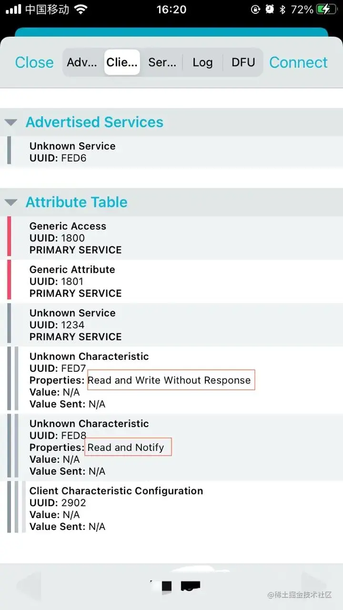

我们使用nRF Connect(一个调试蓝牙的第三方工具)先连接一个设备，可以看到设备相关信息，如下：


中标红色的就是特征值，代表相关服务的特性。特征值有三种，分别是readValue(读取)、setNotifyValue(订阅)、writeValue(写入)。 readValue说明是可读的，回调方法为
```swift
    // 值更新回调
    func peripheral(_ peripheral: CBPeripheral, didUpdateValueFor characteristic: CBCharacteristic, error: Error?) {
        if let error = error {
            print("特征值读取失败：\(error)")
            return
        }
        if let data = characteristic.value {
            print("特征值：\(data)")// 取具体类型的值时，需要根据相关的数据表结构做类型转换
        }
    }
```

一般来讲，同硬件工程师连调时会告诉你该`characteristic`对应的是`readValue`(读取)、`setNotifyValue`(订阅)、还是`writeValue`(写入)，但假如硬件工程师不告诉你呢，其实也很简单，发现`characteristic`有个`properties`属性，点击去查看，如下：
```swift
public struct CBCharacteristicProperties : OptionSet, @unchecked Sendable {

    public init(rawValue: UInt)

    
    public static var broadcast: CBCharacteristicProperties { get }

    public static var read: CBCharacteristicProperties { get }

    public static var writeWithoutResponse: CBCharacteristicProperties { get }

    public static var write: CBCharacteristicProperties { get }

    public static var notify: CBCharacteristicProperties { get }

    public static var indicate: CBCharacteristicProperties { get }

    public static var authenticatedSignedWrites: CBCharacteristicProperties { get }

    public static var extendedProperties: CBCharacteristicProperties { get }

    @available(watchOS 2.0, *)
    public static var notifyEncryptionRequired: CBCharacteristicProperties { get }

    @available(watchOS 2.0, *)
    public static var indicateEncryptionRequired: CBCharacteristicProperties { get }
}
```
这样一来，我们就可以用位运算来获取它是否可以read,代码如下：
```swift
 let isRead = (characteristic.properties.rawValue & CBCharacteristicProperties.writeWithoutResponse.rawValue) != 0 ? true : false
 if isRead {
     peripheral.readValue(ofCharac: characteristic) { result in                  
      }
  }               
```
> 注意：如果尝试读取不可读的特征值，didUpdateValueFor回调将会返回错误error。

setNotifyValue(订阅)说明要对特征进行订阅，一旦外设有值更新时，我们就可以收到这个新值，就是KVO。同样，我们也需要知道该characteristic支不支持订阅，代码如下：
```swift
let enble = (characteristic.properties.rawValue & CBCharacteristicProperties.notify.rawValue) != 0 ? true : false
if enble == true {
  peripheral.setNotifyValue(true, for: characteristic) // 开启订阅
} 
```
订阅成功后，只要外设值发生变化时，我们就可以收到回调：
```swift
// 特征值订阅状态回调
    func peripheral(_ peripheral: CBPeripheral, didUpdateNotificationStateFor characteristic: CBCharacteristic, error: Error?) {
        if let error = error {
            print("特征值订阅失败：\(error)")
            return
        }
    }
```
writeValue是向外设写入指令，譬如跑步机的启停、调速等，来实现一些操作任务。
```swift
/*
data：写入的值

characteristic：待写入的特征对象

type：写入类型，包括以下类型

withResponse：向外设传递特征值，并返回写入状态

withoutResponse：向外设传递特征值，不会返回写入状态
*/
open func writeValue(_ data: Data, for characteristic: CBCharacteristic, type: CBCharacteristicWriteType)
```
同理，也是根据properties 属性来判断是withResponse还是withoutResponse,若该characteristic为withoutResponse，但是传入的是withResponse会导致出错。
```swift
 let type =   (characteristic.properties.rawValue & CBCharacteristicProperties.writeWithoutResponse.rawValue) != 0 ? CBCharacteristicWriteType.withoutResponse : CBCharacteristicWriteType.withResponse
  peripheral.writeValue(ofCharac: characteristic, value: data,type:type) { result in
}
```
这就是readValue(读取)、setNotifyValue(订阅)、writeValue(写入)的含义和使用，有对常用API不清楚的同学可以看看[蓝牙常用API](https://juejin.cn/post/7179496357852839995)。

