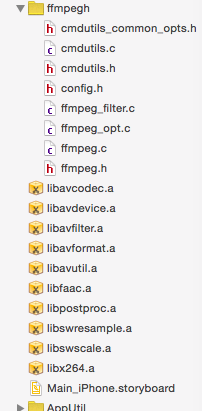

**说一下我自己的情况。还有（ios下的ffmpegh可以下载，代码由我改，基本没啥问题）**
**下载地址：**[ffmpegh](http://download.csdn.net/detail/nil88/9351775)**(怎么用可以看文章）**

1、我是自己下载ffmpeg2.8.3版本，然后加最新的faac,x264来编译的arm64，armv7,armv7s（iphone所有的arm架构了，我是真机测试，所有不用i386了）。
编译的脚本从这里弄的：
[http://blog.csdn.net/leixiaohua1020/article/details/47071547](http://blog.csdn.net/leixiaohua1020/article/details/47071547)

2、编译好这几个脚本后，就可以把Fat-ffmpeg下的include放到项目目录下，SearchFileHeader设置下，指定到这个地方即可。然后就是lib导入到项目copy file的方式。然后把libbfaac.a,libx264.a（从上面的脚本生成的各自的fat目录下)。

3、这样之后，可以把libz.dylib放入项目（这个可以从/usr/local/lib下面导入进去）。即添加lib是用Other Folder然后跑到这个目录即可找到它。

4、这一切准备好，其实如果会自己调用ffmpeg库，基本也可以写代码了。不过懒人一般都跟我一样，想直接调用ffmpeg。那接着看吧。

如何直接调用ffmpeg命令？
先分析下：我们这知道编译出来的几个库（libavcodec.a...等）都只是库，然后include也只是头文件。一个好的库就是一个框架，最好不要跟其他的有什么关系，而你在终端输入的ffmpeg 或者ffmpeg -L等，都跟这个库没有太大的直接关系，也就说ffmpeg.c是调用了库里面的东西，然后编译出来的一个工具。ok，很显然了。我们要使用ffmpeg命令，那只有把ffmpeg.h,ffmpeg.c等代码放入我们的项目，然后重新编译，以便我们调用。
思路搞定，那么接下来就是把ffmpeg.h,ffmpeg.c以及ffmpeg.c依赖的文件放到我们的xcode项目了。好的，我们直接从ffmpeg2.8.3目录下
发现了我们要找的文件。全部弄进XCODE后，你会发现有一些头文件比如 <avutil/internal.h>找不到这类的。当然了，ios下的ffmpeg的include文件确实没有这个东西。

为什么呢？
我猜应该是这些头文件在ios的arm下不支持，也就不需要了。（大神吐槽，我是新手）。于是没办法，我只有把这些没有的头文件删除掉，看看影响那些代码（这个优点冒险，还有一个方法就是找到这些头文件然后放到include目录下，我没这么做。我就喜欢冒险，相信直觉）。影响的代码其实还不少，凭经验把这些去掉。差不多文件如下就可以了（看ffmpegh下)：

当然了，改了之后，还有一个点，就是这里面的代码调用了time.h，就是上面的文章提到的问题。我是把include下面的time.h改了名字，改成ffmpegtime.h，然后你在xcode运行下，就发现只有一个文件ffmpeg.c调用它，修改即可。

最后，修改下ffmpeg.c的main入口为ffmpeg_main,再在.h文件加入申明即可。

到这里，你可以写一个UIViewController来调用ffmpeg了！恭喜！

命令可以运行了，但是整个ios程序退出了。原因如转的原文！

好了，其实重点肯定就是ffmpegh下的几个文件，这个对ios比较重要！

借鉴:[原文链接](http://blog.sina.com.cn/s/blog_47522f7f0102vbwp.html)

ffmpeg是一个多平台多媒体处理工具，处理视频和音频的功能非常强大。目前在网上搜到的iOS上使用FFMPEG的资料都比较陈旧，而FFMPEG更新迭代比较快； 且网上的讲解不够详细，对于初次接触FFMPEG的新手（例如我）来说确实不太好使用。为了防止忘记，这里对iOS下使用FFMPEG做一个总结。

1. FFMPEG层次结构的简单理解
要使用FFMPEG，首先需要理解FFMPEG的代码结构。根据志哥的提示，ffmpeg的代码是包括两部分的，一部分是library，一部分是tool。api都是在library里面，如果直接调api来操作视频的话，就需要写c或者c++了。另一部分是tool，使用的是命令行，则不需要自己去编码来实现视频操作的流程。实际上tool只不过把命令行转换为api的操作而已。

2. 预热-在mac os下使用ffmpeg
在mac os下使用ffmpeg比较简单，可以直接使用命令行来操作。首先安装ffmpeg，这里默认系统已经安装好brew，只需要在终端上输入：
brew install ffmpeg
等待安装结束即可。
安装结束后，尝试以下命令：
ffmpeg -i input.mp4 output.avi
如果能顺利转换，表明安装成功

3. 编译能在iOS下使用的FFMPEG library库
这一步是编译1所说的library，编译好之后可以调用FFMPEG的api。网上有一些方法，但都要自己手动编译，稍显复杂而且比较陈旧。按照app store的需求，编译出来的包还必须支持arm64。我在万能的github中找到一个能够"一键编译"的脚本，地址如下：
[https://github.com/kewlbear/FFmpeg-iOS-build-script](https://github.com/kewlbear/FFmpeg-iOS-build-script)
而且写这个脚本的歪果仁挺好人，更新很及时，已经更新到了最新的2.5.3版本。下载下来，只有一个build-ffmpeg.sh脚本文件。在终端中转至脚本的目录，执行命令：
./build-ffmpeg.sh
脚本则会自动从github中把ffmpeg源码下到本地并开始编译。
编译结束后，文件目录如下：
其中，ffmpeg-2.5.3是源码，FFmpeg-iOS是编译出来的库，里面有我们需要的.a静态库，一共有7个。
执行命令：
lipo -info libavcodec.a 
查看.a包支持的架构，这几个包都支持了armv7 armv7s i386 x86_64 arm64这几个架构，这个脚本果真是业界良心啊～～～

4.在xcode中引入FFMPEG library库
新建工程，把上面编译好的FFmpeg-iOS拖到xcode工程中，添加一个头文件引用

#include "avformat.h"
添加一个api语句：
av_register_all();
添加一个空的类，把执行文件.m后缀改为.mm，开启混编模式。
添加相应的framework，包括avfoundation和coremedia。
运行工程，如果没有报错，则表明编译成功。

5.在xcode项目中使用命令行
执行到第4步，已经可以使用library库了。但是如果要对视频进行操作，还是需要手动写很多代码去调用api，工作量较大，自然不如直接写命令行方便。为了命令行能够在xcode工程中使用，还需要做以下工作：
（1）添加源码中的tools,具体文件包括：

（2）添加Header Search Paths
在target--build setting中搜索Header Search Paths，并在Header Search Paths下面添加源码ffmpeg-2.5.3和scratch的路径。
（3）修改ffmpeg.h和ffmpeg.c源码
如果此时run这个工程，则会报错，原因是工程里面有2个main函数，此时处理方法为：
在ffmpeg.h中添加一个函数声明：
int ffmpeg_main(int argc, char **argv);
在ffmpeg.c中找到main函数，把main函数改为ffmpeg_main。
（4）调用命令行范例
添加头文件：#import "ffmpeg.h"
调用命令行
int numberOfArgs = 16;
char** arguments = calloc(numberOfArgs, sizeof(char*));

arguments[0] = "ffmpeg";
arguments[1] = "-i";
arguments[2] = inputPath;
arguments[3] = "-ss";
arguments[4] = "0";
arguments[5] = "-t";
arguments[6] = durationChar;
arguments[7] = "-vcodec";
arguments[8] = "copy";
arguments[9] = "-acodec";
arguments[10] = "aac";
arguments[11] = "-strict";
arguments[12] = "-2";
arguments[13] = "-b:a";
arguments[14] = "32k";
arguments[15] = outputPath;

int result = ffmpeg_main(numberOfArgs, arguments);
其中inputpath和outputpath是文件路径。经测试，这两个路径不支持asset-library://协议和[file://
 协议，所以如果是要用相册的文件，我目前的解决办法是把它拷贝到沙盒里面。](http://file/%E5%8D%8F%E8%AE%AE%EF%BC%8C%E6%89%80%E4%BB%A5%E5%A6%82%E6%9E%9C%E6%98%AF%E8%A6%81%E7%94%A8%E7%9B%B8%E5%86%8C%E7%9A%84%E6%96%87%E4%BB%B6%EF%BC%8C%E6%88%91%E7%9B%AE%E5%89%8D%E7%9A%84%E8%A7%A3%E5%86%B3%E5%8A%9E%E6%B3%95%E6%98%AF%E6%8A%8A%E5%AE%83%E6%8B%B7%E8%B4%9D%E5%88%B0%E6%B2%99%E7%9B%92%E9%87%8C%E9%9D%A2%E3%80%82%E5%A6%82%E6%9E%9C%E7%94%A8%E4%BA%86%5BURL)

6. 改关闭进程为关闭线程
如果顺利进行到了第5步，在app中是能够用命令行处理视频了，但会出现一个问题，app会退出。经肖大神提醒，发现了命令行执行完毕之后会退出进程。而iOS下只能启动一个进程，因此必须改关闭进程为关闭线程，或者直接把关闭进程的方法给注掉。
在ffmpeg.c中可以看到，执行退出进程的方法是exit_program，定位到了cmdutils.c中执行了c语言的exit方法。这里我将它改为了pthread_exit（需要添加#include 头文件）。在xcode项目中使用时，则可以用NSThread来新开一个线程，执行完毕之后，把线程关闭了即可。再使用NSThreadWillExitNotification通知，即可监听线程退出的情况。

7. 修复ffmpeg.c里面的一个bug
在实际项目中，可能需要多次调用命令行，但在多次调用命令行的过程中，发现ffmpeg.c的代码中会访问空属性导致程序崩溃。逐步debug后发现，很多指针已经置空了，但它们的计数却没有置零，不知道是不是ffmpeg.c的一个bug。修复方法如下：在ffmpeg_cleanup方法下，将各个计数器置零，包括：
nb_filtergraphs
nb_output_files
nb_output_streams
nb_input_files
nb_input_streams
置零之后，重复使用ffmpeg_main方法一切正常。

以上是近期研究ffmpeg的一些小结，目前对于ffmpeg还是处于刚认识阶段，对于其api的使用、命令行的具体参数等，都还需要继续研究和学习。

