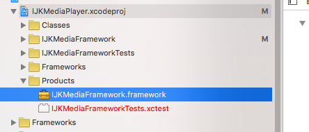
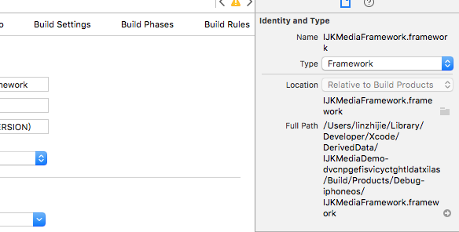
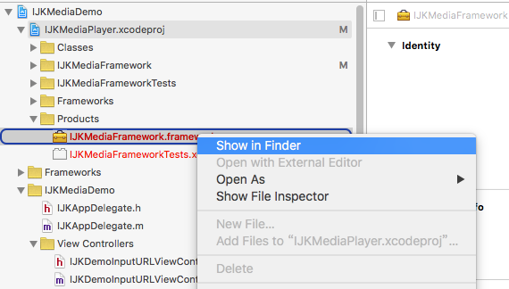
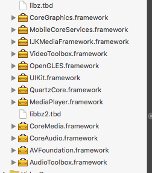

最近要做一个视频直播的项目，刚刚进入视频坑，开始自己琢磨AVPlayer，使用起来发现还挺多限制的，虽然当然知道要先把基础打好，相关基础链接：

网络播放器相关
[http://blog.csdn.net/Matthew_Fan/article/category/1200896](http://blog.csdn.net/Matthew_Fan/article/category/1200896)

HLS流媒体开发
[http://blog.csdn.net/sdvch/article/details/14047281](http://blog.csdn.net/sdvch/article/details/14047281)

HLS 比较全的中文博客
[http://blog.csdn.net/Matthew_Fan/article/category/1200896](http://blog.csdn.net/Matthew_Fan/article/category/1200896)

苹果 iOS 开发文档 （HLS）
[https://developer.apple.com/streaming/](https://developer.apple.com/streaming/)

正文
但是急于做出一个demo交工，就简略的查了查攻略－ －，发现B站的开源项目ijkPlayer是一个很好借鉴的项目，赶紧下下来试试， 
链接：[https://github.com/Bilibili/ijkplayer](https://github.com/Bilibili/ijkplayer) 

具体怎么编译就不一一细说了，自己参照一下文档，这里我主要针对导入ijkplayer包并且使用做一些简单的说明。
完成github上的步骤之后，我们打开ios文件夹下的IJKMediaPlayer工程，发现他的output是一个framework包，那样就轻松了



build&run以后，将framework包复制取出，可以从右侧栏直接查看路径




或者直接右键进入路径




既然已经取出了framework文件，那么我们就将它导入到我们需要的工程里面，当然，前提是你不打算修改里面的东西，你也可以通过建立workplace加上建立依赖关系导入整个工程文件，省的每次修改都要重复导入包。ps：其他ijkplayerdemo上的包也最好一起导入了，不然可能会编译出错



之后的内容可以参考ijkdemo中的ijkMoviePlayerViewController实现调用播放器，如果你不需要这么多东西也可以直接像我这样简单写：
ViewController
```objectivec
#import <IJKMediaFramework/IJKMediaFramework.h>

@interface ViewController : UIViewController
@property (atomic, strong) NSURL *url;
@property (atomic, retain) id <IJKMediaPlayback> player;
@property (weak, nonatomic) IBOutlet UIView *PlayerView;
@property (weak, nonatomic) IBOutlet UIButton *playButton;
```


然后就通过初试化一些基本设置就可以播放了：
1、url
2、PlayView
3、notification
4、prepareToPlay

简单把界面上的东西部署一下，url等初始化
```objectivec
self.url = [NSURL URLWithString:@"http://live.hkstv.hk.lxdns.com/live/hks/playlist.m3u8"];

_player = [[IJKFFMoviePlayerController alloc] initWithContentURL:self.url withOptions:nil];
UIView *playerView = [_player view];
playerView.frame = self.PlayerView.frame;
playerView.autoresizingMask = UIViewAutoresizingFlexibleWidth | UIViewAutoresizingFlexibleHeight;

[self.PlayerView insertSubview:playerView atIndex:1];
[_player setScalingMode:IJKMPMovieScalingModeAspectFill];
[self installMovieNotificationObservers];
```


别忘记了这个

[self.player prepareToPlay];

最后在你需要的地方调用播放等接口

[self.player play];

demo链接：[http://download.csdn.net/detail/atomic123/9402481](http://download.csdn.net/detail/atomic123/9402481)

