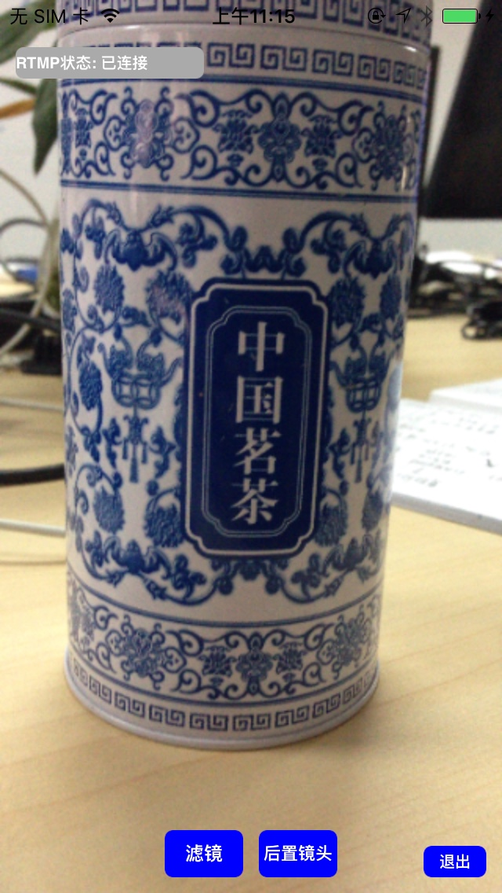
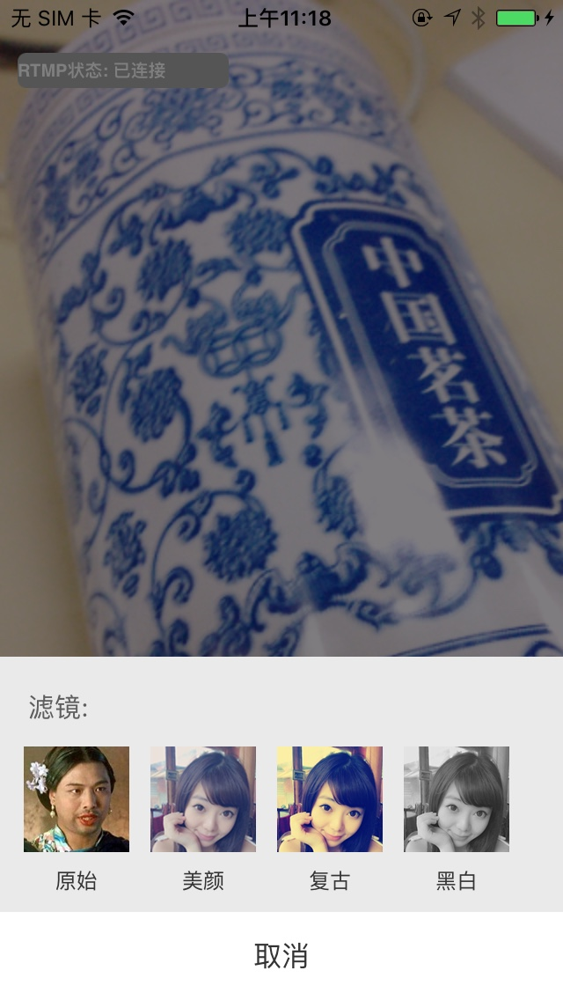

# [直播时代--IOS直播客户端SDK，美艳直播【开源】](https://www.cnblogs.com/Hakim/p/5242304.html)
看到该文章我非常喜欢，为了方便自己查看和参考所以将其复制过来，源文地址：http://www.cnblogs.com/runner42/p/5241407.html
请支持原作者。原作者如看到请原谅复制您的，纯属为了方便查阅。


当前视频直播非常火爆，手机端的视频直播也非常火爆，PGC、UGC的视频直播门槛都降低了很多。
本文介绍一个：IOS 客户端直播的SDK，代码完全开源。
**直播时代：让IOS普通开发者一天内做出一个RTMP直播客户端，并且带有美艳直播功能。(文章最下面有github源码地址)**
包含一下功能:
#### 1, 提供IOS苹果手机的RTMP推流；
填写RTMP服务地址，直接就可以进行推流。
#### 2，美颜直播
美不美都能装的直播，IOS OPENGL美艳加速，手机完全不发烫。
#### 3，前后摄像头随时切换
#### 4，提供RTMP连接状态的回调
一，首先简单扫盲
当前直播都是用RTMP协议，推流到RTMP服务器。
然后RTMP服务器提供RTMP视频服务；
当然通常RTMP服务器也提供HLS，把视音频流切片成ts流，然后用户可以直接播放xxx.m3u8的流媒体。

二，SDK使用简介
1，初始化
[LiveVideoCoreSDK sharedinstance]：全局独立的SDK实例，你不用管理对象的申请和释放；
初始化RTMP连接和视频参数，非常简单：
```objectivec
[[LiveVideoCoreSDK sharedinstance] LiveInit:RtmpUrl Preview:self.view VideSize:LIVE_VIEDO_SIZE_CIF BitRate:LIVE_BITRATE_500Kbps FrameRate:LIVE_FRAMERATE_20];
```

参数：
RtmpUrl: rtmp服务器地址参数，如rtmp://192.168.30.191/live/123456
Preview: IOS本地预览显示的UIVIEW对象，现在都喜欢全屏直播模式，这里直接用self.view
VideSize: 视频分辨率。这里提供了几种视频分辨率，CIF(320*640)，D1(540*960)，720P(720*1280)
BitRate: 视频码率。有500kbps对应CIF，800kbps对应D1, 2Mbps对应720p，怎么配置就看你手机当前的带宽情况了。
FrameRate: 视频帧率。这个决定视频流畅程度，帧率越高越流畅。这里提供：15帧/s，20帧/s，25帧/s，20帧/s
2，连接RTMP视频服务器
```objectivec
[[LiveVideoCoreSDK sharedinstance] connect];
```

调用这个接口后，开始打开iphone本地手机预览，并且开始连接RTMP服务器。
如果网络没有问题，RTMP服务器没有问题，直播就开始了，简单吧！

3，设置滤镜：提供美艳效果
```objectivec
- (void)setFilter:(LIVE_FILTER_TYPE) type;
```

当前提供了美白效果，设置一个LIVE_FILTER_BEAUTY这个参数，看看你有多美白。

4，设置前后摄像头
```objectivec
- (void)setCameraFront:(Boolean)bCameraFrontFlag;
```

前后摄像头随时动态切换，想怎么拍就怎么拍。
5，设置RTMP连接状态回调
```objectivec
[LiveVideoCoreSDK sharedinstance].delete = self;
```

在你的viewcontroller中实现协议：LIVEVCSessionDelegate，如下，这样你可以随时知道RTMP连接的状态了。
```objectivec
//rtmp status delegate:
- (void) LiveConnectionStatusChanged: (LIVE_VCSessionState) sessionState{
dispatch_async(dispatch_get_main_queue(), ^{
switch (sessionState) {
case LIVE_VCSessionStatePreviewStarted:
_RtmpStatusLabel.text = @"RTMP状态: 预览未连接";
break;
case LIVE_VCSessionStateStarting:
_RtmpStatusLabel.text = @"RTMP状态: 连接中...";
break;
case LIVE_VCSessionStateStarted:
_RtmpStatusLabel.text = @"RTMP状态: 已连接";
break;
case LIVE_VCSessionStateEnded:
_RtmpStatusLabel.text = @"RTMP状态: 未连接";
break;
case LIVE_VCSessionStateError:
_RtmpStatusLabel.text = @"RTMP状态: 错误";
break;
default:
break;
}
});
}
```

6，直播结束，断开rtmp连接
```objectivec
[[LiveVideoCoreSDK sharedinstance] disconnect]；
```
简单吧，不解释了。

**GitHub地址: https://github.com/runner365/LiveVideoCoreSDK**

