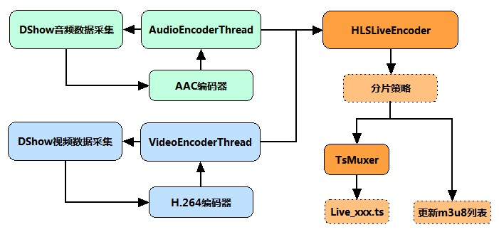
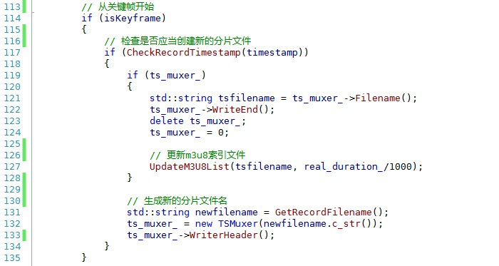
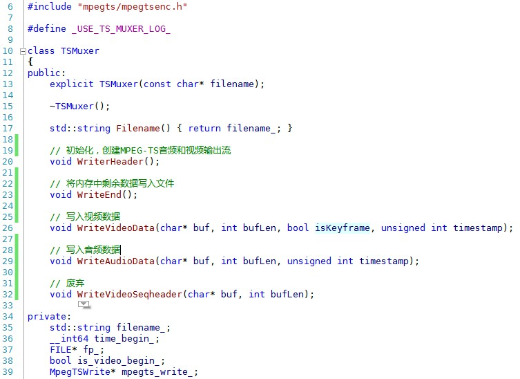
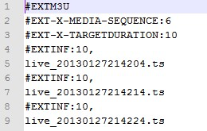
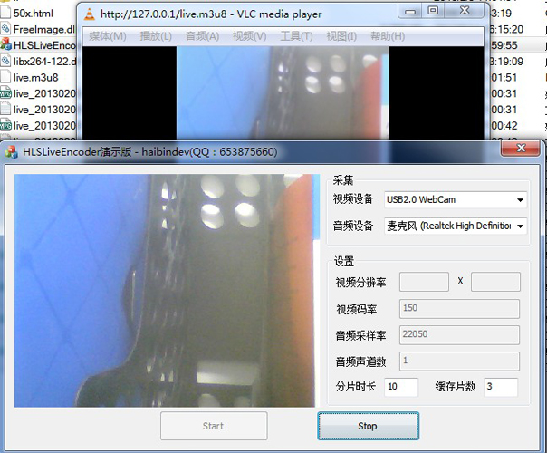

**HTTP Live Streaming直播(iOS直播)技术分析与实现**
花了一些时间研究了**HTTP Live Streaming**（**HLS**）技术，并实现了一个HLS编码器**HLSLiveEncoder**，当然，C++写的。其功能是采集摄像头与麦克风，实时进行H.264视频编码和AAC音频编码，并按照HLS的协议规范，生成分段的标准TS文件以及m3u8索引文件。通过我的**HLSLiveEncoder**和第三方Http服务器（例如：Nginx），成功实现了**HTTP Live Streaming**直播，并在iphone上测试通过。
**HLS技术要点分析**
**HTTP Live Streaming**（**HLS**）是苹果公司(Apple Inc.)实现的基于HTTP的流媒体传输协议，可实现流媒体的直播和点播，主要应用在**iOS**系统，为**iOS**设备（如iPhone、iPad）提供音视频直播和点播方案。**HLS**点播，基本上就是常见的分段HTTP点播，不同在于，它的分段非常小。要实现**HLS**点播，重点在于对媒体文件分段，目前有不少开源工具可以使用，这里我就不再讨论，只谈HLS直播技术。
相对于常见的流媒体直播协议，例如[RTMP协议](http://www.cnblogs.com/haibindev/archive/2011/12/29/2305712.html)、RTSP协议、MMS协议等，HLS直播最大的不同在于，直播客户端获取到的，并不是一个完整的数据流。HLS协议在服务器端将直播数据流存储为连续的、很短时长的媒体文件（**MPEG-TS**格式），而客户端则不断的下载并播放这些小文件，因为服务器端总是会将最新的直播数据生成新的小文件，这样客户端只要不停的按顺序播放从服务器获取到的文件，就实现了直播。由此可见，基本上可以认为，HLS是以点播的技术方式来实现直播。由于数据通过HTTP协议传输，所以完全不用考虑防火墙或者代理的问题，而且分段文件的时长很短，客户端可以很快的选择和切换码率，以适应不同带宽条件下的播放。不过HLS的这种技术特点，决定了它的延迟一般总是会高于普通的流媒体直播协议。
根据以上的了解要实现**HTTP Live Streaming**直播，需要研究并实现以下技术关键点

1. 采集视频源和音频源的数据
2. 对原始数据进行H264编码和AAC编码
3. 视频和音频数据封装为MPEG-TS包
4. HLS分段生成策略及m3u8索引文件
5. HTTP传输协议

其中第1点和第2点，我之前的文章中已经提到过了，而最后一点，我们可以借助现有的HTTP服务器，所以，实现第3点和第4点是关键所在。
**程序框架与实现          **
通过以上分析，实现**HLS LiveEncoder**直播编码器，其逻辑和流程基本上很清楚了：分别开启音频与视频编码线程，通过**DirectShow**（或其他）技术来实现音视频采集，随后分别调用libx264和libfaac进行视频和音频编码。两个编码线程实时编码音视频数据后，根据自定义的分片策略，存储在某个**MPEG-TS**格式分段文件中，当完成一个分段文件的存储后，更新m3u8索引文件。如下图所示：

上图中**HLSLiveEncoder**当收到视频和音频数据后，需要首先判断，当前分片是否应该结束，并创建新分片，以延续TS分片的不断生成。需要注意的是，新的分片，应当从关键帧开始，防止播放器解码失败。核心代码如下所示：

TsMuxer的接口也是比较简单的。

**HLS分段生成策略和m3u8   **
**1. 分段策略**

- HLS的分段策略，基本上推荐是10秒一个分片，当然，具体时间还要根据分好后的分片的实际时长做标注
- 通常来说，为了缓存等方面的原因，在索引文件中会保留最新的三个分片地址，以类似“滑动窗口”的形式，进行更新。

**2. m3u8文件简介**
m3u8，是**HTTP Live Streaming**直播的索引文件。m3u8基本上可以认为就是.m3u格式文件，区别在于，m3u8文件使用**UTF-8**字符编码。
#EXTM3U                     m3u文件头，必须放在第一行
#EXT-X-MEDIA-SEQUENCE       第一个TS分片的序列号
#EXT-X-TARGETDURATION       每个分片TS的最大的时长
#EXT-X-ALLOW-CACHE          是否允许cache
#EXT-X-ENDLIST              m3u8文件结束符
#EXTINF                     extra info，分片TS的信息，如时长，带宽等
一个简单的m3u8索引文件

**运行效果          **
在Nginx工作目录下启动**HLSLiveEncoder**，并用VLC播放器连接播放

通过iPhone播放的效果

