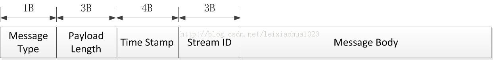
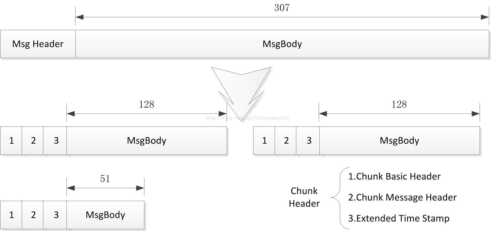

RTMP协议是一个互联网TCP/IP五层体系结构中应用层的协议。RTMP协议中基本的数据单元称为消息（Message）。当RTMP协议在互联网中传输数据的时候，消息会被拆分成更小的单元，称为消息块（Chunk）。
1 消息
消息是RTMP协议中基本的数据单元。不同种类的消息包含不同的Message Type ID，代表不同的功能。RTMP协议中一共规定了十多种消息类型，分别发挥着不同的作用。例如，Message Type ID在1-7的消息用于协议控制，这些消息一般是RTMP协议自身管理要使用的消息，用户一般情况下无需操作其中的数据。Message Type ID为8，9的消息分别用于传输音频和视频数据。Message Type ID为15-20的消息用于发送AMF编码的命令，负责用户与服务器之间的交互，比如播放，暂停等等。消息首部（Message Header）有四部分组成：标志消息类型的Message Type ID，标志消息长度的Payload Length，标识时间戳的Timestamp，标识消息所属媒体流的Stream ID。消息的报文结构如下图所示。

2 消息块
在网络上传输数据时，消息需要被拆分成较小的数据块，才适合在相应的网络环境上传输。RTMP协议中规定，消息在网络上传输时被拆分成消息块（Chunk）。消息块首部（Chunk Header）有三部分组成：用于标识本块的**Chunk Basic Header**，用于标识本块负载所属消息的**Chunk Message Header**，以及当时间戳溢出时才出现的Extended Timestamp。消息块的报文结构如下图所示。

3 消息分块
在消息被分割成几个消息块的过程中，消息负载部分（Message Body）被分割成大小固定的数据块（默认是128字节，最后一个数据块可以小于该固定长度），并在其首部加上消息块首部（Chunk Header），就组成了相应的消息块。消息分块过程如下图所示，一个大小为307字节的消息被分割成128字节的消息块（除了最后一个）。

RTMP传输媒体数据的过程中，发送端首先把媒体数据封装成消息，然后把消息分割成消息块，最后**将分割后的消息块通过TCP协议发送出去**。接收端在通过TCP协议收到数据后，首先把消息块重新组合成消息，然后通过对消息进行解封装处理就可以恢复出媒体数据。

2.1 Chunk Basic Header [1-3字节]
HeaderType+ChannelID组成，其中ChannelID的大小决定了整个Chunk Basic Header的大小

2.1.1  这个字段编码了消息块流的 ID 和消息块的类型，消息块类型决定了消息包头的编码格式，长度完全 取决于可变长的消息块流 HeaderType(fmt):决定了Chunk Message Header的编码方式和大小,在第一个字节的高两位
Bits Chunk Message Header Length
00   12 bytes
01   8 bytes
10   4 bytes
11   1 byte

2.1.2 ChannelID：
ChannelID 用途
02              Ping 和ByteRead通道
03              Invoke通道 我们的connect() publish()和自字写的NetConnection.Call() 数据都是在这个通道的
04              Audio和Vidio通道
05 06 07     服务器保留,经观察FMS2用这些Channel也用来发送音频或视频数据

2.2 Chunk Message Header
以最大fmt =00 length(Chunk Message Header) == 12 为例
Chunk Message Header的结构是:timestamp,message_length,message_type,msg_stream_id
其中message_type是一个枚举变量：
type为1,2,3,5,6的时候是协议控制消息
type为4的时候表示 User Control Messages [Event_type + Event_Data] Event_type有Stream Begin，Stream End...
type为8，音频数据
type为9，视频数据
type为18 元数据消息[AMF0]
type为20 命令消息 Command Message(RPC Message)
These messages are sent to perform some operations like connect, createStream, publish, play, pause on the peer.
命令消息主要分成两种NetConnection和NetStream。
connect，call，close，createStream命令可以在NetConnection中发送。
coonect(name，TranscationID,Command Object pair)
play，publish,seek,pause等命令可以在NetStream中发送。

2.3 Ext Time Stamp

2.4数据

3 [RTMP流媒体播放过程](http://blog.csdn.net/leixiaohua1020/article/details/11704355)
RTMP协议规定，播放一个流媒体有两个前提步骤：第一步，建立一个网络连接（NetConnection）；第二步，建立一个网络流（NetStream）。其中，网络连接代表服务器端应用程序和客户端之间基础的连通关系。网络流代表了发送多媒体数据的通道。服务器和客户端之间只能建立一个网络连接，但是基于该连接可以创建很多网络流。
播放一个RTMP协议的流媒体需要经过以下几个步骤：握手，建立连接，建立流，播放。RTMP连接都是以握手作为开始的。建立连接阶段用于建立客户端与服务器之间的“网络连接”；建立流阶段用于建立客户端与服务器之间的“网络流”；播放阶段用于传输视音频数据。
参考:[http://blog.csdn.net/leixiaohua1020/article/category/1362941](http://blog.csdn.net/leixiaohua1020/article/category/1362941)
[RTMP协议中文版](http://blog.csdn.net/leixiaohua1020/article/category/1362941)
[http://wenku.baidu.com/link?url=Lc4gR-FLeCkHCMM1NL-FcAUtKFTRaFn0tcdoqcid6Dtvu_Q2wlSQ-GMY711Ptc_TdeG2KU0E9e-aHddFVZJSMwt2CujY2p7AdHg8Vr15HuG](http://wenku.baidu.com/link?url=Lc4gR-FLeCkHCMM1NL-FcAUtKFTRaFn0tcdoqcid6Dtvu_Q2wlSQ-GMY711Ptc_TdeG2KU0E9e-aHddFVZJSMwt2CujY2p7AdHg8Vr15HuG)
[RTMP协议](http://blog.csdn.net/leixiaohua1020/article/category/1362941)英文版
[http://wwwimages.adobe.com/www.adobe.com/content/dam/Adobe/en/devnet/rtmp/pdf/rtmp_specification_1.0.pdf](http://wwwimages.adobe.com/www.adobe.com/content/dam/Adobe/en/devnet/rtmp/pdf/rtmp_specification_1.0.pdf)
开源项目 RTMP Dump
[http://rtmpdump.mplayerhq.hu/](http://rtmpdump.mplayerhq.hu/)

