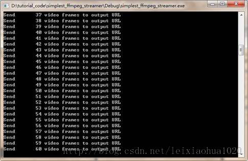

本文记录一个最简单的基于FFmpeg的推流器（simplest ffmpeg streamer）。推流器的作用就是将本地的视频数据推送至流媒体服务器。本文记录的推流器，可以将本地的 MOV / AVI / MKV / MP4 / FLV 等格式的媒体文件，通过流媒体协议（例如RTMP，HTTP，UDP，TCP，RTP等等）以直播流的形式推送出去。由于流媒体协议种类繁多，不一一记录。在这里记录将本地文件以RTMP直播流的形式推送至RTMP流媒体服务器（例如 Flash Media Server，Red5，Wowza等等）的方法。

在这个推流器的基础上可以进行多种方式的修改，实现各式各样的推流器。例如：

- 将输入文件改为网络流URL，可以实现转流器。
- 将输入的文件改为回调函数（内存读取）的形式，可以推送内存中的视频数据。
- 将输入文件改为系统设备（通过libavdevice），同时加上编码的功能，可以实现实时推流器（现场直播）。
> PS：本程序并不包含视频转码的功能。


# 简介
RTMP推流器（Streamer）的在流媒体系统中的作用可以用下图表示。首先将视频数据以RTMP的形式发送到流媒体服务器端（Server，比如FMS，Red5，Wowza等），然后客户端（一般为Flash Player）通过访问流媒体服务器就可以收看实时流了。
运行本程序之前需要先运行RTMP流媒体服务器，并在流媒体服务器上建立相应的Application。有关流媒体服务器的操作不在本文的论述范围内，在此不再详述。本程序运行后，即可通过RTMP客户端（例如 Flash Player, FFplay等等）收看推送的直播流。

> 需要要注意的地方

封装格式
RTMP采用的封装格式是FLV。因此在指定输出流媒体的时候需要指定其封装格式为“flv”。同理，其他流媒体协议也需要指定其封装格式。例如采用UDP推送流媒体的时候，可以指定其封装格式为“mpegts”。

# 延时
发送流媒体的数据的时候需要延时。不然的话，FFmpeg处理数据速度很快，瞬间就能把所有的数据发送出去，流媒体服务器是接受不了的。因此需要按照视频实际的帧率发送数据。本文记录的推流器在视频帧与帧之间采用了av_usleep()函数休眠的方式来延迟发送。这样就可以按照视频的帧率发送数据了，参考代码如下。
```objectivec
	int64_t start_time=av_gettime();
	while (1) {

	Important:Delay
	if(pkt.stream_index==videoindex){
		AVRational time_base=ifmt_ctx->streams[videoindex]->time_base;
		AVRational time_base_q={1,AV_TIME_BASE};
		int64_t pts_time = av_rescale_q(pkt.dts, time_base, time_base_q);
		int64_t now_time = av_gettime() - start_time;
		if (pts_time > now_time)
		av_usleep(pts_time - now_time);
	}

}

```
i


# PTS/DTS问题
没有封装格式的裸流（例如H.264裸流）是不包含PTS、DTS这些参数的。在发送这种数据的时候，需要自己计算并写入AVPacket的PTS，DTS，duration等参数。这里还没有深入研究，简单写了一点代码，如下所示。
```objectivec
//FIX：No PTS (Example: Raw H.264)
//Simple Write PTS
if(pkt.pts==AV_NOPTS_VALUE){
	//Write PTS
	AVRational time_base1=ifmt_ctx->streams[videoindex]->time_base;
	Duration between 2 frames (us)
	int64_t calc_duration=(double)AV_TIME_BASE/av_q2d(ifmt_ctx->streams[videoindex]->r_frame_rate);
	//Parameters
	pkt.pts=(double)(frame_index*calc_duration)/(double)(av_q2d(time_base1)*AV_TIME_BASE);
	pkt.dts=pkt.pts;
	pkt.duration=(double)calc_duration/(double)(av_q2d(time_base1)*AV_TIME_BASE);
}

```


## 程序流程图
程序的流程图如下图所示。可以看出和《最简单的基于FFMPEG的封装格式转换器（无编解码）》中的封装格式转换器比较类似。它们之间比较明显的区别在于：
1. Streamer输出为URL
2. Streamer包含了延时部分


## 代码
代码如下。
```objectivec
/**
* 最简单的基于FFmpeg的推流器（推送RTMP）
* Simplest FFmpeg Streamer (Send RTMP)
*
*
* 本例子实现了推送本地视频至流媒体服务器（以RTMP为例）。
* 是使用FFmpeg进行流媒体推送最简单的教程。
*
* This example stream local media files to streaming media
* server (Use RTMP as example).
* It's the simplest FFmpeg streamer.
*
*/

#include <stdio.h>

#define __STDC_CONSTANT_MACROS

#ifdef _WIN32

Windows
extern "C"
{
	#include "libavformat/avformat.h"
	#include "libavutil/mathematics.h"
	#include "libavutil/time.h"
};

#else
Linux...

#ifdef __cplusplus
extern "C"
{
	#endif
	#include <libavformat/avformat.h>
	#include <libavutil/mathematics.h>
	#include <libavutil/time.h>
	#ifdef __cplusplus
};
#endif
#endif

int main(int argc, char* argv[])
{
	AVOutputFormat *ofmt = NULL;
	//输入对应一个AVFormatContext，输出对应一个AVFormatContext
	（Input AVFormatContext and Output AVFormatContext）
	AVFormatContext *ifmt_ctx = NULL, *ofmt_ctx = NULL;
	AVPacket pkt;
	const char *in_filename, *out_filename;
	int ret, i;
	int videoindex=-1;
	int frame_index=0;
	int64_t start_time=0;
	in_filename  = "cuc_ieschool.mov";
	in_filename  = "cuc_ieschool.mkv";
	in_filename  = "cuc_ieschool.ts";
	in_filename  = "cuc_ieschool.mp4";
	in_filename  = "cuc_ieschool.h264";
	in_filename  = "cuc_ieschool.flv";//输入URL（Input file URL）
	in_filename  = "shanghai03_p.h264";

	out_filename = "rtmp://localhost/publishlive/livestream";输出 URL（Output URL）[RTMP]
	out_filename = "rtp://233.233.233.233:6666";输出 URL（Output URL）[UDP]

	av_register_all();
	//Network
	avformat_network_init();
	//输入（Input）
	if ((ret = avformat_open_input(&ifmt_ctx, in_filename, 0, 0)) < 0) {
		printf( "Could not open input file.");
		goto end;
	}
	if ((ret = avformat_find_stream_info(ifmt_ctx, 0)) < 0) {
		printf( "Failed to retrieve input stream information");
		goto end;
	}

	for(i=0; i<ifmt_ctx->nb_streams; i++)
		if(ifmt_ctx->streams[i]->codec->codec_type==AVMEDIA_TYPE_VIDEO){
		videoindex=i;
		break;
	}

	av_dump_format(ifmt_ctx, 0, in_filename, 0);

	//输出（Output）

	avformat_alloc_output_context2(&ofmt_ctx, NULL, "flv", out_filename); RTMP
	avformat_alloc_output_context2(&ofmt_ctx, NULL, "mpegts", out_filename);UDP

	if (!ofmt_ctx) {
		printf( "Could not create output context\n");
		ret = AVERROR_UNKNOWN;
		goto end;
	}
	ofmt = ofmt_ctx->oformat;
	for (i = 0; i < ifmt_ctx->nb_streams; i++) {
	//根据输入流创建输出流（Create output AVStream according to input AVStream）
		AVStream *in_stream = ifmt_ctx->streams[i];
		AVStream *out_stream = avformat_new_stream(ofmt_ctx, in_stream->codec->codec);
		if (!out_stream) {
			printf( "Failed allocating output stream\n");
			ret = AVERROR_UNKNOWN;
			goto end;
	}

	//复制AVCodecContext的设置（Copy the settings of AVCodecContext）
	ret = avcodec_copy_context(out_stream->codec, in_stream->codec);
	if (ret < 0) {
			printf( "Failed to copy context from input to output stream codec context\n");
		goto end;
	}
	out_stream->codec->codec_tag = 0;
	if (ofmt_ctx->oformat->flags & AVFMT_GLOBALHEADER)
		out_stream->codec->flags |= CODEC_FLAG_GLOBAL_HEADER;
	}

	//Dump Format
	av_dump_format(ofmt_ctx, 0, out_filename, 1);
	//打开输出URL（Open output URL）
	if (!(ofmt->flags & AVFMT_NOFILE)) {
	ret = avio_open(&ofmt_ctx->pb, out_filename, AVIO_FLAG_WRITE);
	if (ret < 0) {
		printf( "Could not open output URL '%s'", out_filename);
		goto end;
	}
	}

	//写文件头（Write file header）
	ret = avformat_write_header(ofmt_ctx, NULL);
	if (ret < 0) {
		printf( "Error occurred when opening output URL\n");
		goto end;
	}

	start_time=av_gettime();
	while (1) {
	AVStream *in_stream, *out_stream;
	//获取一个AVPacket（Get an AVPacket）
	ret = av_read_frame(ifmt_ctx, &pkt);
	if (ret < 0)
	break;
	//FIX：No PTS (Example: Raw H.264)
	//Simple Write PTS
	if(pkt.pts==AV_NOPTS_VALUE){
		//Write PTS
		AVRational time_base1=ifmt_ctx->streams[videoindex]->time_base;
		Duration between 2 frames (us)
		int64_t calc_duration=(double)AV_TIME_BASE/av_q2d(ifmt_ctx->streams[videoindex]->r_frame_rate);
		//Parameters
		pkt.pts=(double)(frame_index*calc_duration)/(double)(av_q2d(time_base1)*AV_TIME_BASE);
	pkt.dts=pkt.pts;
	pkt.duration=(double)calc_duration/(double)(av_q2d(time_base1)*AV_TIME_BASE);
	}

	//Important:Delay
	if(pkt.stream_index==videoindex){
		AVRational time_base=ifmt_ctx->streams[videoindex]->time_base;
		AVRational time_base_q={1,AV_TIME_BASE};
		int64_t pts_time = av_rescale_q(pkt.dts, time_base, time_base_q);
		int64_t now_time = av_gettime() - start_time;
		if (pts_time > now_time)
		av_usleep(pts_time - now_time);

	}

	in_stream  = ifmt_ctx->streams[pkt.stream_index];
	out_stream = ofmt_ctx->streams[pkt.stream_index];
	/* copy packet */
	//转换PTS/DTS（Convert PTS/DTS）
	pkt.pts = av_rescale_q_rnd(pkt.pts, in_stream->time_base, out_stream->time_base, (AVRounding)(AV_ROUND_NEAR_INF|AV_ROUND_PASS_MINMAX));
	pkt.dts = av_rescale_q_rnd(pkt.dts, in_stream->time_base, out_stream->time_base, (AVRounding)(AV_ROUND_NEAR_INF|AV_ROUND_PASS_MINMAX));
	pkt.duration = av_rescale_q(pkt.duration, in_stream->time_base, out_stream->time_base);
	pkt.pos = -1;
	Print to Screen
	if(pkt.stream_index==videoindex){
		printf("Send %8d video frames to output URL\n",frame_index);
		frame_index++;
	}
	ret = av_write_frame(ofmt_ctx, &pkt);
	ret = av_interleaved_write_frame(ofmt_ctx, &pkt);

	if (ret < 0) {
		printf( "Error muxing packet\n");
		break;
	}

	av_free_packet(&pkt);

	}
	//写文件尾（Write file trailer）
	av_write_trailer(ofmt_ctx);
	end:
	avformat_close_input(&ifmt_ctx);
/* close output */
	if (ofmt_ctx && !(ofmt->flags & AVFMT_NOFILE))
	avio_close(ofmt_ctx->pb);
	avformat_free_context(ofmt_ctx);
	if (ret < 0 && ret != AVERROR_EOF) {
		printf( "Error occurred.\n");
		return -1;
	}
	return 0;
}
```

## 结果
程序开始运行后。截图如下所示。



可以通过网页播放器播放推送的直播流。
例如下图所示，使用Flash Media Server 的Samples文件夹下的videoPlayer播放直播流的截图如下图所示。（直播地址：rtmp://localhost/publishlive/livestream）


此外，也可以通过FFplay这样的客户端播放直播流。
# 下载

simplest ffmpeg streamer

项目主页
SourceForge：https://sourceforge.net/projects/simplestffmpegstreamer/
Github：https://github.com/leixiaohua1020/simplest_ffmpeg_streamer
开源中国：http://git.oschina.net/leixiaohua1020/simplest_ffmpeg_streamer

CSDN下载地址：
[http://download.csdn.net/detail/leixiaohua1020/8005311](http://download.csdn.net/detail/leixiaohua1020/8005311)

# 更新-1.1 
这次考虑到了跨平台的要求，调整了源代码。经过这次调整之后，源代码可以在以下平台编译通过：

VC++：打开sln文件即可编译，无需配置。
cl.exe：打开compile_cl.bat即可命令行下使用cl.exe进行编译，注意可能需要按照VC的安装路径调整脚本里面的参数。编译命令如下。
```objectivec
::VS2010 Environment
call "D:\Program Files\Microsoft Visual Studio 10.0\VC\vcvarsall.bat"
::include
@set INCLUDE=include;%INCLUDE%;
::lib
@set LIB=lib;%LIB%;
::compile and link
cl simplest_ffmpeg_streamer.cpp /link avcodec.lib avformat.lib avutil.lib ^
avdevice.lib avfilter.lib postproc.lib swresample.lib swscale.lib /OPT:NOREF
```


MinGW：MinGW命令行下运行compile_mingw.sh即可使用MinGW的g++进行编译。编译命令如下。
```objectivec
g++ simplest_ffmpeg_streamer.cpp -g -o simplest_ffmpeg_streamer.exe \
-I /usr/local/include -L /usr/local/lib -lavformat -lavcodec -lavutil
```


GCC：Linux或者MacOS命令行下运行compile_gcc.sh即可使用GCC进行编译。编译命令如下。
```objectivec
cc simplest_ffmpeg_streamer.cpp -g -o simplest_ffmpeg_streamer.out \
-I /usr/local/include -L /usr/local/lib -lavformat -lavcodec -lavutil
```

PS：相关的编译命令已经保存到了工程文件夹中


CSDN下载地址：http://download.csdn.net/detail/leixiaohua1020/8445455
SourceForge上已经更新。

# 更新-1.2
增加了下列工程：
simplest_ffmpeg_receiver: 将流媒体数据保存成本地文件。

CSDN项目下载地址：http://download.csdn.net/detail/leixiaohua1020/8924345
SourceForge、Github等上面已经更新。

