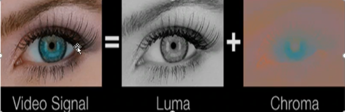
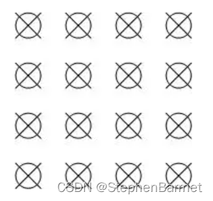
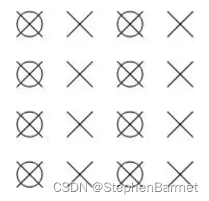
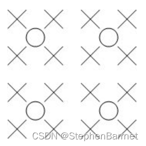

# 一、RGB编码格式
[RGB图像](https://so.csdn.net/so/search?q=RGB%E5%9B%BE%E5%83%8F&spm=1001.2101.3001.7020)具有三个通道 R、G、B，分别对应红、绿、蓝三个分量，由三个分量的值决定颜色；通常，会给RGB图像加一个通道alpha，即透明度，于是共有四个分量共同控制颜色。

一般情况下，RGB 图像中，每个像素点都有红、绿、蓝三个原色，其中每种原色都占用 8 bit，也就是一个字节，那么一个像素点也就占用 24 bit，也就是三个字节。如果是argb格式图像，1个像素点需要32 bit，也就是4个字节。

在图像显示中，一张 1280 _ 720 大小的图片，就代表着它有 1280 _ 720 个像素点。其中每一个像素点的颜色显示都采用 RGB 编码方法。一张 1280 _ 720 大小的图片，就占用 1280 _ 720 * 3 / 1024 / 1024 = 2.63 MB 存储空间。
# 二、YUV编码格式
YUV 相比于 RGB 格式最大的好处是可以做到在保持图像质量降低不明显的前提下，减小文件大小。TUV 格式之所以能够做到，是因为进行了采样操作。

YUV 颜色编码采用的是**明亮度**和**色度**来指定像素的颜色。。其中，**Y** 表示**明亮度**（Luminance、Luma），而 **U** 和 **V** 表示**色度**（Chrominance、Chroma）。

和 RGB 表示图像类似，每个像素点都包含 Y、U、V 分量。但是它的 Y 和 UV 分量是可以分离的，如果没有 UV 分量一样可以显示完整的图像，只不过是黑白的。

对于 YUV 图像来说，并不是每个像素点都需要包含了 Y、U、V 三个分量，根据不同的采样格式，可以每个 Y 分量都对应自己的 UV 分量，也可以几个 Y 分量共用 UV 分量。



## YUV存储格式（分类）：

YUV格式的两大类：**平面(plannr)** 和 **紧凑(packed)**。

- 对于planar的YUV格式，先连续存储所有像素点的Y，紧接着存储所有像素点的U，随是存储所有像素点的V，或者是先v后u
- 对于packed的YUV格式，每个像素点的Y，U，V是连续交替存储的。比如YUV420P，其中P表示紧凑，YUV420SP其中的SP表示“半紧凑”。

```
YUV420P:YYYYYYYY UU VV 
YUV420: YUV YUV YUV
```

- **packed**：Y、U、V 分量穿插着排列，三个分量存在一个 Byte 型数组里；
- **planar**：Y、U、V 分量分别存在三个 Byte 型数组中。

## YUV采样方式：

YUV主流的采样方式有三种，**YUV4:4:4**，**YUV4:2:2** ，**YVU4:2:0**。

- **YUV 4:4:4 采样**：YUV 4:4:4 采样，意味着 Y、U、V 三个分量的采样比例相同，因此在生成的图像里，每个像素的三个分量信息完整，都是 8 bit，也就是一个字节。

如下图所示：


其中，Y 分量用叉表示，UV 分量用圆圈表示。

> 举个例子 ：
假如图像像素为：[Y0 U0 V0]、[Y1 U1 V1]、[Y2 U2 V2]、[Y3 U3 V3]
那么采样的码流为：Y0 U0 V0 Y1 U1 V1 Y2 U2 V2 Y3 U3 V3
最后映射出的像素点依旧为 [Y0 U0 V0]、[Y1 U1 V1]、[Y2 U2 V2]、[Y3 U3 V3]


可以看到这种采样方式的图像和 RGB 颜色模型的图像大小是一样，并没有达到节省带宽的目的，当将 RGB 图像转换为 YUV 图像时，也是先转换为 YUV 4:4:4 采样的图像。

- **YUV4:2:2采样**：YUV 4:2:2 采样，意味着 UV 分量是 Y 分量采样的一半，Y 分量和 UV 分量按照 2 : 1 的比例采样。如果水平方向有 10 个像素点，那么采样了 10 个 Y 分量，而只采样了 5 个 UV 分量。

如下图所示：


其中，Y 分量用叉表示，UV 分量用圆圈表示。

> 举个例子 ：
假如图像像素为：[Y0 U0 V0]、[Y1 U1 V1]、[Y2 U2 V2]、[Y3 U3 V3]
那么采样的码流为：Y0 U0 Y1 V1 Y2 U2 Y3 V3
其中，每采样过一个像素点，都会采样其 Y 分量，而 U、V 分量就会间隔一个采集一个。
最后映射出的像素点为 [Y0 U0 V1]、[Y1 U0 V1]、[Y2 U2 V3]、[Y3 U2 V3]


采样的码流映射为像素点，还是要满足每个像素点有 Y、U、V 三个分量。但是可以看到，第一和第二像素点公用了 U0、V1 分量，第三和第四个像素点公用了 U2、V3 分量，这样就节省了图像空间。

一张 1280 * 720 大小的图片，在 YUV 4:2:2 采样时的大小为：

> （1280 _ 720 _ 8 + 1280 _ 720 _ 0.5 _ 8 _ 2）/ 8 / 1024 / 1024 = 1.76 MB


可以看到 YUV 4:2:2 采样的图像比 RGB 模型图像节省了三分之一的存储空间，在传输时占用的带宽也会随之减少。

- **YUV 4:2:0 采样**：YUV 4:2:0 采样，并不是指只采样 U 分量而不采样 V 分量。而是指，在每一行扫描时，只扫描一种色度分量（U 或者 V），和 Y 分量按照 2 : 1 的方式采样。比如，第一行扫描时，YU 按照 2 : 1 的方式采样，那么第二行扫描时，YV 分量按照 2:1 的方式采样。对于每个色度分量来说，它的水平方向和竖直方向的采样和 Y 分量相比都是 2:1 。

如下图所示：


其中，Y 分量用叉表示，UV 分量用圆圈表示。

假设第一行扫描了 U 分量，第二行扫描了 V 分量，那么需要扫描两行才能够组成完整的 UV 分量。

> 举个例子 ：
假设图像像素为：
[Y0 U0 V0]、[Y1 U1 V1]、 [Y2 U2 V2]、 [Y3 U3 V3]
[Y5 U5 V5]、[Y6 U6 V6]、 [Y7 U7 V7] 、[Y8 U8 V8]
那么采样的码流为：Y0 U0 Y1 Y2 U2 Y3 Y5 V5 Y6 Y7 V7 Y8
其中，每采样过一个像素点，都会采样其 Y 分量，而 U、V 分量就会间隔一行按照 2 : 1 进行采样。
最后映射出的像素点为：
[Y0 U0 V5]、[Y1 U0 V5]、[Y2 U2 V7]、[Y3 U2 V7]
[Y5 U0 V5]、[Y6 U0 V5]、[Y7 U2 V7]、[Y8 U2 V7]


从映射出的像素点中可以看到，四个 Y 分量是共用了一套 UV 分量，而且是按照 2*2 的小方格的形式分布的，相比 YUV 4:2:2 采样中两个 Y 分量共用一套 UV 分量，这样更能够节省空间。

一张 1280 * 720 大小的图片，在 YUV 4:2:0 采样时的大小为：

> （1280 _ 720 _ 8 + 1280 _ 720 _ 0.25 _ 8 _ 2）/ 8 / 1024 / 1024 = 1.32 MB


可以看到 YUV 4:2:0 采样的图像比 RGB 模型图像节省了一半的存储空间，因此它也是比较主流的采样方式。

## 常见的YUV格式

- **YUV422：YUYV、YVYU、UYVY、VYUY**
这四种格式每一种又可以分为 2 类（packed和planar），以 YUYV 为例，一个 6*4 的图像的存储方式如下：

```
	Y Y Y Y Y Y                   
	Y Y Y Y Y Y                  
	Y Y Y Y Y Y                   
	Y Y Y Y Y Y                    
	U U U U U U                  Y U Y V Y U Y V Y U Y V
	U U U U U U                  Y U Y V Y U Y V Y U Y V
    V V V V V V                  Y U Y V Y U Y V Y U Y V
	V V V V V V                  Y U Y V Y U Y V Y U Y V
	- Planar -                          - Packed -
```

**- YUV420：I420、YV12、NV12、NV21**
YUV420p: I420、YV12
YUV420sp: NV12、NV21

同样，对于一个6*4的图像，这四种像素格式的存储方式如下：

```
	Y Y Y Y Y Y      Y Y Y Y Y Y      Y Y Y Y Y Y      Y Y Y Y Y Y
	Y Y Y Y Y Y      Y Y Y Y Y Y      Y Y Y Y Y Y      Y Y Y Y Y Y
	Y Y Y Y Y Y      Y Y Y Y Y Y      Y Y Y Y Y Y      Y Y Y Y Y Y
	Y Y Y Y Y Y      Y Y Y Y Y Y      Y Y Y Y Y Y      Y Y Y Y Y Y
	U U U U U U      V V V V V V      U V U V U V      V U V U V U
	V V V V V V      U U U U U U      U V U V U V      V U V U V U
     - I420 -          - YV12 -         - NV12 -         - NV21 -
```

- I420、YV12 三个分量均为平面格式，即分别存在三个 Byte 型数组中；
- NV12、NV21 的存储格式为 Y 平面，UV 打包，即 Y 信息存储在一个数组中，UV 信息存储在一个矩阵中。
# 三、RGB与YUV转换公式
YUV像素格式来源于RGB像素格式，通过公式运算，YUV三分量可以还原出RGB，YUV转RGB的公式如下：

```
R = Y + 1.403V
G = Y - 0.344U - 0.714V
B = Y + 1.770U
```

一般，将RGB和YUV的范围均限制在[0,255]间，则有如下转换公式：

```
R = Y + 1.403(V - 128)
G = Y - 0.344(U - 128) - 0.714(V - 128)
B = Y + 1.770(U - 128)
```

**References：**
[常用图像像素格式 NV12、NV2、I420、YV12、YUYV](https://blog.csdn.net/cgwang_1580/article/details/79595958)
[一文读懂 YUV 的采样与格式](https://glumes.com/post/ffmpeg/understand-yuv-format/#rgb-%E9%A2%9C%E8%89%B2%E7%BC%96)

