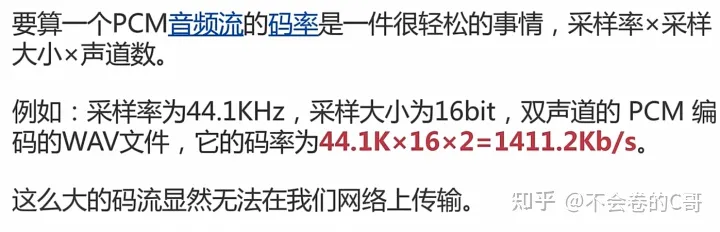
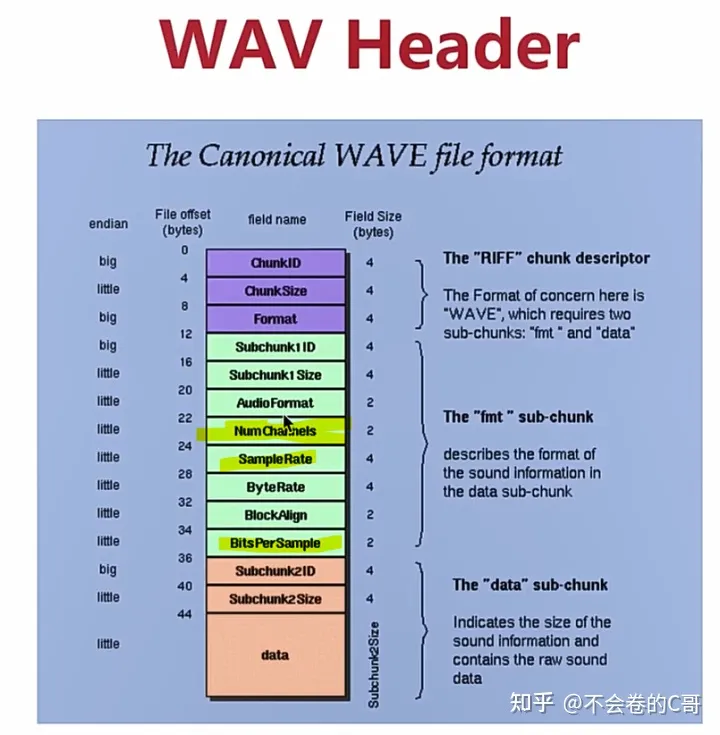
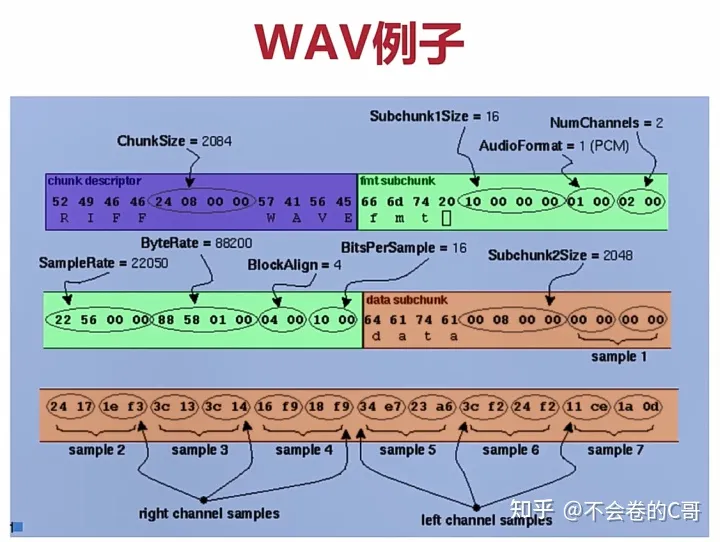

### 一、音视频处理流程
音视频通信是指将音频和视频数据从一个端点传输到另一个端点的过程。通常，音视频通信流程包括音视频采集、编码、传输、解码和渲染五个主要环节。下面是更详细的描述：

1. 音视频采集：音视频采集是指将麦克风、摄像头等音视频设备中的模拟信号转换成数字信号的过程。这个数字信号可以是PCM音频数据或者视频帧。在采集过程中需要确定采样率、采样精度等参数。
2. 音视频编码：音视频编码是指将数字信号转换成可传输或存储的格式的过程。常见的音视频编码格式有H.264、H.265、VP8、VP9、AAC、MP3等。编码后的音视频数据可以更有效地进行传输和存储。
3. 传输：音视频数据传输可以通过网络或者本地传输。在传输过程中需要注意网络带宽、延迟、丢包等因素。传输过程中的数据可以通过一些协议进行控制和优化，如RTP、RTCP、STUN等。
4. 音视频解码：音视频解码是指将接收到的音视频数据解码成原始的数字信号的过程。解码器需要知道解码的格式和参数。解码后的音视频数据可以用于播放或者后续处理。
5. 音视频渲染：音视频渲染是指将解码后的音视频数据还原成模拟信号，输出到扬声器或者显示器上。在渲染过程中需要注意音频音量控制和视频的帧率、分辨率等参数。

下面为具体的音频和视频处理流程：
### 1.1 音频处理流程
音频处理是将声音信号进行数字化、处理和还原的过程。音频处理流程包括以下几个步骤：

1. 采集：将声音信号从模拟信号转换成数字信号。采集可以通过麦克风、音频接口等设备进行。采集过程中需要注意采样率和位深度的设置，采样率表示每秒采集的样本数，位深度表示每个采样值所占用的位数。
2. 预处理：对采集到的音频信号进行一些预处理，如滤波、降噪、增益调整等。这些预处理步骤有助于减少噪音、改善音质。
3. 数字信号处理（DSP）：对数字信号进行一系列的数字信号处理，如均衡器、压缩器、限幅器、混响器等。这些数字信号处理步骤可以改变音频的频率响应、动态范围、时域特性等。
4. 编码：将数字信号编码成可传输或存储的格式，如MP3、AAC、WAV等。在编码过程中需要选择适当的编码算法和参数设置，以达到合适的压缩比和音质。
5. 传输或存储：将编码后的音频信号进行传输或存储。音频信号可以通过网络传输，也可以存储到本地硬盘或其他存储介质上。
6. 解码：将传输或存储的音频信号解码成数字信号，以便进行后续的数字信号处理或者还原成模拟信号输出。
7. 输出：将数字信号转换成模拟信号输出，如通过扬声器、耳机等设备输出。在输出过程中需要注意音量控制和音质保护。
### 1.2 视频处理流程
视频处理流程包括以下主要步骤：

1. 视频采集：采集视频信号源，如摄像头、录像机、电视等，将模拟视频信号转换成数字视频信号，通常使用视频采集卡或者专业视频采集设备。
2. 视频编码：将原始数字视频信号进行压缩编码，减少数据量，便于传输和存储。常见的视频编码标准包括H.264、H.265、MPEG-4、AVC等。
3. 视频传输：将编码后的视频数据通过网络或者传输介质传输到接收端。视频传输涉及到网络传输协议、传输带宽、网络延迟等因素。
4. 视频解码：接收端使用相应的解码器对传输过来的视频数据进行解码，还原出原始的数字视频信号。
5. 视频处理：对解码后的视频信号进行各种处理，如裁剪、旋转、调整亮度、对比度、色彩等，实现特殊效果和优化处理。
6. 视频渲染：将处理后的视频信号渲染成可视化的视频画面，通常使用显示器、投影仪等设备进行展示。
### 1.3 音视频数据流转
音视频的流转简单来说就是：PCM（采集数据的格式，数字信号）->acc/mp3（编码器）->mp4/flv（套一层马甲，生成多媒体文件），详细来讲就是：
首先，在音视频采集过程中，通常需要将模拟信号转换成PCM格式的数字信号，以便于后续的处理和传输。
然后，PCM格式的音频数据需要进行压缩，以便于存储和传输。常见的压缩格式包括AAC、MP3等。这些压缩格式通常采用有损压缩算法，即通过去除一些听觉上不太明显的音频信号，来减少数据量和提高压缩比。在进行压缩时，可以设置一些编码参数，如码率、采样率、声道数、编码质量等。这些参数的设置会影响到压缩后的音频质量和数据量。
最后，压缩后的音频数据可以通过容器格式进行打包，生成多媒体文件。常见的容器格式包括MP4、FLV、AVI等。容器格式可以包含音频、视频、字幕、元数据等多种媒体数据，同时还可以提供索引和元数据信息，方便多媒体文件的管理和播放。
### 1.4 为什么音视频采集完之后，不能直接传输，要进行编码？
音视频数据采集之后，得到的是原始的模拟信号或数字信号，这些信号通常是非常庞大的，无法直接传输或存储。同时，由于音视频数据传输具有时延和带宽等限制，需要进行压缩以减少数据量，保证数据传输的实时性和稳定性。
音视频编码可以将音视频信号转换成压缩格式，以减少数据量和提高传输效率。编码可以根据不同的应用场景和需求，选择不同的编码格式和编码参数。常见的音视频编码格式包括H.264、H.265、VP8、VP9、AAC、MP3等，它们各自具有不同的压缩比、编码质量、延迟等特点，可以根据实际情况进行选择和优化。
因此，进行音视频编码可以提高数据传输的效率，降低带宽成本，同时也可以提高音视频质量，减少传输延迟。采集完音视频数据之后，必须对其进行编码才能使其适合进行传输和存储。
### 1.5 模数转换
音视频模数转换（ADC/DAC）是指将模拟信号转换成数字信号或将数字信号转换成模拟信号的过程。在音视频领域，模数转换通常用于音视频的采集和输出，以便于数字信号的处理和传输。
首先，将模拟信号转换成数字信号的过程被称为ADC（模数转换器）。ADC接受模拟信号输入，并将其转换成数字信号。这个过程分为三个主要步骤：

1. 采样：模拟信号在时间轴上进行采样，即周期性地测量信号的幅值，并将其转换成数字值。采样的频率被称为采样率，通常以Hz为单位表示。
2. 量化：将采样后的模拟信号幅值转换成数字值的过程称为量化。量化的精度通常由量化位数（即每个采样值的位数）来衡量。例如，16位的ADC可以将每个采样值转换成一个16位的数字值。
3. 编码：将量化后的数字值编码成特定格式的二进制码流。编码的格式通常与音频数据的压缩格式有关，如PCM、AAC、MP3等。

接下来是数字信号转换成模拟信号的过程，被称为DAC（数字模拟转换器）。DAC接受数字信号输入，并将其转换成模拟信号。这个过程与ADC相反，分为三个步骤：

1. 解码：将二进制码流解码成数字值。
2. 量化：将数字值转换成幅值，即将数字信号离散化成一系列幅度值。
3. 重建：将量化后的数字信号转换成模拟信号。这个过程涉及到信号重建滤波器，通常是一个低通滤波器，以平滑模拟信号的波形，防止信号中出现干扰。

总的来说，音视频模数转换是音视频处理中重要的步骤，将模拟信号转换成数字信号或将数字信号转换成模拟信号。这个过程需要采样、量化、编码、解码、重建等多个步骤，对音视频信号的质量和处理效果有很大影响。
第一次更新：2023/3/2

---

### 1.6 PCM
PCM（Pulse Code Modulation）是指脉冲编码调制，是一种用于模拟信号数字化的标准方法。PCM将模拟信号通过采样、量化、编码等处理，转换成数字信号，从而可以方便地进行数字信号的存储、处理和传输。PCM通常采用的量化方法是线性量化，采用的编码方法是二进制编码。PCM的采样位数和采样率决定了数字音频的精度和质量，通常采用16位或24位采样位数，采样率则通常为44.1kHz或48kHz。
**PCM码率计算：**

### 1.7 WAV
WAV是指Windows Audio File，是一种使用PCM编码的数字音频文件格式。WAV文件格式由Microsoft和IBM联合开发，是Windows系统中常见的音频文件格式之一。WAV文件是无损的数字音频格式，支持多种采样位数和采样率，通常支持16位、24位和32位的采样位数，以及44.1kHz、48kHz、96kHz等不同的采样率。WAV文件可以存储单声道或双声道的音频数据，支持使用各种编码器进行压缩和解压缩，但由于采用的是无损压缩算法，因此WAV文件通常较大，不适合网络传输或存储空间有限的设备。
具体来讲，WAV包括以下几个方面的内容：

1. 音频数据：WAV文件中包含采样后的数字音频数据，这些数据是经过量化和编码后的，以二进制形式存储。WAV文件支持多种采样位数和采样率，通常采用16位或24位的采样位数，以及44.1kHz或48kHz的采样率。
2. 头部信息：WAV文件的头部包含了音频数据的基本信息，如采样率、采样位数、声道数等。头部信息也包含了WAV文件的格式信息，如文件类型、块大小、格式子块等。WAV文件头部通常占据文件的前44个字节。
3. 格式子块：WAV文件中还包括了格式子块，用于描述音频数据的格式。格式子块包含了音频数据的格式类型、声道数、采样率、平均字节率、块对齐字节数等信息。
4. 数据块：WAV文件中的数据块存储了音频数据的实际内容，包括了每个采样点的采样值。数据块的大小取决于音频数据的大小，通常为文件总大小减去头部信息和格式子块的大小。

总的来说，WAV文件包含了音频数据、头部信息、格式子块和数据块等内容，是一种常见的无损音频文件格式。WAV文件的结构和内容在数字音频处理和应用中具有重要的作用，需要深入理解和掌握。

WAV 文件头部信息包括以下内容：

1. ChunkID：4 字节，文件标识符，固定值为 "RIFF"。
2. ChunkSize：4 字节，整个文件长度（不包括 ChunkID 和 ChunkSize 所占的字节数）。
3. Format：4 字节，文件格式标识符，固定值为 "WAVE"。
4. Subchunk1ID：4 字节，子块标识符，固定值为 "fmt "。
5. Subchunk1Size：4 字节，子块大小，一般为 16。
6. AudioFormat：2 字节，音频格式，如 PCM 等。
7. NumChannels：2 字节，声道数，如单声道、立体声等。
8. SampleRate：4 字节，采样率，表示每秒采样次数。
9. ByteRate：4 字节，数据传输速率，表示每秒传输的字节数。
10. BlockAlign：2 字节，数据块对齐单位，表示每个采样块所占的字节数。
11. BitsPerSample：2 字节，采样位数，如 8 位、16 位等。
12. Subchunk2ID：4 字节，子块标识符，固定值为 "data"。
13. Subchunk2Size：4 字节，子块大小，表示音频数据的长度。

其中，Subchunk1 和 Subchunk2 是 WAV 文件中的两个子块，分别存储文件格式信息和音频数据信息。这些头部信息对于解码和播放 WAV 文件非常重要，因为它们提供了必要的参数和元数据，帮助解码器正确地读取和解码音频数据。

WAV 格式文件包含多个子块，其中两个最为重要，分别是 fmt 和 data 子块。

1. fmt 子块：存储音频格式信息，包括采样率、声道数、采样位数等。一般情况下，这个子块的大小是 16 字节，但是也可能有其他大小。这个子块的标识符是 "fmt "（注意末尾有一个空格字符）。
2. data 子块：存储实际的音频数据，这个子块的大小由音频数据的长度决定。这个子块的标识符是 "data"。

此外，WAV 文件还可以包含其他子块，比如 LIST 和 fact 子块，用于存储附加信息或者数据样本的数量等。这些子块不是必需的，而且其格式和用途也比较复杂，因此在一般情况下，解码器只需要关注 fmt 和 data 子块即可。
总的来说，PCM是一种数字音频编码标准，用于将模拟信号数字化，而WAV是一种基于PCM编码的数字音频文件格式，用于存储和传输数字音频数据。PCM和WAV在数字音频处理和应用中具有重要的作用，是数字音频领域中必须掌握的基础知识。

