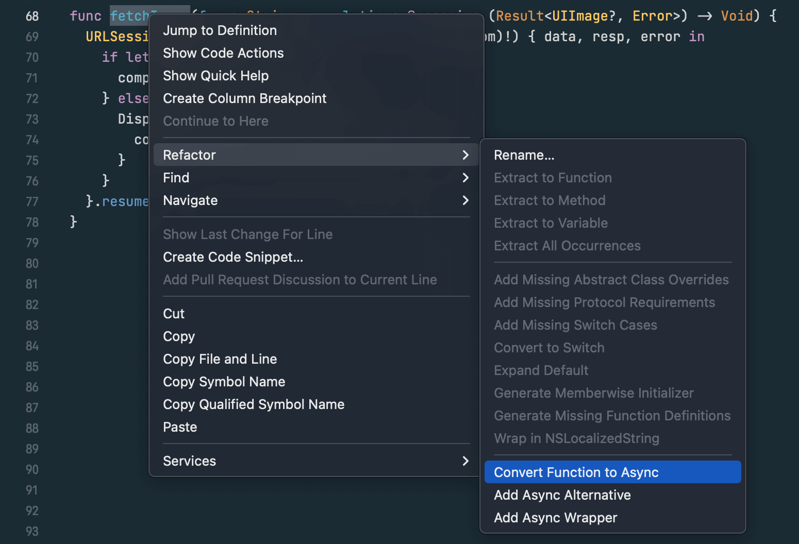

# 引言

对于诞生于 2014 年的 Swift 而言，它已不再年轻。至今我还记得初次体验 Swift 时的喜悦之情，比起冗长的 OC 而言，它更加现代、简洁、优雅。但 Swift 的前期发展是野蛮而动荡的，每次发布新版本时都会导致旧项目出现大量的报错和告警，项目迁移工作令开发者苦不堪言。不得不说，Swift 诞生之初就敢于在项目中实践并运用的人，是真的猛士。我是从 Swift 4 才开始将项目逐渐从 OC 向 Swift 迁移的，到 2019 年 Swift 5 实现了 ABI 稳定时，才全面迁移至纯 Swift 开发。

ABI 的稳定象征着 Swift 的成熟，然而在并发编程方面，Swift 却落后了一截。Chris Lattner 早在2017年发表的 [《Swift 并发宣言》](https://gist.github.com/lattner/31ed37682ef1576b16bca1432ea9f782) 中就描绘了令人兴奋的前景。2021 年 Swift 5.5 的发布终于将 [Concurrency](https://developer.apple.com/documentation/swift/swift_standard_library/concurrency) 加入了标准库，从此，Swift 并发编程变得更为简单、高效和安全。

在此之前，我们通常使用闭包来处理异步事件的回调，如下是一个下载网络图片的示例：

```swift
func fetchImage(from: String, completion: @escaping (Result<UIImage?, Error>) -> Void) {
  URLSession.shared.dataTask(with: .init(string: from)!) { data, resp, error in
    if let error = error {
      completion(.failure(error))
    } else {
      DispatchQueue.main.async {
        completion(.success(.init(data: data!)))
      }
    }
  }.resume()
}
```

代码并不复杂，不过这只是针对下载单一图片的场景。我们将需求设计的再复杂一点点：先下载前两张图片（无先后顺序）并展示，然后再下载第三张图片并展示，当三张图片都下载完成后，再展示在 UI 界面。当然，实际开发中一般是先下载的图片先展示，这里的非常规设计只作举例而已。

完整的实现代码变成如下：

```swift
import UIKit

class ViewController: UIViewController {
  
  let sv = UIScrollView(frame: UIScreen.main.bounds)
  let imageViews = [UIImageView(), UIImageView(), UIImageView()]
  let from = [
    "https://images.pexels.com/photos/10646758/pexels-photo-10646758.jpeg?auto=compress&cs=tinysrgb&dpr=2&w=500",
    "https://images.pexels.com/photos/9391321/pexels-photo-9391321.jpeg?auto=compress&cs=tinysrgb&dpr=2&w=500",
    "https://images.pexels.com/photos/9801136/pexels-photo-9801136.jpeg?auto=compress&cs=tinysrgb&dpr=2&w=500"
  ]
  
  override func viewDidLoad() {
    super.viewDidLoad()
    
    sv.backgroundColor = .white
    view.addSubview(sv)
    sv.contentSize = .init(width: 0, height: UIScreen.main.bounds.height + 100)
    
    imageViews.enumerated().forEach { i, v in
      v.backgroundColor = .lightGray
      v.contentMode = .scaleAspectFill
      v.clipsToBounds = true
      v.frame = .init(x: 0, y: CGFloat(i) * 220, width: UIScreen.main.bounds.width, height: 200)
      sv.addSubview(v)
    }
    
    let group = DispatchGroup()
    let queue = DispatchQueue(label: "fetchImage", qos: .userInitiated, attributes: .concurrent)
    
    let itemClosure: (Int, DispatchWorkItemFlags, @escaping () -> ()) -> DispatchWorkItem = { idx, flags, completion in
      return DispatchWorkItem(flags: flags) {
        self.fetchImage(from: self.from[idx]) { result in
          print(idx)
          switch result {
          case let .success(image):
            self.imageViews[idx].image = image
          case let .failure(error):
            print(error)
          }
          completion()
        }
      }
    }
    
    from.enumerated().forEach { i, _ in
      group.enter()
      let flags: DispatchWorkItemFlags = (i == 2) ? .barrier : []
      queue.async(group: group, execute: itemClosure(i, flags, {
        group.leave()
      }))
    }
    
    group.notify(queue: queue) {
      DispatchQueue.main.async {
        print("end")
      }
    }
  }
}
```

这里使用了 GCD 来实现需求，看上去也不是特别复杂，我们还能使用 [PromiseKit](https://github.com/mxcl/PromiseKit) 来管理事件总线，不直接编写 GCD 层面的代码，使代码更简洁更易读。但是试想一下，实际需求可能更复杂，我们也许要先从服务端获取一些数据后，再下载图片并进行解码以及缓存，同时可能还会有下载音频、视频等任务要处理，这样的情况就更加复杂了。不管有没有使用 PromiseKit 这样优秀的库，随着业务的复杂度增加，都无法回避会越来越明显地暴露出来的问题：

- 闭包本身难以阅读，还有导致循环引用的潜在风险
- 回调必须覆盖各种情况，一旦遗漏则难以排查问题所在
- Result 虽然较好地处理了错误，但难以解决错误向上传递的问题
- 嵌套层级太深导致回调地狱
- ......

# async/await 初体验

针对上面的这些问题，Concurrency 的解决方案是使用 `async/await` 模式，该模式在 C#、Javascript 等语言中有着成熟的应用。现在，我们终于可以在 Swift 中使用它了！

下面是使用 async/await 改造 fetchImage 的代码，这里先了解一下 `async` 和 `await` 关键字的基本使用：

- async：添加在函数末尾，标记其为异步函数
- await：添加在调用 async 函数前，表明该处的代码会受到阻塞，直到异步事件返回

```swift
func fetchImage(idx: Int) async throws  -> UIImage { // 1
  let request = URLRequest(url: .init(string: from[idx])!)
  // 2
  let (data, resp) = try await URLSession.shared.data(for: request)
  // 3
  print(idx, Thread.current)
  guard (resp as? HTTPURLResponse)?.statusCode == 200 else {
    throw FetchImageError.badNetwork
  }
  guard let image = UIImage(data: data) else {
    throw FetchImageError.downloadFailed
  }
  return image
}
```

1. async throws 表明该函数是异步的、可抛出错误的

2. URLSession.shared.data 方法的全名如下，因此我们需要使用 try await 来调用该方法

   ```swift
   public func data(from url: URL, delegate: URLSessionTaskDelegate? = nil) async throws -> (Data, URLResponse)
   ```

3. 代码执行到这里时，表明下载图片的异步事件已经结束了

相信你对 async/await 的使用已经有点感觉了：async 用来标记异步事件，await 用来调用异步事件，等待异步事件返回，然后继续执行后面的代码。它和 throws、try 这对关键词很像，几乎总是同时出现在相关场合。有的读者可能会纳闷，为何 try await 和 async throws 的顺序是反的，这里不必纠结，设计如此罢了，而且 try await 好像听上去和写起来更顺一点？

接下来我们要做的就是调用异步函数 fetchImage，并且需要控制图片的下载顺序，实现代码：

```swift
// 1
async let image0 = try? fetchImage(idx: 0)
async let image1 = try? fetchImage(idx: 1)
// 2
let images = await [image0, image1]
imageViews[0].image = images[0]
imageViews[1].image = images[1]
// 3
imageViews[2].image = try? await fetchImage(idx: 2)
```

1. async let 可以让多个异步事件同时执行，这里表示同时异步下载前两张图片。

   前面我们说了 async 用来标记异步函数，await 用来调用，几乎总是出现在相关场合。而且编译器会去检查调用 async 函数时是否使用了 await，如果没有，则会报错。而这里，我们在调用 fetchImage 时并没有使用 await，依然可以通过编译，是因为在使用 async let 时，如果我们没有显示地使用 try await，Swift 会隐式的实现它，而且能将 try await 的调用时机推迟。

   上面的代码，我们将它改成如下也是可以的：

   ```swift
   async let image0 = fetchImage(idx: 0)
   async let image1 = fetchImage(idx: 1)
   let images = try await [image0, image1]
   ```

2. await 阻塞当前任务，等待上面的两个异步任务返回结果

3. 前两张图片下载完成之后，继续异步下载第三张图片并展示

将上面的代码放在 viewDidLoad 中执行，发现凡是有 async 的地方都报红了。这是因为如果某个函数内部调用了 async 函数，该函数也需要标记为 async，这样才能为函数体内部提供异步环境，并且将异步事件进行传递。而 viewDidLoad 没有被标记为 async，编译器发现了这一问题并报错了。但是，我们不能这样做。因为 viewDidLoad 是重写的 UIViewController 中的方法，它是运行在主线程中的同步函数而且必须如此。

那么这个问题该如何解决呢？Swift 为我们提供了 `Task`，在创建的 Task 实例闭包中，我们将获得一个新的异步环境，如此，就可以调用异步函数了。Task 就像打破同步环境结界的桥梁，为我们提供了通向异步环境的通道。

我们将上面的代码放在 Task 实例的闭包中，就可以顺利运行程序了。

```swift
Task {
  // 1
  async let image0 = fetchImage(idx: 0)
  async let image1 = fetchImage(idx: 1)
  // 2
  let images = try await [image0, image1]
  imageViews[0].image = images[0]
  imageViews[1].image = images[1]
  // 3
  imageViews[2].image = try? await fetchImage(idx: 2)
}
```

上面的代码最终的表现结果和改造前还有点细微差别：前两张图片虽然是同时异步下载的，但是会相互等待，直到两张图片都下载完成后，才展示在界面上。这里提供两个思路去实现与之前同样的效果，一是将展示图片的逻辑放在 fetchImage 方法中，另一种是使用 Task 解决，参考代码如下：

```swift
Task {
  let task1 = Task {
    imageViews[0].image = try? await fetchImage(idx: 0)
  }
  let task2 = Task {
    imageViews[1].image = try? await fetchImage(idx: 1)
  }
  let _ = await [task1.value, task2.value]
  imageViews[2].image = try? await fetchImage(idx: 2)
}
```

关于 Task、TaskGroup 并不在本文的讨论范畴，后面会有单独的章节去详述。

这里要补充说明的是，当我们使用 async let 时，实际上是在当前任务中隐式地创建了一个新的 task，或者叫子任务。async let 就像一个匿名的 Task，我们没有显示地创建它，也不能使用本地变量存储它。所以 Task 相关的 value、cancel() 等属性和方法，我们都无法使用。

async let 其实就是一个语法糖，我们可以使用它应对多数场景下的异步事件处理。如果要处理的异步事件数量多且关系复杂，甚至涉及到事件的优先级，那么使用 Task、TaskGroup 是更明智的选择。

# Refactor to Async

如果你想把之前基于回调的异步函数迁移至 async/await（最低支持 iOS 13），Xcode 内置了非常方便的操作，能够快速地进行零成本的迁移和兼容。

如图所示，选中相应的方法，右键选择 Refactor，会有三种选择：

1. Convert Function to Async：将当前的回调函数转换成 async，覆盖当前函数
2. Add Async Alternative：使用 async 改写当前的回调函数，基于改写后的函数结合 Task 再提供一个回调函数
3. Add Async Wrapper：保留当前的回调函数，在此基础上提供一个 async 函数

从上我们可以得知 Wrapper 支持的 iOS 版本范围是大于 Alternative 的，我们可以根据项目的最低支持版本按需操作：

- `< iOS 13`，选 3
- `>= iOS 13`
  - 整体迁移至 async：选 1
  - 保留回调函数 API：选 3 或 1



# 小结

async/await 简化了异步事件的处理，我们无需和线程直接打交道，就可以写出安全高效的并发代码。回调机制经常衍生出的面条式代码也不复存在，我们可以用线性结构来清晰地表达并发意图。

这得益于[结构化并发](https://en.wikipedia.org/wiki/Structured_concurrency)的编程范式在背后做理念支撑，结构化并发的思想和[结构化编程](https://zh.wikipedia.org/wiki/结构化编程)是类似的。每个并发任务都有自己的作用域，并且有着明确且唯一的入口和出口。不管这个并发任务内部的实现有多复杂，它的出口一定是单一的。

我们把要执行并发任务想象成一根管道，水流就是管道内要执行的任务。在非结构化编程的世界，子任务会生成许多的管道分支，水流会从不同的分支出口流出去，也可能会遇到故障，我们需要在不同的出口去处理水流结果，出口越多，我们越手忙脚乱。而结构化编程的世界里，我们无需关心各个分支出口，只要守住管道另一端的唯一出口就可以了，分支出口不管多复杂，水流最终会回到管道的出口。

