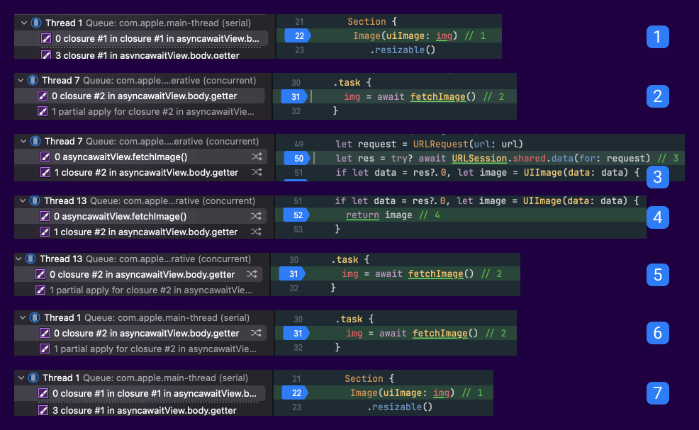
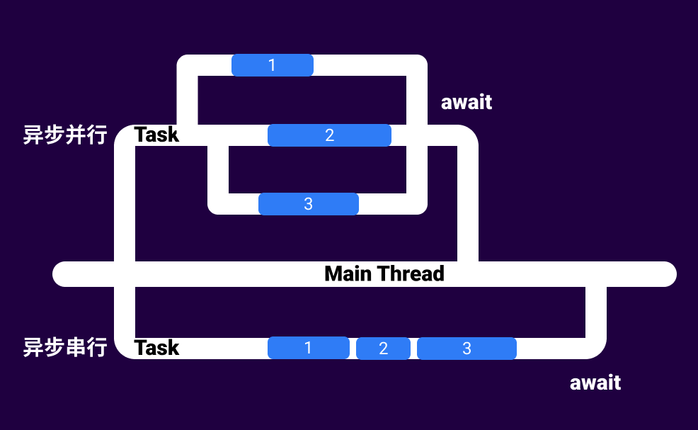

# async/await

上一节我们已经简单介绍了 async/await 的使用，接下来我们通过一个例子来加深对 async/await 的理解。如下是一个下载图片并展示在界面上的示例代码：

```swift
struct asyncawaitView: View {
  
  @State private var img = UIImage()
  
  var body: some View {
    List {
      Section {
       Image(uiImage: img) // 1
          .resizable()
          .aspectRatio(contentMode: .fit)
      } header: {
        SectionHeaderView(chapter: "async/await", section: "")
      }
    }
    .listStyle(.insetGrouped)
    .task {
      img = await fetchImage() // 2
    }
  }
  
  func fetchImage() async -> UIImage {
    let str = "https://images.pexels.com/photos/1056251/pexels-photo-1056251.jpeg?auto=compress&cs=tinysrgb&dpr=1&w=500"
    let url = URL(string: str)!
    let request = URLRequest(url: url)
    let res = try? await URLSession.shared.data(for: request) // 3
    if let data = res?.0, let image = UIImage(data: data) {
      return image // 4
    }
    return UIImage()
  }
}
```

我们在 1、2、3、4 处打上断点，代码执行步骤如下图：



1. 主线程将空图 img 覆值给 Image；

2. 主线程继续运行，`.task` 在视图出现时，系统立即开启一个异步任务执行，这里是在子线程 Thread 7；

3. 子线程 7 开启的异步环境中，继续运行至调用 fetchImage 异步方法。

   > 注意：当程序运行至第 50 行代码时，`await` 会阻塞后续代码的运行。但线程 7 不会被阻塞，它会继续执行由系统分配的其它任务，这样才能最大程度低提高并发效率。而下载图片的工作会在另一个线程执行，直到图片的下载操作完成后，被阻塞的代码才会继续执行。

4. 图片下载完成后，当前线程在 Thread 13，这就是 `URLSession.shared.data` 工作的线程；

5. 异步任务完成了，`await` 阻塞处的代码继续执行；

6. 断点在这里第二次被捕获，这一步是将图片赋值给 img 实例，这里已切回至主线程。

   关于 @State，苹果的[文档](https://developer.apple.com/documentation/swiftui/state)有如下描述：

   > You should only access a state property from inside the view’s body, or from methods called by it. For this reason, declare your state properties as private, to prevent clients of your view from accessing them. It is safe to mutate state properties from any thread.

   根据描述，我们应该只在 view 的 `body` 内访问 @State 修饰的属性。因为 `body` 是在主线程中运行的，无论是 @State 或其它属性包装起修饰的属性，只要是在 `body` 内修改，SwiftUI 都会确保相关的视图更新工作在主线程中进行。

   

7. img 的值发生了改变，视图在主线程刷新。

关于 async/await 的内容就介绍就到这里，通过这两节的内容，相信你对 async/await 有了更详细的了解，剩下的就是多加运用和实践了。

# async let

async/await 让我们可以简单方便地处理并发问题，但它有一定的局限性。因为 await 会阻塞当前任务，遇到多个任务需要并行执行时，它就无能为力了。后面介绍的 Task、TaskGroup 很强大，但使用起来不够不太方便，因此， Swift 提供了 `async let` 给我们使用。

如下是一个下载三张图片后并刷新 UI 的示例代码：

```swift
struct CatsView: View {
  
  var isParallel: Bool = false
  
  @State private var imgs = Array(repeating: UIImage(), count: 3)
  private let imgUrlStrings = [
    "https://images.pexels.com/photos/1056251/pexels-photo-1056251.jpeg?auto=compress&cs=tinysrgb&dpr=1&w=500",
    "https://images.pexels.com/photos/1629061/pexels-photo-1629061.jpeg?auto=compress&cs=tinysrgb&h=750&w=1260",
    "https://images.pexels.com/photos/1404825/pexels-photo-1404825.jpeg?auto=compress&cs=tinysrgb&dpr=1&w=500"
  ]
  
  var body: some View {
    HStack {
      ForEach(0..<imgs.count) {
        Image(uiImage: imgs[$0])
          .resizable()
          .aspectRatio(contentMode: .fit)
      }
    }
    .task {
      if isParallel { // 异步并行
        async let img0 = fetchImage(from: imgUrlStrings[0]) // 1
        async let img1 = fetchImage(from: imgUrlStrings[1]) // 1
        async let img2 = fetchImage(from: imgUrlStrings[2]) // 1
        imgs = await [img0, img1, img2] // 2
      } else { // 异步串行
        imgs[0] = await fetchImage(from: imgUrlStrings[0])
        imgs[1] = await fetchImage(from: imgUrlStrings[1])
        imgs[2] = await fetchImage(from: imgUrlStrings[2])
      }
    }
  }
  
  func fetchImage(from urlString: String) async -> UIImage {
    let url = URL(string: urlString)!
    let request = URLRequest(url: url)
    let res = try? await URLSession.shared.data(for: request)
    if let data = res?.0, let image = UIImage(data: data) {
      return image
    }
    return UIImage()
  }
}
```

1. 每一行 async let 都会开启一个子任务并立即执行，并且会隐式地 `await`
2. 异步任务会在这里暂停，直到所有并行的任务都完成了，才继续执行后面的代码

你可以使用断点或者控制台打印的方式来调试上面的程序，可以清晰地看到整个程序的执行顺序。或者通过使用 Network Link Conditioner 控制网速来直观地观察界面的刷新（macOS 工具：[下载](https://developer.apple.com/download/all/?q=Hardware%20IO%20Tools)，iPhone 可以在 设置 - 开发者 - Network Link Conditioner 中进行设置），你会发现使用 `async let` 并行下载图片时，它能更快将图片展示在界面上。

两种执行方式的差异，在下面这张图也有直观的对比：



关于 await 和 async let 的使用并不是很难，至于如何选择，得考虑具体的需求场景。

并发可以提高程序执行的效率，但这并不是一条定理，我们不能据此盲目地使用并发。比如视频处理这种需要占用大量系统资源的场景，如果使用多线程并行处理，未必是最佳选择。因为系统的性能是有峰值的，把系统所有的资源都用来单独处理一条视频就够它喝一壶的了，同时并行处理多个视频可能还会增加额外的性能开销，效率还不如集中力量办好一件事后，再继续依次处理后面的视频。熟悉影视剪辑或者 3D 建模的同学可能对此有所体会，一个工程完成后导出一个高清视频时，电脑都会疯狂运转，少则几分钟多则几小时，才能看到导出的成品。

或许有读者会问为什么时 `async let` 而不是 async var？其实很简单，var 定义的是变量，变量意味着可以修改，如果一个变量在等待异步返回的结果时，而同时又能去修改该变量的值，那就再次陷入了数据竞争的陷阱，我们辛辛苦苦建立起来的线程安全的世界，瞬间又崩塌了。

# async properties

Swift 5.5 对**只读属性**加入了 `async` 和 `throws` 关键词的支持，可以单独使用 async 或 throws 关键词修饰，也可以同时使用。

比如我们可以将上面示例中的 img 属性改成：

```swift
var asyncImg: UIImage {
  get async {
    await fetchImage()
  }
}
```

如果 fetchImage 支持 throw error，也可以写成：

```swift
var asyncImg: UIImage {
  get async throws {
    try await fetchImage()
  }
}
```

此外，协议中定义的属性也支持以上关键词：

```swift
protocol P {
  
  var name: String { get async throws }
}
```

显然，我们在实现协议时，也要和协议中声明的属性保持一致。

