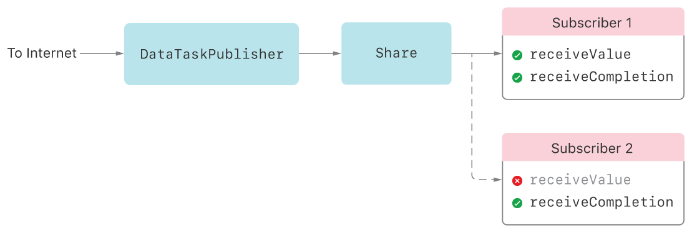
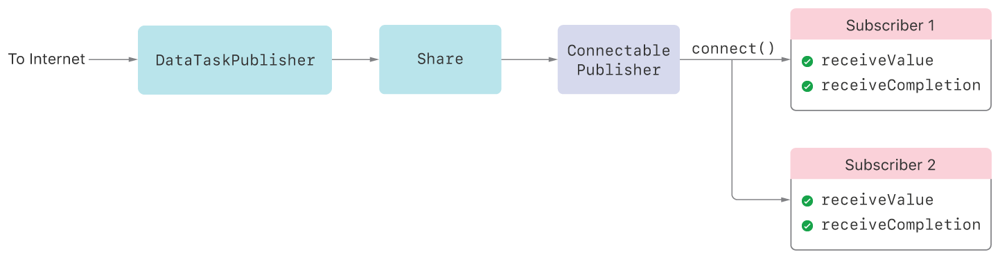

# AnyPublisher

前面视图部分的内容我们提到过，有些情况下， View 为了避免在传参或返回时类型不一致从而无法通过编译时，可以使用 AnyView 来作类型擦除，以此使得视图变得通用。

Publisher 也有同样的问题，其实这是所有包含关联类型的协议的“通病”，因为关联类型的具体类型本身就是不确定的。Combine 给出的解决方案正是 AnyPublisher，它是擦除类型的 publisher，同时也隐藏了内部的实现细节。

Combine 中所有的 publisher 都可以调用 `eraseToAnyPublisher()` 方法来返回一个 AnyPublisher 实例，实际开发中，我们几乎处处都会使用它。

# ConnectablePublisher 协议

> 关于 ConnectablePublisher 协议，苹果官方的文档讲解的非常细致，本小节大部分内容节选自苹果官方文档：[ docs](https://developer.apple.com/documentation/combine/controlling-publishing-with-connectable-publishers)，英语好的同学可以看英文文档

多数订阅者一旦和发布者绑定后，会立即在数据流中产生数据，比如前面用到的 `sink(receiveValue:)` ，该方法被调用时，就会向发布者请求数据。

而实际情况中，我们常常需要让这个数据发送的时机变得可控，比如我们创建一个 URLSession.DataTaskPublisher 请求网络数据，然后我们使用 sink 来创建 Subscriber1 接收数据。紧接着，我们以同样的方式创建 Subscriber2 接收数据。当 Subscriber1 的订阅行为和网络请求速度足够快的情况下，数据流中产生的数据已经发送完毕，Subscriber2 不会接收到任何数据，这并不是我们想要的结果。



为了解决这样的问题，Combine 为我们提供了 **ConnectablePublisher** 协议。该协议的使用非常简单，我们直接通过 publisher 调用  makeConnectable() 方法，就会将 publisher 进行一层包装，返回一个遵循该协议的实例。

**ConnectablePublisher** 协议有个两个方法：connect()、autoconnect()，它们都返回 Cancellable 实例。在调用上述两个方法之前，管道中不会产生任何数据流。当我们需要发送数据的时候，就调用 connect() 方法。

而 autoconnect() 方法主要用于本身已经遵循 **ConnectablePublisher** 协议的 publisher，比如我们之前用过的 Timer。当我们创建一个 Timer 的时候，它已经默认遵循 **ConnectablePublisher** 协议，我们无需显示地调用 makeConnectable() 方法，只需要在合适的时机调用 connect() 激活定时器，或者调用 autoconnect() 立即激活定时器。

```swift
// 定时器
let cancellable = Timer.publish(every: 1, on: .main, in: .default)
    .autoconnect()
    .sink() { date in
        print ("Date now: \(date)")
     }
```



```swift
// 网络请求样例参考代码
let url = URL(string: "https://example.com/")!
let connectable = URLSession.shared
    .dataTaskPublisher(for: url)
    .map() { $0.data }
    .catch() { _ in Just(Data() )}
    .share()
    .makeConnectable()

cancellable1 = connectable
    .sink(receiveCompletion: { print("Received completion 1: \($0).") },
          receiveValue: { print("Received data 1: \($0.count) bytes.") })

DispatchQueue.main.asyncAfter(deadline: .now() + 1) {
    self.cancellable2 = connectable
        .sink(receiveCompletion: { print("Received completion 2: \($0).") },
              receiveValue: { print("Received data 2: \($0.count) bytes.") })
}

DispatchQueue.main.asyncAfter(deadline: .now() + 2) {
    self.connection = connectable.connect()
}
```
