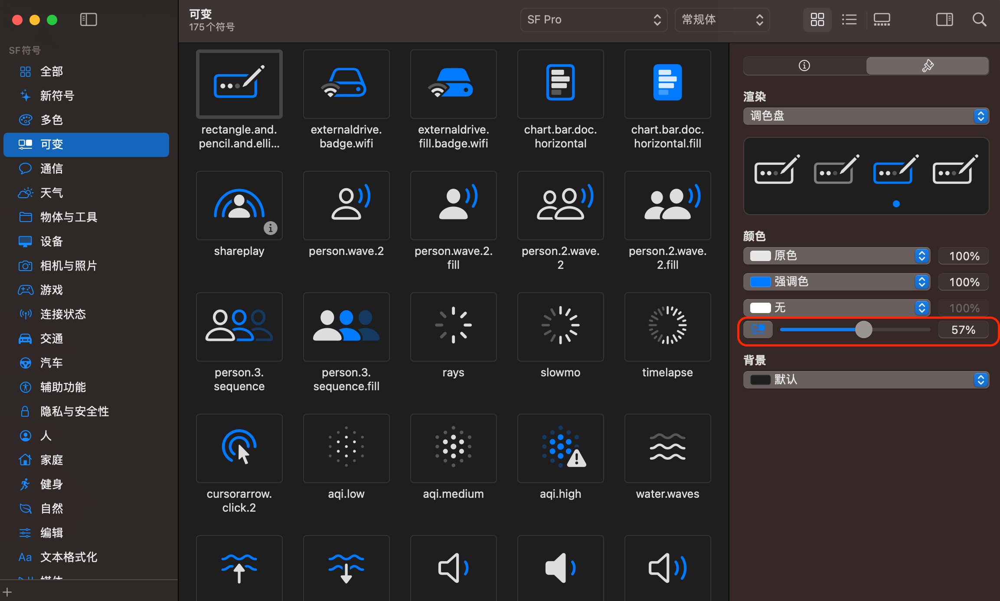

<br>


#  Image

[Image](https://developer.apple.com/documentation/swiftui/image) 用于展示图片，它可以加载资源包（Bundle）中的图片和系统内置的图标。

## 资源图片

资源图片直接使用 Image 展示时，会保持自身原有的尺寸。如果图片过大，会超出屏幕显示区域。使用 [resizable(capInsets:resizingMode:)](https://developer.apple.com/documentation/swiftui/image/resizable(capinsets:resizingmode:)) 可以将图片缩放至合适的大小，其中的 `resizingMode` 参数有如下两个枚举值：

- stretch：拉伸。如果图片尺寸不够，会拉伸填充。
- tile：平铺。如果图片尺寸不够，会平铺填充。试试在示例中将 resizingMode 置为 `.tile`，打开小图开关，则显示平铺效果。

此外，Xcode 15 新增了一个非常实用的功能：**Image 可以直接引用资源图片！**

以前只能传入和图片名相同的字符串，比如本地有一张名为 “parrot” 的图片，代码需要这样写：

```swift
Image("parrot")
```

而借助 [init(_ resource: ImageResource)](https://developer.apple.com/documentation/swiftui/image/init(_:)) 方法，编译器会自动提示，我们可以非常方便地引用资源图片：

```swift
Image(.parrot)
```

不仅是图片，Color 也支持直接引用 Color Set。

<span style="background: #007BFF; color: white; padding: 3px 10px; border-radius: 5px">> 查看示例</span>

## SF Symbols

SF Symbols 是一套系统内置的图标库，包含多达 5000 多个样式丰富、风格统一的图标。要在如此繁多的图标中找到想要的并非易事，虽然 Xcode 可以通过快捷键 ⌘ + ⇧ + L 快速唤出图标库，但更推荐下载 [SF Symbols](https://developer.apple.com/sf-symbols/) 后打开程序，通过分类和搜索去提高查找效率。

要调整图标尺寸，有如下三种方式：

- 使用 [imageScale(_:)](https://developer.apple.com/documentation/swiftui/view/imagescale(_:)) 指定放大模式。

- 通过 `.font` 设置字体。

- 通过 [scaleEffect(_: anchor:)](https://developer.apple.com/documentation/swiftui/view/scaleeffect(_:anchor:)-7q7as) 进行放大。

  scaleEffect 适用于任何 view，后面的动画部分会经常使用这个方法。

<span style="background: #007BFF; color: white; padding: 3px 10px; border-radius: 5px">> 查看示例</span>

在 《文本》 中介绍过 foregroundStyle 最多可以使用三种样式，SF Symbols 中的部分图标是支持多样式的。而且可以结合 [.symbolRenderingMode(_:)](https://developer.apple.com/documentation/swiftui/view/symbolrenderingmode(_:)) 来渲染更丰富的样式，symbolRenderingMode 有如下几个选项：

- hierarchical：多层渲染，使用不同透明度的前景样式（foregroundStyle）。
- monochrome：单层渲染，使用 foregroundStyle 填充。
- multicolor：多层渲染，使用系统内置的多色样式。
- palette：多层渲染，在不同层上使用 foregroundStyle 中的样式。

此外，SF Symbols 还支持可变状态，比如示例中改变 variableValue 时，图标会渲染成不同的状态。

要在 SF Symbols 应用程序内查看可变效果，选择如下图所示的**可变**分类，调整右侧红框内的滑块。



WWDC 23 演示了 SF Symbols 5 的新特性：动画！为了支持这一特性，甚至推出了一个新的框架：[Symbols](https://developer.apple.com/documentation/symbols)。该框架内置了一些动画，在 SwiftUI 中可以通过以下几个新增的方法来方便地为 SF Symbols 添加和移除动画效果：

- [symbolEffect(_:options:isActive:)](https://developer.apple.com/documentation/swiftui/view/symboleffect(_:options:isactive:))
- [symbolEffect(_:options:value:)](https://developer.apple.com/documentation/swiftui/view/symboleffect(_:options:value:))
- [symbolEffectsRemoved(_:)](https://developer.apple.com/documentation/swiftui/view/symboleffectsremoved(_:))

前两个方法用于添加动画效果，第三个方法用于移除动画效果。

以 `symbolEffect(_:options:value:)` 方法为例：

```swift
if #available(iOS 17, macOS 14, *) {
  VStack {
    images
      .symbolEffect(.variableColor, options: .repeating, value:
    
    images
      .symbolEffect(.pulse, options: .repeat(3).speed(2), value:
    
    images
      .symbolEffect(.bounce.down, value: symbolAnimated)
  }
  Toggle("animated", isOn: $symbolAnimated)
} else {
  Text("iOS 17, macOS 14 才支持动画")
}
```

`effect` 参数用于指定动画的样式，这里只演示了其中的几种，更多内容请查看 [Symbols](https://developer.apple.com/documentation/symbols) 文档，或者在 [SF Symbols](https://developer.apple.com/sf-symbols/) 应用内预览各种动画效果。

`options` 默认为 `.default`，正如示例所示，如果我们将其指定为 `.repeat(3).speed(2)`，那么动画会以 2 倍速重复三次。

`value` 参数用于控制动画的执行。

# AsyncImage

Image 适用于加载体积**较小**的**本地**资源图片，如果要渲染本地**大图**或者加载**远程**图片，那么可以使用能够异步加载的 [AsyncImage](https://developer.apple.com/documentation/swiftui/asyncimage) 。

要加载远程图片只需要一行代码：

```swift
AsyncImage(url: url)
```

<span style="background: #007BFF; color: white; padding: 3px 10px; border-radius: 5px">> 查看示例</span>

不过这样渲染的图片和 Image 一样贪婪，如果它自身尺寸过大，会超出屏幕显示区域。和 Image 稍有不同，我们无法直接对 AsyncImage 使用 `.resizable` 将其调整至合适的尺寸。因为图片是异步加载的，只有加载完之后才能获取图片真实尺寸。所以我们需要在 AsyncImage 的闭包中获取返回的图片，再对其进行调整：

```swift
AsyncImage(url: url) { image in
  image
    // 条件渲染，源码见 Extensions
    .if(resizable) { view in
      view.resizable()
    }
    .aspectRatio(contentMode: .fill)
} placeholder: {
  // 自定义 placeholder
  Color.gray.opacity(0.3)
    .overlay(ProgressView())
}
```

AsyncImage 还支持监听图片下载过程，添加动画效果：

```swift
AsyncImage(
  url: url,
  // 动画
  transaction: .init(animation: .default)
) { phase in
  switch phase {
  // 图片未下载
  case .empty:
    ProgressView()
  // 图片已下载
  case let .success(image):
    image
      .resizable()
      .scaledToFit()
      .cornerRadius(20)
      .transition(
        .move(edge: .top)
        .combined(with: .opacity)
      )
  // 图片下载失败
  case .failure(_):
    Image(systemName: "xmark.circle")
  @unknown default:
    Image(systemName: "xmark.circle")
  }
}
```

`transaction ` 参数是 [Transaction](https://developer.apple.com/documentation/swiftui/transaction?changes=latest_major) 类型，它表示视图发生变化时的上下文，其主要作用是方便管理视图变化时的动画。在它的初始化方法中传入一个 animation，当视图变化时会执行相应的 animation。

如果网速太快导致无法细察异步事件的变化，可参考如下网速控制技巧：

- macOS：安装 [Network Link Conditioner ](https://developer.apple.com/download/all/?q=Hardware%20IO%20Tools)。
- iPhone：在 *设置 > 开发者 > Network Link Conditioner* 中进行设置。

从 iOS 17、macOS 14 开始，Image 和 AsyncImage 支持 HDR 图像的显示，具体查看 [allowedDynamicRange(_:)](https://developer.apple.com/documentation/swiftui/image/alloweddynamicrange(_:))。

# ImageRenderer

ImageRenderer 用于从 SwiftUI 视图生成图片，而且它仅支持 SwiftUI 渲染的视图。

<span style="background: #007BFF; color: white; padding: 3px 10px; border-radius: 5px">> 查看示例</span>

以下是示例中的生辰图片的代码：

```swift
@MainActor private func createSnapshot() {
  let renderer = ImageRenderer(content: content)
  // 设置分辨率，默认为 1.0
  // 这里从环境变量获取当前屏幕分辨率
  renderer.scale = displayScale
  if let uiImage = renderer.uiImage {
    snapshot = .init(uiImage: uiImage)
  }
}
```

ImageRenderer 遵循 ObservableObject 协议，我们只需要在构造方法中传入需要生成图片的视图，然后就可以通过 `renderer.uiImage` 获取相应的图片了。

这里我们使用 @MainActor 来确保生成图片的操作在主线程进行，关于 @MainActor 的使用，请参考 《 @globalActor、@MainActor 的使用》。

获取的图片类型除了 uiImage，还支持 cgImage、nsImage。除此之外，还能生成 PDF，[ImageRenderer](https://developer.apple.com/documentation/swiftui/imagerenderer) 的文档中已经有非常详细的示例代码了。

