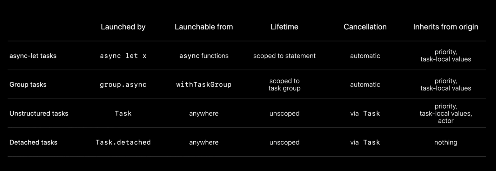

前面的章节中，我们学习了 `async let`、`Task` 以及 `TaskGroup` 的使用。它们都可以帮助我们写出高质量的并发代码，也各有千秋。

借助于 `async let` 这个语法糖，我们能够在不直接接触 `Task` 或 `TaskGroup` 的层面上开启异步任务，获取异步返回结果，因此 `async let` 又叫“并发绑定”，顾名思义，为某个变量绑定了并发任务的异步返回结果。

`async let`  的局限性在于，它必须在异步环境中开启任务。异步任务的中间处理过程就像个黑盒，我们无法控制。但 `Task` 的显式创建，为我们提供了更多的可操作空间。我们可以指定 `Task` 实例的优先级，在 task 定义的范围之外引用该实例，在合适的时机手动取消它。即使在非异步环境中，我们也可以使用 `Task` 开启异步任务。它的灵活性很强，这意味著我们需要在使用它时更加谨慎。

对于并发量不大的多数场景，`async let` 和 `Task` 足以应付，但总有黔驴技穷的时候。比如我们有多个异步并行操作，优先取第一个返回的结果，使用 `TaskGroup` 的 `next()` 就很好实现。又比如 N 个文件需要并行上/下载，这里的 N 是未知数，它可能依赖于前一个网络请求返回的结果。类似这种没有严格的顺序限制的多并发场景，`TaskGroup` 尤其合适。当然了，有时为了保证并发结果的有序，我们还要多做点工作，比如使用占位数组等。

在实际开发中，如何选择，可参考如下顺序：

- 优先选择 `async let`
- `async let` 难以解决，使用 `Task`
- `async let` 和 `Task` 都难以应付，使用 `TaskGroup`

在前面的章节中，大部分内容都属于结构化并发的范畴。如果你对结构化并发的概念仍然感到困惑，可以试着作如下想象：现在有一根从主管道（主线程）分出来的父管道（父任务），父管道又从不同的节点分出子管道（子任务），子管道最终会在不同的时间点流回父管道，父管道在收集到所有子管道的水流后，最终回到了主管道。

结构化并发的世界，比较类似于我们想象出来的管道。子任务的作用域（或者叫生命周期）不会超出父任务，父任务总是会等待所有子任务的结果，无论该结果是具体的值还是抛出的错误。每个任务的入口和出口就像管道一样，都是明确而且唯一的。无论异步任务的内部执行多么地纷繁复杂，我们只要守住该任务（管道）唯一的出口就可以得到我们想要的结果，就不至于手忙脚乱，如此甚好。

你可以结合此前的章节内容，丰富一下上面想象的场景：加入任务的优先级、取消行为之后，整个管道的水流情况将会是怎样的情形？

得益于结构化并发，我们可以使用 `async let` 或 `TaskGroup` 将复杂的并发代码写的像同步代码一样简洁易读。然而，结构化并发的限定作用域，在某些情况下会对我们造成一定的束缚，我们需要更加灵活的非结构化并发来摆脱这个限制。

其实我们已经接触过非结构化并发了，此前介绍的在 `viewDidLoad` 中使用 `Task` 开启异步任务，就是非结构化并发的运用。`viewDidLoad` 在主线程中运行，花括号 `{}` 内就是它的作用域，`Task` 可以在超出这个作用域后继续执行。同理，如果是在 Task 内嵌套 Task，嵌套的 Task 的生命周期是可以超越外层的 Task 的。我们再用管道来做一次想象，非结构化并发的世界，从“父管道”分出去的“子管道”，摆脱了“父管道”的限制，它是放飞自我的，它的水流不会再回到“父管道”，出口也是不确定的。如果有多个“子管道”，我们需要在不同的出口进行看守，这其实又回到了我们以前的“面条式”结构。注意这里的“父”和“子”，我都使用引号进行了标注，是因为它们已经不是“父子”关系了，而是相互独立的任务。

除了使用 [Task.init(priority:operation:)](https://developer.apple.com/documentation/swift/task/3856790-init) 来创建非结构化并发任务，我们还可以使用 [Task.detached(priority:operation:)](https://developer.apple.com/documentation/swift/task/3856786-detached) 来创建分离式任务实现非结构化并发。顾名思义，分离式任务是独立于创建它的上下文环境的，故而无法继承上下文的任何信息。而 `Task.init` 可以继承优先级、TaskLocal 值以及 actor 的上下文环境。[TaskLocal](https://developer.apple.com/documentation/swift/tasklocal) 在实际开发中使用概率很低，这里不做过多介绍，有兴趣的朋友可以自行了解。关于 actor，后面会有专门的章节介绍，此处不展开来讲。

自由是相对的，非结构化并发为我们带来了更多的灵活性，同时也需要我们更加谨慎地管理它的返回结果、取消行为以及生命周期。

下图源自 WWDC，形象地总结了各种并发工具的差异，供参考：

