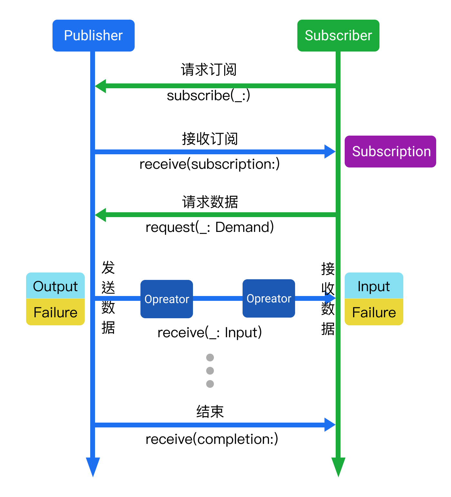

# 订阅行为的详细过程

前面我们介绍过了，**Subscriber** 是一个协议，和 Publisher 遥相呼应，前者接收数据（Input、Failure），后者发送数据（Output、Failure)，数据类型必须保持一致。

在前文的基础上，笔者重新绘制了一张更为详细的说明图，下面的内容将围绕这此图展开。



Subscriber 在请求订阅时，Publisher 会调用 `subscriber(:_)` 方法，绑定订阅者，为后续的数据发送做准备。`subscriber(:)` 的方法签名如下：

```swift
func subscribe<S>(_ subscriber: S) where S : Subscriber, Self.Failure == S.Failure, Self.Output == S.Input
```

我们可以看到，在这一步，就已经对 <Input, Failure> 和 <Output, Failure> 的类型一致做了强制要求。

在成功绑定订阅者后，Publisher 会告知 Subscriber 已成功订阅，并唤起 Subscriber 的方法 `receive(subscription:)`，同时会发送一个 Subscription 实例给 Subscriber。

**Subscription** 是非常重要的一个协议，正是它将 Publisher 和 Subscriber 连接起来，同时它让 Subscriber 拥有了控制数据流大小以及释放资源的能力。

然后，Subscription 调用方法 `request(_: Demand)` 向发布者请求数据，发布者会根据要求发送数据，中间可能会经过一个或多个 Operator 处理，Subscriber 在接收到数据时会调用 `receive(_: Input)` 方法。数据的发送和接收过程可能是同步的，也可能是异步的。在整个过程结束后，Subscriber 会调用 `receive(completion:)` 方法。

# Cancellable、AnyCancellable

上面提到的 **Subscription** 协议，是继承自 **Cancellable** 协议的，该协议提供了一个方法 `cancel()`，让我们可以在合适的时机手动释放相关资源，系统回收资源后，所有和订阅相关的实例以及行为都将不复存在。

对于 **AnyCancellable**，有了前面的基础，读者应该可以见名知意了。它同样用于类型擦除，还能在实例销毁时自动调用 `cancel()` 方法释放资源。因此，在实际开发中，通常我们会在某个对象内用一个集合（Set）去保存 AnyCancellable 实例，当这个对象销毁时，集合里的 AnyCancellable 实例也会随之释放。在后面的内容中，你会见到这样的用法。

# Back Pressure

关于 Back Pressure 这个词，笔者查阅了相关的资料，似乎没有很好的翻译，也许直译成“背压”是比较受认可的。在这里，背压可以理解为 Subscriber 对管道中的数据流的承受压力。

上面我们提到，Publisher 在接收订阅后，会发送一个 Subscription 实例给 Subscriber，Subscription 因为继承自 Cancellable 协议，它拥有了释放资源的能力。而 Subscription 协议本身提供了方法 `request(_: Demand)` 让我们可以向发布者索要数据，而且可以控制发布者发送的数据量。我们可以把数据的接收方 Subscriber 当成甲方，而发布者是乙方，甲方有权要求（Demand）乙方按需供给数据，管道中的数据流大小完全是由 Subscriber 控制的。

为什么 Combine 会提供这样一个机制呢？因为 Publisher 端无法控制数据流的大小，而系统内建的 Subscriber，比如后面会讲到的 sink 和 assign，默认都是要求无限大（unlimited）的数据流。这样会引发一个问题，**Publisher 发送数据的速度大于 Subscriber 处理数据的速度时，就会造成数据的丢失**。所以，Combine 赋予了 Subscription 协议控制数据流大小的能力，让 Subscriber 能够承受合适的数据流压力。

当然，系统提供的内建的 Subscriber，一般情况下也无需承受巨大的数据流压力，足以在日常开发中使用。只是当我们自定义 Subscriber 时，如果遇到频繁发送数据的情况，我们就需要设计合理的背压，防止数据丢失。
