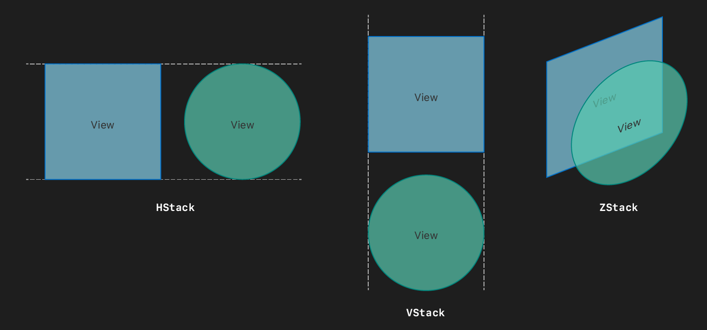

 

# HStack、VStack、ZStack

[HStack](https://developer.apple.com/documentation/swiftui/hstack)、[VStack](https://developer.apple.com/documentation/swiftui/vstack)、[ZStack](https://developer.apple.com/documentation/swiftui/zstack) 分别可以在三个线性轴 x、y、z 方向上组合视图。

HStack 和 VStack 都可以设置子视图的间距（spacing）和对齐方式（alignment），二者在不同平台上都有不同的默认间距，若要消除默认间距则需要将 spacing 参数指定为 0 。

ZStack 只有对齐方式，没有间距的概念。

示例中演示了 HStack 的使用，VStack 和 ZStack 与此类同。

此外，HStack 还能设置 Text 的对齐方式，示例中没有展示出来，详情请参考[文档](https://developer.apple.com/documentation/swiftui/verticalalignment)。

> 查看示例

# LazyHStack、LazyVStack

HStack、VStack、ZStack 适用于将少量的视图组合在一起，SwiftUI 会将其中的子视图全部进行计算和渲染，无论它们是在屏幕内还是屏幕外，如果视图过多，会导致性能损耗。

[LazyHStack](https://developer.apple.com/documentation/swiftui/lazyhstack)、[LazyVStack](https://developer.apple.com/documentation/swiftui/lazyvstack) 则不然，它只会实时计算和渲染可见区域内的视图，避免了无谓的性能损耗。不过，LazyHStack、LazyVStack 通常需要内嵌在 ScrollView 中使用，如果单独使用，是没有性能优化的效果的。

和 HStack、VStack 一样，LazyHStack、LazyVStack 也是分别用于在 x、y 轴上组合视图，也可以指定 spacing 和 alignment，它还新增了一个可选的 pinnedViews 参数，可以给 Section 的 header、footer 添加吸附效果。

