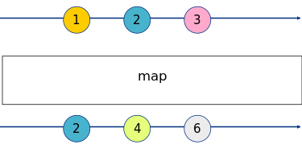
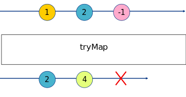
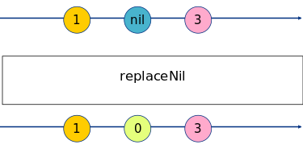
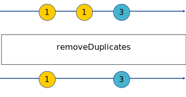
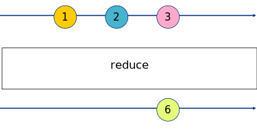

我们可以在数据流的管道中，使用 Operators 对上游的数据进行各种操作，然后再发送给下游的订阅者，这就是 Operators 的作用。

Combine 提供了大量的 Operators 给我们使用，鉴于内容过多，笔者将其分为三个小节。

后续内容用了部分**弹珠图**来加深理解，有兴趣的读者可以进一步了解：[Marble Diagrams](https://rx-marbles-online.herokuapp.com/)。

# Map

## map


```swift
[1, 2, 3].publisher
  .map { v -> Int in v * 2 }
  .sink(receiveValue: { print($0) })

// print
2
4
6
```

map 还能使用 keyPath 进行操作，最多支持三个属性。

```swift
struct Person {
  var name: String
  var age: Int
}

let subject = PassthroughSubject<Person, Never>()

subject
  .map(\.name, \.age)
  .sink { name, age in
    print("Name: \(name), age: \(age)")
  }

let p = Person(name: "Steve Jobs", age: 56)

subject.send(p)

// print
Name: Steve Jobs, age: 56
```

## tryMap

tryMap 功能与 map 类似，不过它多了一个功能：允许抛出错误。

```swift
enum SomeError: Error {
  case someErr
}

[1, 2, -1, 3].publisher
  .tryMap { v -> Int in
    if v < 0 { throw SomeError.someErr }
    return v * 2
  }
  .sink(receiveCompletion: {
    print($0)
  }, receiveValue: {
    print($0)
  })

// print
2
4
failure(__lldb_expr_17.SomeError.someErr)
```



这里的红 X 表示遇到错误而终止。

## scan

```swift
[1, 2, 3].publisher
  .scan(10, { v1, v2 -> Int in
    v1 + v2
  })
  .sink(receiveValue: { print($0) })

// print
11
13
16
```

## tryScan

tryScan 同 tryMap，允许抛出错误。

## flatMap

将上游的 publisher 发送的所有数据转换成一个新的 publisher。

```swift
struct JSONModel: Codable {
  var userId: Int
  var id: Int
  var title: String
  var body: String
}

let subject = PassthroughSubject<Int, Error>()
let cancellable = subject.flatMap { id -> AnyPublisher<JSONModel, Error> in
  let url = URL(string: "https://jsonplaceholder.typicode.com/posts/\(id)")!
  return URLSession.shared.dataTaskPublisher(for: url)
    .map { $0.data }
    .decode(type: JSONModel.self, decoder: JSONDecoder())
    .eraseToAnyPublisher()
}
.sink(receiveCompletion: { print($0) }, receiveValue: { print($0) })

subject.send(1)
subject.send(2)
subject.send(3)
```

上例是一个网络请求的示例，我们分别发送 1、2、3 三个 id，请求相应的 JSON 数据并打印。flatMap 会在闭包内将接收到的数字转换成 URLSession.DataTaskPublisher，然后经过 map、decode、 eraseToAnyPublisher 转换成最终的 AnyPublisher<JSONModel, Error> 类型。当网络请求结束后，控制台会打印三个 JSONModel 的实例。

flatMap 默认可转换的 Publisher 数量是无限大的，我们可以通过 maxPublishers 参数指定其最大的并发数。比如我们将上面的代码加以改造：

```swift
subject.flatMap(maxPublishers: .max(1)) { ... }
```

这样一来，我们只会收到一个网络请求的结果。

## setFailureType

```swift
let pub1 = [1, 2, 3].publisher
let pub2 = CurrentValueSubject<Int, Error>(0)
let cancellable = pub1
  // .setFailureType(to: Error.self)
  .combineLatest(pub2)
  .sink(receiveCompletion: { print($0) }, receiveValue: { print($0) })
```

如上代码的意思是将 pub1 和 pub2 发送的数据通过 combineLatest 操作符将它们的最后一个数据组合成元组，然后发往下游。

但是问题来了，pub1 的 Failure 类型是 Never，pub2 的 Failure 类型是 Error，这回导致类型不匹配，无法编译通过。

我们打开注释处的代码，通过使用 setFailuerType 操作符转换错误类型可以解决上面的问题这里有个前提条件，被转换的 publisher 的 Failure 类型必须为 Never。

## replaceNil

```swift
[1, nil, 3].publisher
  .replaceNil(with: 0)
  .sink(receiveValue: { print($0!) })

// print
1
0
3
```



# Filter

## filter、tryFilter

```swift
[1, 2, 3].publisher
  .filter { $0 > 1 }
  .sink(receiveValue: { print($0) })

// print
2
3
```

tryFilter，略。

## compactMap、tryCompactMap

compactMap 可以过滤掉可选值中的 nil。

```swift
[1, nil, 3].publisher
  .compactMap { $0 }
  .sink(receiveValue: { print($0) })

// print
1
3
```

tryCompactMap，略。

## removeDuplicates、tryRemoveDuplicates

```swift
[1, 1, 3].publisher
  .removeDuplicates()
  .sink(receiveValue: { print($0) })

// print
1
3
```



tryRemoveDuplicates，略。

## replaceEmpty

```swift
[].publisher
  .replaceEmpty(with: 0)
  .sink(receiveValue: { print($0) })

// print
0
```

## replaceError

用指定值替换数据流中的错误。

```swift
let subject = PassthroughSubject<Int, SomeError>()
subject
  .replaceError(with: 0)
  .sink(receiveValue: { print($0) })
subject.send(1)
subject.send(completion: .failure(SomeError.someErr))

// print
1
0
```

# Reduce

## reduce、tryReduce

```swift
[1, 2, 3].publisher
  .reduce(0, { v1, v2 in v1 + v2} )
  .sink(receiveValue: { print($0) })

// print
6
```



tryReduce，略。

## collect、timeGroupingStrategy

collect 不带参数时，会收集所有上游的数据，将其暂存在内存中，直至收到上游的 publisher 发送的 completion 时，它会将所有收集到的数据以数组的形式发送出去。如果上游发送了错误事件，collect 会向下游传递错误。

```swift
[1, 2, 3, 4, 5, 6].publisher
  .collect()
  .sink(receiveValue: { print($0) })

// print
[1, 2, 3, 4, 5, 6]
```

我们还可指定收集数据的数量，比如我们将 collect() 改成 collect(4)，publisher 就会在每收集到 4 个数据触发发送事件。这时控制台会打印：

```swift
// print
[1, 2, 3, 4]
[5, 6]
```

除了直接使用数字给 collect 传参外，我们还可以通过传递 timeGroupingStrategy 参数来指定收集数据的策略。timeGroupingStrategy 是一个枚举类型，包含一下两种策略：

- byTime：每隔一段时间，发送一次收集到的数据
- byTimeOrCount：每隔一段时间，或收集到指定数量的数据时，就发送一次收集到的数据

```swift
let cancellabel = Timer.publish(every: 0.6, on: .main, in: .default)
  .autoconnect()
  .collect(.byTime(RunLoop.main, .seconds(2)))
  .sink(receiveValue: { print($0) })
```

上面的代码会在每 2 秒收集一次数据，因为定时器每 0.6 秒产生一个数据，那么第一个 2 秒过后，会发送一次数据，包含三个时间。

我们将收集策略稍作调整：

```swift
.collect(.byTimeOrCount(RunLoop.main, .seconds(2), 3))
```

这表示每 2 秒或收集到 3 个数据后就发送一次数据，那么订阅者第一次接收到数据的时间就不再是 2 秒，而是 1.8 秒，因为此时定时器已经产生了 3 个数据。

## ignoreOutput

忽略所有上游发送的数据，只向下游传递 completion（finish 或 failed）。
