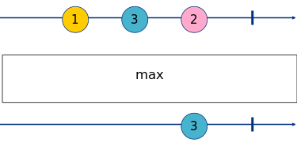
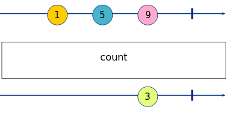
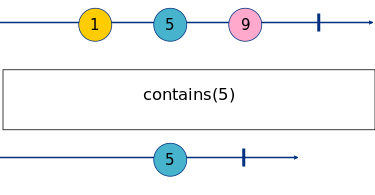
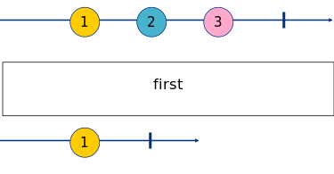
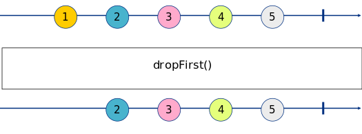
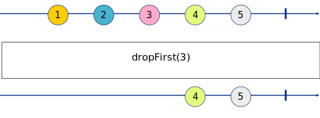
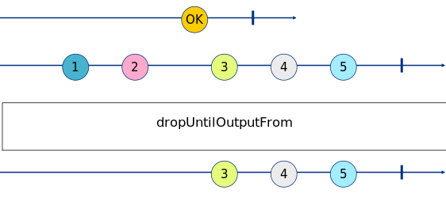
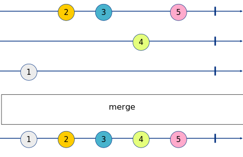
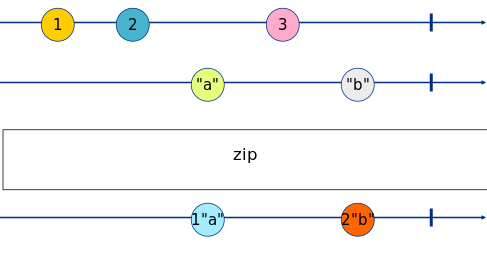

# Mathematic

## max、tryMax



max 使用时有个前提条件：OutPut 需要遵循 Comparable 协议。

弹珠图中的竖线 | 表示结束（finished）的意思，它所要表达的是发布者结束发送 finished 消息之前，订阅者是无法获取到最大值的。

如果发布者向下游发送 failure 消息，订阅者将不会收到任何结果。

如果 Output 没有遵循 Comparable 协议，我们可以手动指定排序规则（必须是升序），比如：

```swift
let p1 = Person(name: "P1", age: 10)
let p2 = Person(name: "P2", age: 20)
let p3 = Person(name: "P3", age: 15)
[p1, p2, p3].publisher
  .max { $0.age < $1.age }
  .sink(receiveValue: { print($0) })

// print
Person(name: "P2", age: 20)
```

tryMax，略。

## min、tryMin

参考 max、tryMax。

## count



订阅者接收到数据的时机和 max 相同。

# Match

## contains、containsWhere、tryContainsWhere



一旦找到匹配的值，contains 就会忽略后面产生的数据，结束数据流的发送。如果管道中的所有数据在完成匹配操作前，上游发送了 finished 消息，则会立即返回 false 并且结束数据的发送。

我们还可以使用 contains(where: ) 来指定匹配条件：

```swift
let p1 = Person(name: "P1", age: 10)
let p2 = Person(name: "P2", age: 20)
let p3 = Person(name: "P3", age: 15)
[p1, p2, p3].publisher
  .contains(where: { $0.age == 10 })
  .sink(receiveValue: { print($0) })

// print
true
```

tryContainsWhere，略。

## allSatisfy、tryAllSatisfy

```swift
[1, 2, 3].publisher
  .allSatisfy( { $0 < 2 })
  .sink(receiveValue: { print($0) })

// print
false

[1, 2, 3].publisher
  .allSatisfy( { $0 < 10 })
  .sink(receiveValue: { print($0) })

// print
true
```

tryAllSatisfy，略。

# Select

## first、firstWhere、tryFirstWhere



firstWhere、tryFirstWhere 同 containsWhere、tryContainsWhere。

## last、lastWhere、tryLastWhere

略。

## dropFirst





## dropUntilOutputFrom

忽略所有上游 publisher1 发送的数据，直到另一个 publisher2 发送数据时，才接收 publisher1 发送的数据。如下图，在 OK 之前，数字 1、2 是会被忽略的，订阅者在接收到 OK 之后，会取消和与之的订阅关系，转而接收另一个 publisher 在这一刻之后发送的所有数字。



```swift
let trigger = PassthroughSubject<Void, Never>()
let publisher = PassthroughSubject<Int, Never>()
let cancellable = publisher
  .drop(untilOutputFrom: trigger)
  .sink(receiveValue: { print($0) })

publisher.send(1)
publisher.send(2)
trigger.send()
publisher.send(3)
publisher.send(4)
publisher.send(5)

// print
3
4
5
```

## dropWhile、tryDropWhile

dropWhile 闭包内返回 false 时，开始发送之后的所有数据。

要注意的是，一旦满足发送条件，后续的数据会全部发往下游，这是有别于 filter 的地方。如下示例，前三个数字都小于 4 ，当 4 出现时，闭包返回 false，后续的 4 和 3 都会发送出去。

```swift
[1, 2, 3, 4, 3].publisher
  .drop(while: { $0 < 4 })
  .sink(receiveValue: { print($0) })

// print
4
3
```

tryDropWhile，略。

## prepend

```swift
// 元素
[3, 4].publisher
  .prepend(1, 2)
  .sink(receiveValue: { print($0) })

// 数组
[3, 4].publisher
  .prepend([1, 2])
  .sink(receiveValue: { print($0) })

// publisher
[3, 4].publisher
  .prepend([1, 2].publisher)
  .sink(receiveValue: { print($0) })

// 以上都会打印
1
2
3
4
```

## append

append 与 prepend 类似，只是添加顺序相反。

## prefix、prefixWhile、tryPrefixWhile、prefixUntilOutputFrom

```swift
[1, 2, 3, 4, 5].publisher
  .prefix(2)
  .sink(receiveValue: { print($0) })

// print
1
2

[1, 2, 3, 4, 5].publisher
  .prefix(while: { $0 < 3 })
  .sink(receiveValue: { print($0) })

// print
1
2
```

tryPrefixWhile，略。

prefixUntilOutputFrom，参见 dropUntilOutputFrom。

## output

发送指定索引或范围内的数据。

```swift
[1, 2, 3, 4, 5].publisher
  .output(at: 2)
  .sink(receiveValue: { print($0) })

// print
3

[1, 2, 3, 4, 5].publisher
  .output(in: (2...3))
  .sink(receiveValue: { print($0) })

// print
3
4
```

# Mix

## combineLatest

融合一个或多个 publisher，将所有 publishers 的最后发送的值组合成元组向下游发送。combineLatest 发送数据的前提时，所有被融合的 publisher 必须发送至少一个数据。


```swift
let publisher1 = PassthroughSubject<Int, Never>()
let publisher2 = PassthroughSubject<String, Never>()
publisher1.combineLatest(publisher2)
  .sink(receiveValue: { print($0) })

publisher1.send(1)
publisher1.send(2)

publisher2.send("a")

publisher1.send(3)
publisher1.send(4)

publisher2.send("b")
publisher2.send("c")

publisher1.send(5)

// print
(2, "a")
(3, "a")
(4, "a")
(4, "b")
(4, "c")
(5, "c")
```

元组是默认的组装形式，我们也可以在闭包内作自定义转换操作，比如：

```swift
let publisher1 = PassthroughSubject<Int, Never>()
let publisher2 = PassthroughSubject<Int, Never>()
publisher1.combineLatest(publisher2, { $0 * $1 })
  .sink(receiveValue: { print($0) })

publisher1.send(2)
publisher1.send(3)

publisher2.send(4)

publisher1.send(5)

// print
12
20
```

## merge

将一个或多个 publisher 发布的数据合并在一起发往下游。



```swift
let publisher1 = PassthroughSubject<Int, Never>()
let publisher2 = PassthroughSubject<Int, Never>()
let publisher3 = PassthroughSubject<Int, Never>()
publisher1.merge(with: publisher2, publisher3)
  .sink(receiveValue: { print($0) })

publisher3.send(1)

publisher1.send(2)
publisher1.send(3)

publisher2.send(4)

publisher1.send(5)

// print
1
2
3
4
5
```

## zip

zip 可以传入一个或多个 publisher 参数，默认输出的元组总是成对的，即需要进行 zip 操作的多个 publisher 之间会相互等待其它的 publisher 发出数据，只有每个 publisher 都发出同样数量的数据后，zip 才会发送组合的元组到下游。



```swift
let publisher1 = PassthroughSubject<Int, Never>()
let publisher2 = PassthroughSubject<String, Never>()
//let publisher3 = PassthroughSubject<Int, Never>()
publisher1.zip(publisher2)
  .sink(receiveValue: { print($0) })

publisher1.send(1)
publisher1.send(2)

publisher2.send("a")

publisher1.send(3)

publisher2.send("b")

// print
(1, "a")
(2, "b")
```

zip 与 combineLatest 一样，支持自定义转换数据的组合方式，这里不再举例。


