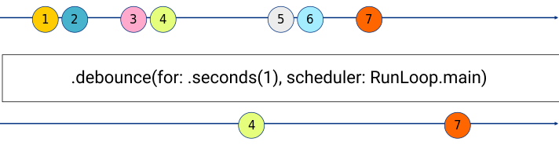
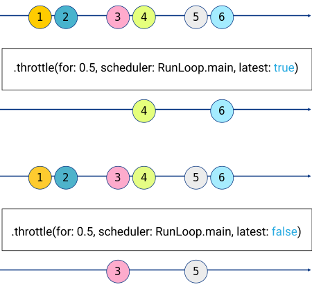

# Republish

## switchToLatest

字面意思就是切换到最近的 publisher，这比较难那理解，我们结合代码来看。

如下是一个三次获取网络图片的示例，中间的时间间隔分别为 3s 和 0.1s。

```swift
let url = URL(string: "https://source.unsplash.com/random")!

// 获取网络图片
func getImage() -> AnyPublisher<UIImage?, Never> {
  return URLSession.shared
    .dataTaskPublisher(for: url)
    .map { data, _ in UIImage(data: data) }
    .print("image")
    .replaceError(with: nil)
    .eraseToAnyPublisher()
}

let subject = PassthroughSubject<Void, URLError>()
let cancellable = subject
  .map { _ in getImage() }
  .switchToLatest()
  .sink(receiveCompletion: { print($0) }, receiveValue: { print($0) })

subject.send()

DispatchQueue.main.asyncAfter(deadline: .now() + 3) {
  subject.send()
}

DispatchQueue.main.asyncAfter(deadline: .now() + 3.1) {
  subject.send()
}

// print
image: receive subscription: (DataTaskPublisher)
image: request unlimited
image: receive value: (Optional(<UIImage:0x600001428750 anonymous {1080, 1512}>))
Optional(<UIImage:0x600001428750 anonymous {1080, 1512}>) // 1

image: receive finished
image: receive subscription: (DataTaskPublisher)
image: request unlimited
image: receive cancel // 2

image: receive subscription: (DataTaskPublisher)
image: request unlimited
image: receive value: (Optional(<UIImage:0x600001420d80 anonymous {1080, 1620}>))
Optional(<UIImage:0x600001420d80 anonymous {1080, 1620}>)
image: receive finished // 3
```

如果我们的网络情况不是特别极端，将会看到如上的打印输出。

前两次网络请求间隔了 3s，这意味着第一次图片请求有足够的时间来完成，因此在标记 1 处我们看到了图片已经获取到了。

后两次请求间隔时间只有 0.1s，在第二次请求尚未返回图片时，第三次请求已开始，这时候，switchToLatest 会发挥它的作用：取消第二次请求的订阅，切换至第三次请求的订阅。我们看到，标记 2 这里有个 cancel 消息，佐证了第二次请求订阅被取消了。

标记 3 处打印了返回的图片结果，还有 finshed 消息，表明整个订阅过程已结束。

需要注意的是，switchToLatest 在切换至最近的 publisher 时，会取消之前的 publisher 的订阅，以节省资源。

# Handling Errors

## catch、tryCatch

当捕获到上游发送的 failure 时，在闭包内将错误转换成另一个 publisher。

```swift
let subject = PassthroughSubject<Int, SomeError>()
subject
  .catch { err in Just(0) }
  .sink(receiveCompletion: { print($0) }, receiveValue: { print($0) })

subject.send(1)
subject.send(completion: .failure(.someErr))
subject.send(3)

// print
1
0
finished
```

tryCatch，略。

## assertNoFailure

一旦上游发送了 .failure 类型的 completion，assertNoFailure 会抛出一个致命的错误，一般用于测试。

## retry

当上游发出 failure 消息时，尝试指定次数的重试。

如下是一个请求随机图片的示例，如果请求失败，它会重试这个请求，如果三次都失败了。则会向下游发送错误，而一旦请求成功，重试操作也会提前终止。

```swift
let url = URL(string: "https://source.unsplash.com/random")!

let cancellabel = URLSession.shared
  .dataTaskPublisher(for: url)
  .retry(3)
  .map { data, _ in UIImage(data: data) }
  .replaceError(with: nil)
  .eraseToAnyPublisher()
  .sink(receiveCompletion: { print($0) }, receiveValue: { print($0) })

// print
Optional(<UIImage:0x60000399ccf0 anonymous {1080, 722}>)
finished
```

## mapError

将上游 publisher 发出的 failure 转换成另一种 Error。

```swift
Just(3)
  .tryMap { v -> Int in
    if v < 10 { throw SomeError.someErr }
    return v
  }
  .mapError { err -> AnotherError in
    return AnotherError.anotherErr
  }
  .sink(receiveCompletion: { print($0) }, receiveValue: { print($0) })

// print
failure(__lldb_expr_77.AnotherError.anotherErr)
```

# Controlling Timing

## debounce

在指定的时间内，如果管道没有接收到新的数据，就将最近的数据发送至下游。比如，我们在一个 TextField 中输入内容需要即时搜索，但是又不希望每次输入内容发生变化时就立即发起网络请求，就可以用到 debounce，指定一个时间，当用户停止输入的某个时间后，再去请求网络，以节省资源。



*注：2、3 间隔 0.5s，4、5 间隔 1.5s，6、7 间隔 0.5s*

## throttle

与 debounce 相似，区别在于，debounce 选择的是指定时间间隔后的前一个值，而 throttle 选择的是后面的值，而且可以指定是否最后一个值。



*注：2、3 和 4、5 间隔均为 0.5s*

## delay

延迟发送所有要发往下游的数据。

## measureInterval

计量并输出上游输出事件之间的间隔时间。

```swift
let cancellable = Timer.publish(every: 1, on: .main, in: .default)
  .autoconnect()
  .measureInterval(using: RunLoop.main)
  .sink(receiveValue: { print($0) })

// print
Stride(magnitude: 1.0006330013275146)
Stride(magnitude: 1.000614047050476)
```

## timeout

如果在指定时间内，上游没有发出所需的数据，那就结束发布事件。比如，我们可以用它来指定网络请求允许的时间。

# Encoding and Decoding 

## encode/decode

使用指定编码器进行编码/解码。

# Working with Multiple Subscribers

## share

Publisher 一般都是结构体类型，每当我们给同一个 publisher 添加一个订阅者时，该 publisher 都会被 copy 一份，并且生成相互独立的 subscription。

这样势必会造成资源的浪费，Combine 为我们提供了 share() 来解决这个问题。调用 .share() 会返回一个引用类型的 Publisher，实现多个 Subscriber 共享一个引用的 Publisher。

```swift
let url = URL(string: "https://source.unsplash.com/random")!

let pub = URLSession.shared
  .dataTaskPublisher(for: url)
  .map { data, _ in UIImage(data: data) }
  // .share()
  .eraseToAnyPublisher()
  
let cancellable1 = pub.sink(receiveCompletion: { print($0) }, receiveValue: { print($0) })
let cancellable2 = pub.sink(receiveCompletion: { print($0) }, receiveValue: { print($0) })

// print
Optional(<UIImage:0x600003b8d050 anonymous {1080, 720}>)
finished
Optional(<UIImage:0x600003b80c60 anonymous {1080, 1624}>)
finished
```

上面的 pub 每次调用 sink 时，都会生成新的 Subscription 实例。因此，控制台会输出两张不同的图片。

如果我们将注释处的 .share() 打开，cancellable1 和 cancellable2 则会共享一份 Subscription 实例，最终控制台的输出如下：

```swift
Optional(<UIImage:0x600003cfccf0 anonymous {1080, 720}>)
Optional(<UIImage:0x600003cfccf0 anonymous {1080, 720}>)
finished
finished
```

## multicast

share 虽然好用，但是有个弊端：我们无法手动控制数据的发送时机。

这会带来一个问题，如果调用 share 生成引用类型的 publisher 有多个订阅者，前面的订阅者可以收到上游发送的数据，在数据发送完成之后后面的订阅者就无法接收到数据了，只能接收到数据发送完成的消息。

```swift
let url = URL(string: "https://source.unsplash.com/random")!
var bags = Set<AnyCancellable>()

let pub = URLSession.shared
  .dataTaskPublisher(for: url)
  .map { data, _ in UIImage(data: data) }
  .share()
  
pub.sink(receiveCompletion: { print($0) }, receiveValue: { print($0) })
  .store(in: &bags)

// 10 秒后
DispatchQueue.main.asyncAfter(deadline: .now() + 10) {
  pub.sink(receiveCompletion: { print($0) }, receiveValue: { print($0) })
    .store(in: &bags)
}

// print
Optional(<UIImage:0x600003600d80 anonymous {1080, 720}>)
finished
finished
```

我们需要一个可以手动控制数据发送时机的操作符，看到这里，是不是可以联想到什么？没错，就是我们此前讲过的 **ConnectablePublisher** 协议。Combine 为我们提供了遵循该协议的 multicast 操作符，它有如下代码中的两种使用方法：

```swift
let url = URL(string: "https://source.unsplash.com/random")!
var bags = Set<AnyCancellable>()

let pub = URLSession.shared
  .dataTaskPublisher(for: url)
  .map { data, _ in UIImage(data: data) }
  // 共享同一个 subject，一对多
  .multicast(subject: PassthroughSubject<UIImage?, URLError>())
  // 分别创建 subject，一对一
  // .multicast { PassthroughSubject<UIImage?, URLError>() }

pub.sink(receiveCompletion: { print($0) }, receiveValue: { print($0) })
  .store(in: &bags)
DispatchQueue.main.asyncAfter(deadline: .now() + 10) {
  pub.sink(receiveCompletion: { print($0) }, receiveValue: { print($0) })
    .store(in: &bags)
  pub.connect().store(in: &bags)
}
```

运行代码，大概 10秒 之后，控制台会输出：

```swift
Optional(<UIImage:0x6000014a0d80 anonymous {1080, 1618}>)
Optional(<UIImage:0x6000014a0d80 anonymous {1080, 1618}>)
finished
finished
```

这正是我们想要的结果。

# Working with Subscribers

## subscribe、receive

在以前的开发中，我们常常会有如下范式的编码：

```swift
DispatchQueue.global().async {
  DispatchQueue.main.async {
    // update UI
  }
}
```

Combine 为我们提供了相应的操作符来避免这样冗长的嵌套写法，那就是 subscribe 和 receive，它们都可以指定处理数据的调度器（[Scheduler](https://developer.apple.com/documentation/combine/scheduler))，通常这里的 Scheduler 指的是：[RunLoop](https://developer.apple.com/documentation/foundation/runloop)、[DispatchQueue](https://developer.apple.com/documentation/dispatch/dispatchqueue)、[OperationQueue](https://developer.apple.com/documentation/foundation/operationqueue)。

 subscribe 和 receive 的区别在于，前者影响的是管道的上游，后者影响的是管道的下游。

我们来看看下面一段伪代码：

```swift
networkDataPublisher
  .subscribe(on: backgroundQueue)
  .receive(on: RunLoop.main)
  .assign(to: \.text, on: yourLabel)
```

上面这段代码的意思是：在 backgroundQueue 线程调用 publisher，在主线程接收数据并更新 youLabel。

# Debugging

Combine 提供了四个操作符来调试程序，Apple 的文档写的很详细，此处不展开来讲。

- [breakpoint](https://developer.apple.com/documentation/combine/publishers/merge/breakpoint(receivesubscription:receiveoutput:receivecompletion:))：在需要触发断点的地方，触发断点调试。
- [breakpointOnError](https://developer.apple.com/documentation/combine/publishers/merge/breakpointonerror())：遇到错误时，触发断点调试。
- [print](https://developer.apple.com/documentation/combine/publishers/merge/print(_:to:))：打印所有发布事件的信息。
- [handleEvents](https://developer.apple.com/documentation/combine/publishers/merge/handleevents(receivesubscription:receiveoutput:receivecompletion:receivecancel:receiverequest:))：比 print 更灵活，可以在不同的发布事件闭包中手动调试。

