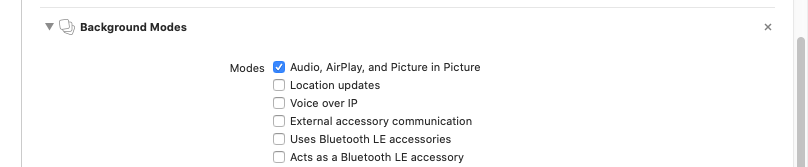

项目内嵌了H5导出的包 但是APP进入后台会导致未加载页面无法响应，故此想到后台保活策略 参考网上教程[https://blog.csdn.net/WangQingLei0307/article/details/112002904](https://blog.csdn.net/WangQingLei0307/article/details/112002904)



首先我们就要在Background Modes把音乐对应权限打开。

这个权限打开后，我们的工作就已经完成了1/3了

接下来我就就要在app进入后台的时候开始播放无声音的mp3。

我这里对音乐播放器进行了简单的封装，方便使用 SXAudioSessionObject

.h
```objectivec
#import <Foundation/Foundation.h>

NS_ASSUME_NONNULL_BEGIN

    @interface SXAudioSessionObject : NSObject

/// 创建单利
+ (SXAudioSessionObject *)shareManager;

/// 创建音乐播放器
- (void)creatAVAudioSessionObject;

/// 开始播放音乐
- (void)startPlayAudioSession;

/// 停止播放音乐
- (void)stopPlayAudioSession;

@end

NS_ASSUME_NONNULL_END
```
 

.m
```objectivec
#import "SXAudioSessionObject.h"
#import <AVFoundation/AVFoundation.h>
#import <AudioToolbox/AudioToolbox.h>

@interface SXAudioSessionObject()
@property (strong, nonatomic) AVAudioPlayer *audioPlayer;
@end

@implementation SXAudioSessionObject

/// 创建单利
+ (SXAudioSessionObject *)shareManager{
    static SXAudioSessionObject *manager = nil;
    static dispatch_once_t onceToken;
    dispatch_once(&onceToken, ^{
    manager = [[SXAudioSessionObject alloc]init];
});
    return manager;
}

/// 创建音乐播放器
- (void)creatAVAudioSessionObject{
    //设置后台模式和锁屏模式下依然能够播放
    [[AVAudioSession sharedInstance] setCategory:AVAudioSessionCategoryPlayback withOptions:AVAudioSessionCategoryOptionMixWithOthers error:nil];
    [[AVAudioSession sharedInstance] setActive: YES error: nil];
    //初始化音频播放器
    NSError *playerError;
    NSURL *urlSound = [[NSURL alloc]initWithString:[[NSBundle mainBundle]pathForResource:@"pomodoSound" ofType:@"m4a"]];
    _audioPlayer = [[AVAudioPlayer alloc] initWithContentsOfURL:urlSound error:&playerError];
    _audioPlayer.numberOfLoops = -1;//无限播放
    _audioPlayer.volume = 0;
}

/// 开始播放声音
- (void)startPlayAudioSession{
    [_audioPlayer play];
}

/// 停止播放声音
- (void)stopPlayAudioSession{
    [_audioPlayer stop];
}

@end
```
 
> 这里的音频需要放在本地 自己录一个1s无声音频就好了

对这个封装完，我们就要使用了。后台保活，我们只需要在进入后台的时候播放音乐即可，进入前台我们停止音乐播放

首先我们先要穿件音乐播放器
```objectivec
[[SXAudioSessionObject shareManager] creatAVAudioSessionObject];
```

接下来就是播放和停止 

 
//应用程序已经进入后台运行
```objectivec
- (void)applicationDidEnterBackground:(UIApplication *)application
{
    NSLog(@"如果应用程序支持后台运行，则应用程序已经进入后台运行"); //如果需要退出后台,则在这里加上:exit(0);
    [[SXAudioSessionObject shareManager] startPlayAudioSession];    //创建一个背景任务去和系统请求后台运行的时间
}
//应用程序已经进入活动状态
- (void)applicationDidBecomeActive:(UIApplication *)application{
    NSLog(@"应用程序已进入前台，处于活动状态");
    [[SXAudioSessionObject shareManager] stopPlayAudioSession];
}
```

同时我们还要创建一下UIBackgroundTaskIdentifier和NSTimer
```objectivec
@property (nonatomic, assign) UIBackgroundTaskIdentifier backgrounTask;
- (BOOL)application:(UIApplication *)application didFinishLaunchingWithOptions:(NSDictionary *)launchOptions
{
    self.timer = [NSTimer scheduledTimerWithTimeInterval:5.0 target:self selector:@selector(applyToSystemForMoreTime) userInfo:nil repeats:YES];
    [self.timer setFireDate:[NSDate distantPast]];
    return YES;
}
 
 
#pragma mark - 定时器设置判断后台保活时间，如果将要被后台杀死，重新唤醒
- (void)applyToSystemForMoreTime {
    if ([UIApplication sharedApplication].backgroundTimeRemaining < 30.0) {//如果剩余时间小于30秒
        [[UIApplication sharedApplication] endBackgroundTask:self.self.backgrounTask];
        self.backgrounTask = [[UIApplication sharedApplication] beginBackgroundTaskWithExpirationHandler:^{
            [[UIApplication sharedApplication] endBackgroundTask:self.self.backgrounTask];
            self.backgrounTask = UIBackgroundTaskInvalid;
        }];
    }
}
```


上面的代码最好写成，如果进入后台的时候再启用定时器，在前台定时器处于停止状态即可。


