## 前言

我们之前通过一篇文章在讨论“`移动客户端架构设计`的时候，仅是通过[一篇文章](https://juejin.cn/post/7118599362036367391)进行了综述。

后来，我就换工作，来到了Nike。近半年一直很忙,最近接到一个工单，要求升级SDK。借此契机,简单回顾一下iOS开发包二进制化,并进一步认识一下我们比较陌生的 `XCFramework`

## 一、综述

> > ## **项目中库的划分:**

> - 我们在实际开发中,若是项目比较庞大,我们可以将 库 划分为:
> - 

>    - **`私有库:`** (若是我们的公司移动开发建设比较成熟,也可以理解为我们内部移动开发套件的私有库)

> - 

>    - **`二方库`:** 因项目建设需要而采购的，由 服务 供应商 提供的SDK库。如:埋点服务SDK、阿里的反爬虫服务SDK、OCR扫描服务等。(通常需要付费 或 有限 免费体验 SDK功能)

> - 

>    - **`三方库`:** 免费使用的外部库(通常来源于Github等开源平台)


> > ## iOS开发中的库的二进制化处理(功能模块闭源处理)

> - 根据是否将库的功能服务实现代码开源,我们又可以将库 划分为 “`开源库`”、“`闭源库`”
> - 

>    - **`二进制化`:** 把功能服务模块的源码 打包成 【**闭源库**】的开发，也就是 `iOS开发包二进制化` 处理！！！！（二进制化处理也可以称为SDK开发）

> - 

>    - 在iOS二进制化开发中,可以将模块打包成`静态库`/`动态库`的形式

> - 

>    - 这些 `静态库`、`动态库`，可以统称为 `二进制库`；

> - 

>    - 二进制化库开发完毕后，我们可以把库`集成`在一个项目里面进行使用；


### 1. 二进制化库的几种分类

在iOS开发中的二进制化库可以简单划分为,**静态库**、**动态库**(.framework)`（注:不是所有的.framework就一定是动态库）`

- **静态库:** 以`.a` 或者 `.framework` 作为文件的扩展名。链接时完整地拷贝至可执行文件中，被多次使用就有多份冗余拷贝
- **动态库:** 以`.dylib` 或者 `.framework` 作为文件的扩展名。链接时不复制，程序运行时由系统动态加载到内存，供程序调用，系统只加载一次，多个程序共用，节省内存。`注意`：

   - 动态库只能苹果使用，如果项目中使用了动态库不允许上架(如：jspatch)
   - 我们在开发过程中,即使有用到系统动态库的需求,也要常常检查对动态库的引入需要,因为这会影响App的启动速度。(若是不太了解这一块的朋友,可以通过我的这篇文章简单了解一下:[App启动装载的过程](https://juejin.cn/post/7096480684847415303#heading-8))
- `.a`与`.framework`的区别？
- 

   - .a是一个纯二进制文件，.framework中除了有二进制文件之外还有资源文件；
- 

   - .a文件不能直接使用，至少要有.h文件配合，.framework文件可以直接使用。
- 

   - .a + .h + sourceFile = .framework
- 

   - 建议用.framework

### 2. 简单了解CPU架构

我们在开发好功能服务模块，准备导出二进制化包的时候，我们要根据 自身投放应用市场的需要硬件适配需要，对库进行的CPU架构的支持。从而在满足自身需要的同时，避免导出二进制化包的体积过大。

#### 2.1 什么是CPU架构？

> CPU架构是CPU厂商给属于同一系列的CPU产品定的一个规范，主要目的是为了区分不同类型CPU的重要标示。


目前市面上的CPU分类主要分有两大阵营，一类是复杂指令集(CISC)CPU，另一类是精简指令集(RISC)CPU。我们今天要讨论的ARM指令集就属于精简指令集(RISC)CPU。

#### 2.2 ARM处理器

> ARM处理器是英国Acorn有限公司设计的低功耗成本的第一款RISC微处理器。全称为Advanced RISC Machine。


我们之前有一篇文章是关于[探究iOS底层原理|ARM64汇编](https://juejin.cn/post/7115302848270696485/)的。其中简单介绍了，不同的型号真机硬件设备的CPU硬件架构:

| 架构 | 设备 |
| --- | --- |
| **armv6** | iPhone, iPhone2, iPhone3G, 第一代、第二代 iPod Touch |
| **armv7** | iPhone3GS, iPhone4, iPhone4S,iPad, iPad2, iPad3(The New iPad), iPad mini, iPod Touch 3G, iPod Touch4 |
| **armv7s** | iPhone5, iPhone5C, iPad4(iPad with Retina Display) |
| **arm64** | iPhone5S 以后 iPhoneX , iPad Air, iPad mini2以后 |


ARM处理器因其低功耗和尺寸小而闻名，iPhone的处理器全部都基于ARM。

我们经常见到的armv7 | armv7s | arm64都是ARM处理器的指令集。

指令集应用于开发有如下特点:

- 所有指令集原则上向下兼容。
- Xcode的模拟器是运行在电脑上的，所以iPhone模拟器并没有使用ARM指令集(在Intel芯片的老款Mac上的iPhone模拟器)，而是使用的X86(64为处理器)或者i386(32位处理器)。
- 通过Xcode打包时，会为支持的所有的指令集编译出对应的指令集代码的数据包，所以工程支持的指令集越多，生成的二进制包就越大。

#### 2.3 进一步认识 指令集 对应的机型

> **机型-架构** 对照表

| 架构 | 设备 |
| --- | --- |
| **armv6** | iPhone, iPhone2, iPhone3G, 第一代、第二代 iPod Touch |
| **armv7** | iPhone3GS, iPhone4, iPhone4S,iPad, iPad2, iPad3(The New iPad), iPad mini, iPod Touch 3G, iPod Touch4 |
| **armv7s** | iPhone5, iPhone5C, iPad4(iPad with Retina Display) |
| **arm64** | iPhone 5S、iPhone 6、iPhone 6 Plus、iPhone 6S、iPhone 6S Plus、iPhone 7、 iPhone 7 Plus、 iPad (2018)、 iPhone 8 、 iPhone 8 Plus 、 and iPhone X |
| **arm64e** | iPhone XS 、iPhone XS Max 、 iPhoneXR、iPhone 11 、 iPhone 11 Pro、 iPhone 11 Pro Max、iPhone 12 、 iPhone 12 Mini 、 iPhone 12 Pro 、 iPhone 12 Pro Max ... 等 |


> **`模拟器`**


- 

   - 模拟器32位处理器测试需要i386架构
- 

   - 模拟器64位处理器测试需要x86_64架构
- 

   - 模拟器64位处理器测试需要arm64架构(`采用了苹果公司内部自行设计的M1系列芯片的新款Mac,该Mac上跑的模拟器架构也是arm64架构,但不是iPhone真机那种arm64`)

> **`真机`**


- 

   - 真机32位处理器需要armv7,或者armv7s架构
- 

   - 真机64位处理器需要arm64架构

> **`应对当前(2023年)市场常用的设备推荐适配 指令集`**


- 模拟器: 64位处理器`x86_64`架构、`arm64`架构
- 真机:64位处理器`arm64`架构、`armv7s`架构(iPhone5及其以上的设备)

#### 2.4 二进制化库适配架构的设置`Build Setting`

`Build Settings`中搜索`Architecture`，可以看到如下图的设置项：

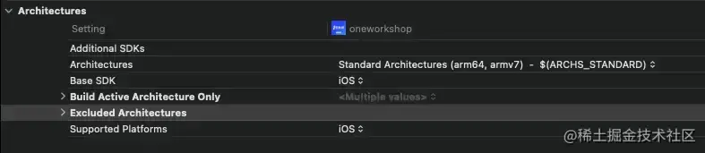

- 
Architectures

指定当前`Target`被编译时支持的指令集的列表，如果指定了多个架构，机会生成多个架构需要的二进制文件。

- 
Build Active Architecture Only

指定是否只编译当前连接设备所支持的指令集。

默认`Debug`时为`YES`，`Release`时为`NO`。设置为`YES`时，编译后只生成当前连接设备所支持的指令集代码，编译速度更快。

- 
Excluded Architectures

指定当前`Target`被编译时拒绝接纳的指令集列表，编译后最终生成的二进制文件支持的指令集是`Architectures`减去`Excluded Architectures`。


## 二、开发二进制化库的实践

我们前面有提及 `静态库`、`动态库`，的区别。我们这里就不再重复介绍。

我们直接进入创建一个.framework静态库的实践(此次我采用的是Xcode14.1,与之前的Xcode版本的创建过程总体上大致相似，略有不同。若是同学们用比较老的Xcode版本，请自行寻找相应教程)

### 1. 首先创建`.frmawork`项目

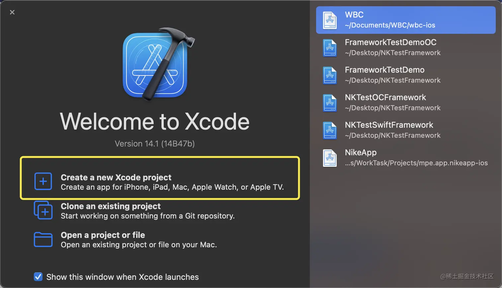

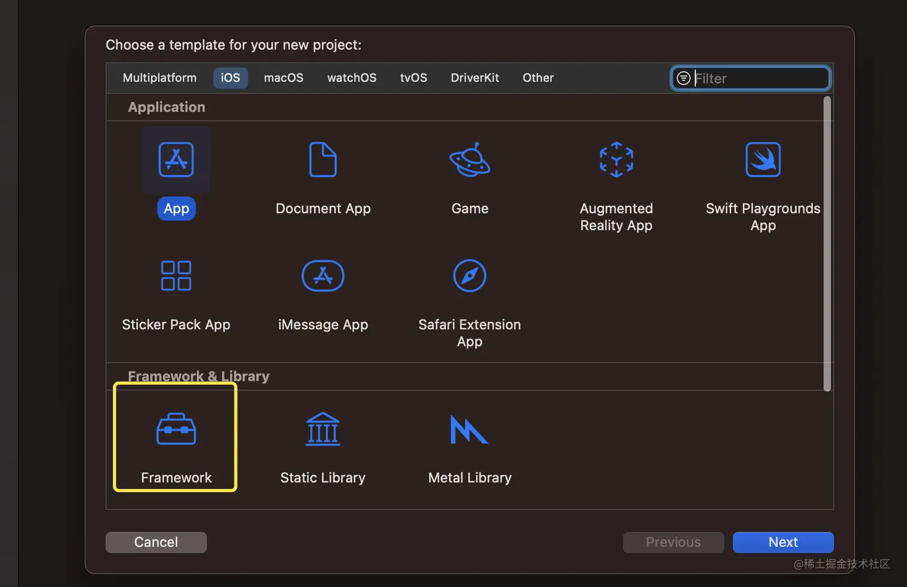

在`framewrok`中可以封装入自己需要封装的内容

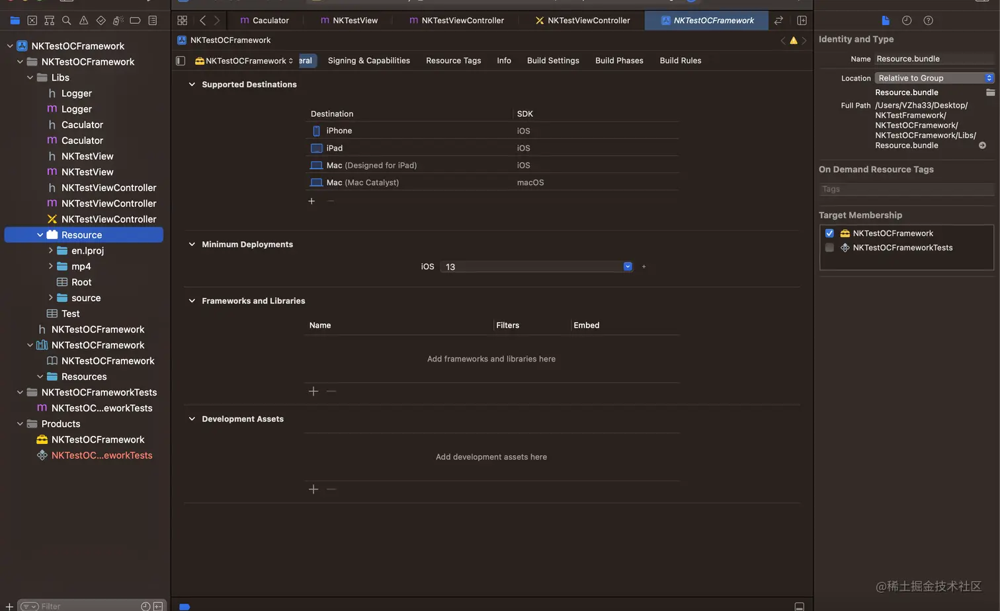

eg: 我在`Logger.h`中加入了一个测试方法

```objectivec


#import "Logger.h"

@implementation Logger

+ (void)logWithString:(NSString *)log{
    NSLog(@"Log:%@",log);
}

+ (NSString *)testString:(NSString *)string {
    return [@"NKTestOCFramework: " stringByAppendingString:string];
}

@end
```

### 2. 接下来进行项目配置：

1、设置Build Setting参数 `将Build Active Architecture only`设置为NO


2、设置Build Setting参数 `Mach-O Type` 为Static Library （配置静态、动态）

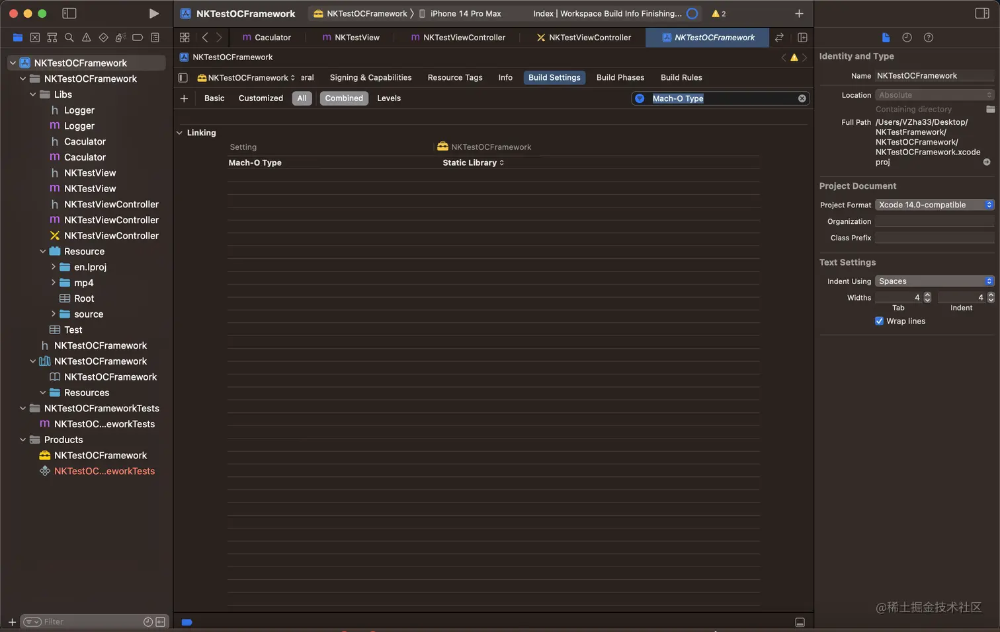

3、设置Build Setting参数 在`Architectures`下增加 需要适配的硬件CPU,如 `armv7s`、`armv7`(我们当下流行的设备基本都是iPhone5s以上了，通常我们直接arm64就够用了)


4、在Build Phases中设置需要公开和需要隐藏的头文件 

5、将头文件引入到`NKTestOCFramework` (自己SDK的头文件) 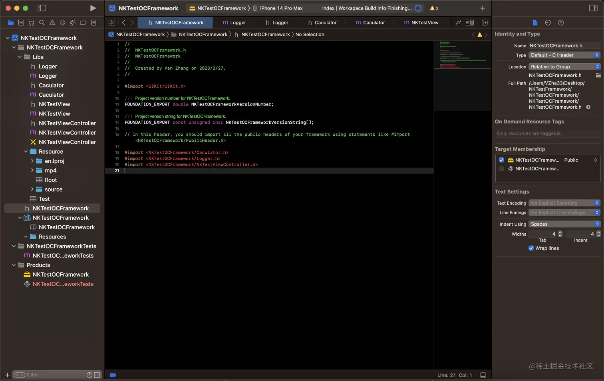

6、`Command + B`运行项目，在`Product`中找到`framework` (在Xcode14创建的工程中，我们找不到`Product`文件夹，需要做如下调整:)

- 1、找到.xcodeproj文件
- 2、右键显示包内容
- 3、找到project.pbxproj并双击打开
- 4、在文件内搜索productRefGroup，旁边还有一个mainGroup，把mainGroup后边的值复制一下替换到productRefGroup后边，然后关闭文件并且保存。


### 3.framework的使用将封装好的`.framework`拉入需要使用的项目中

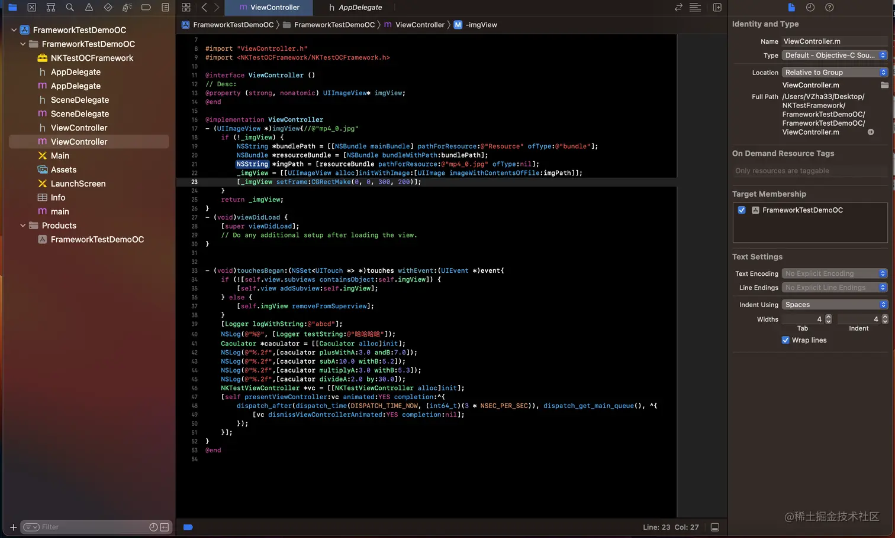

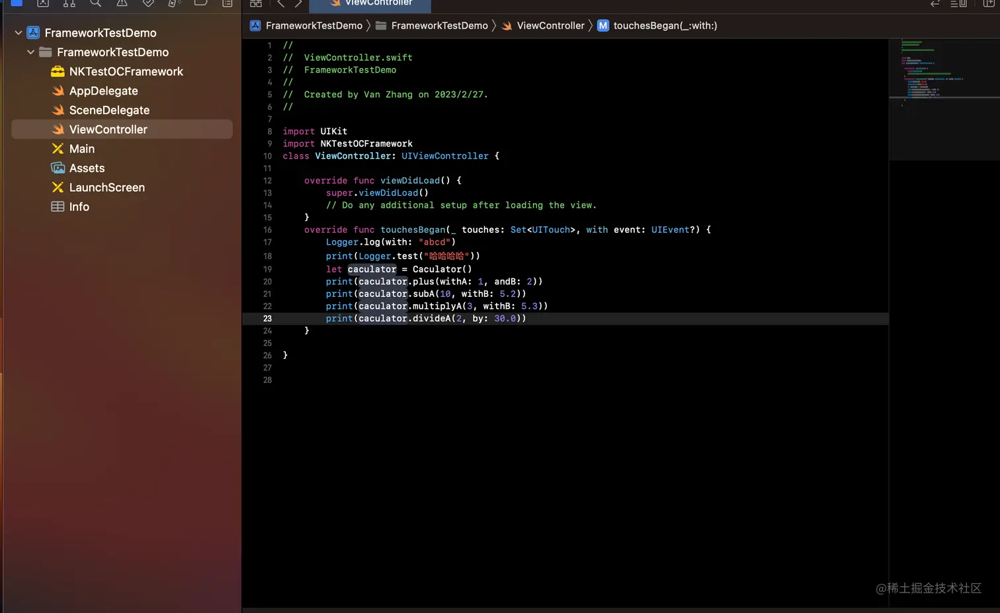

### 4.工程运行

想要对Demo进行运行实践的朋友，可以通过以下链接,下载:

- [github.com/VanZhang-CN…](https://link.juejin.cn/?target=https%3A%2F%2Fgithub.com%2FVanZhang-CN-SZ-SN9037%2FiOS-SDK-Development)

## 三、二进制包的架构检查，包的合并与拆分

### 1、相关概念以及常规处理

- 
二进制包文件都是 Mach-O 文件的一种(可以通过这篇文章简单了解[Mach-O文件](https://juejin.cn/post/7117274106940096520#heading-1))

- 
iOS 的 二进制包 文件 分为 `fat` 二进制文件 和 `thin` 二进制文件

   - 胖二进制文件:包含多套指令集架构的Mach-O文件（比如同时包含`armv7`、`armv7s`、`armv64`、`i386`、`x86_64`其中的两种以上）
   - thin二进制文件: 仅包含一套指令集架构的Mach-O文件
- 
二进制文件处理:

   1. **`lipo -info`:** 检查二进制文件支持的架构
```c

lipo -info + 二进制文件路径
```

   2. **`lipo -remove`:** 移除二进制文件支持的某架构
```c

lipo -remove + 要删除的指令集架构 + 二进制文件路径 + -output + 输出的二进制文件路径
如:
lipo -remove armv7 origin_xxx.a -output op_xxx.a
```

   3. **`lipo -thin`:** 导出二进制文件支持的某架构
```c

lipo -thin + 要导出的指令集架构 + 二进制文件路径 -output + 输出的二进制文件路径
如:
lipo -thin arm64 origin_xxx.a -output op_xxx.a
```

   4. **`lipo -create`:** 创建一个fat二进制文件使其支持的多个架构
```c

lipo -create + 二进制文件路径1 + 二进制文件路径2 -output 输出的二进制文件路径
如:
lipo -create device_xxx.a simulator_xxx.a -output universal_xxx.a
```

### 2. 了解XCFramework

> **快速了解XCFramework:**

官方视频链接:[developer.apple.com/videos/play…](https://link.juejin.cn/?target=https%3A%2F%2Fdeveloper.apple.com%2Fvideos%2Fplay%2Fwwdc2019%2F416%2F) 官方文档链接:[developer.apple.com/documentati…](https://link.juejin.cn/?target=https%3A%2F%2Fdeveloper.apple.com%2Fdocumentation%2Fxcode%2Fcreating-a-multi-platform-binary-framework-bundle)


- XCFramework 是苹果新出的库类型，在 Xcode 11 及 cocoapods 1.9 以上版本被支持
- 与普通动态库/静态库最大的区别是将**多个平台**的二进制库，捆绑到一个可分发的`.xcframework`捆绑包中，支持所有的苹果平台和架构。

   - 
这里的关键词是**多个平台**（iOS, macOS, tvOS, watchOS, iPadOS, carPlayOS）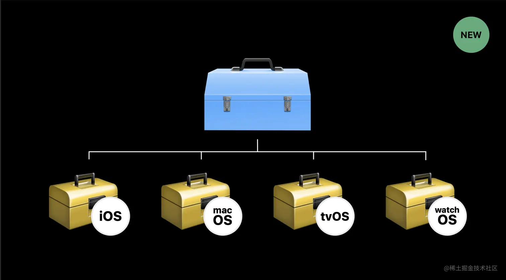

   - 
我们使用的普通动态库/静态库属于`fat file`，仅仅是包含多个架构，如`armv7 armv7s arm64 arm64e x86_64`等

   - 
XCFramework 可以包含 iOS 设备，iOS 模拟器和 Mac Catalyst 等多个平台的二进制库。

   - 
XCFramework库是把不同平台、不同架构的Framework库放在一起(与Framework的开发相同,支持C、OC、C++、Swift)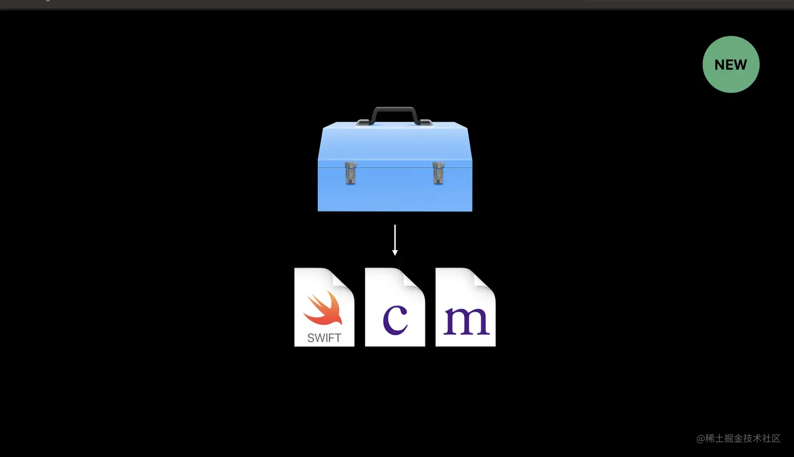

      - 注意: 若是原本的Framework库中有C文件(.hpp、.cpp),要尽可能地转换成Objective-C文件(.h、.mm)。
      - 我们的项目若是存量项目(旧项目),通常开发项目的时候还是会或多或少地引入不同开发语言的库。

         - 比如:Swift语言开发+Swift库+OC库
         - OC语言开发+Swift库+OC库
      - 只要我们用到OC或OC库,内部若是使用了runtime 或 KVC、KVO等。无法避免的,我们需要在项目主工程的Build Setting-> Other Linker Flag 添加一项: `-all_load`
      - 添加 `-all_load` 会导致 包含 了 C++ 的库,在导入 主工程 后 发生冲突
      - 因此要尽可能 把 在 OC库中的C文件(.hpp、.cpp)转换成Objective-C文件(.h、.mm)

### 3. 终端指令制作XCFramework

通过`xcodebuild -create-xcframework`命令即可完成制作 `XCFramework` 示例如下:

```c
.
├── ios_arm64
│   ├── 0CD1FB8D-9D63-3092-B68B-2E579A306D3F.bcsymbolmap
│   ├── NKTestOCFramework.framework
│   └── NKTestOCFramework.framework.dSYM
└── ios_simulator_x86-64_arm64
    ├── NKTestOCFramework.framework
    └── NKTestOCFramework.framework.dSYM
```

通过`xcodebuild -create-xcframework`命令来合并为 XCFramework。

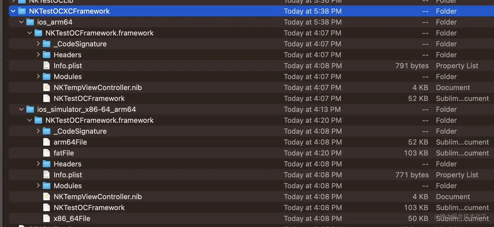

```c
xcodebuild -create-xcframework\
           -framework ios_arm64/NKTestOCFramework.framework\
           -framework ios_simulator_x86-64_arm64/NKTestOCFramework.framework\
           -output NKTestOCFramework.xcframework
```

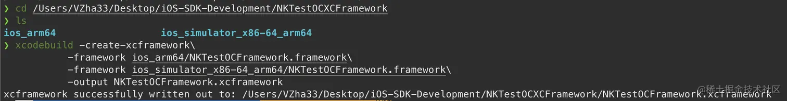

合并后的 NKTestOCFramework.xcframework 目录结构如下，包含 `arm64` 和 `x86_64` 版本，这和 lipo 操作类似，合并其他平台时操作类似。 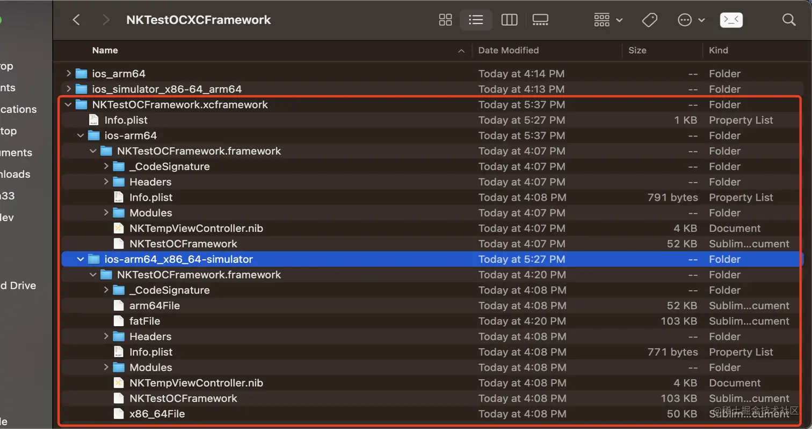

```c
NKTestOCFramework.xcframework
├── Info.plist
├── ios-arm64
│   └── NKTestOCFramework.framework
└── ios-x86_64-simulator
    └── NKTestOCFramework.framework
```

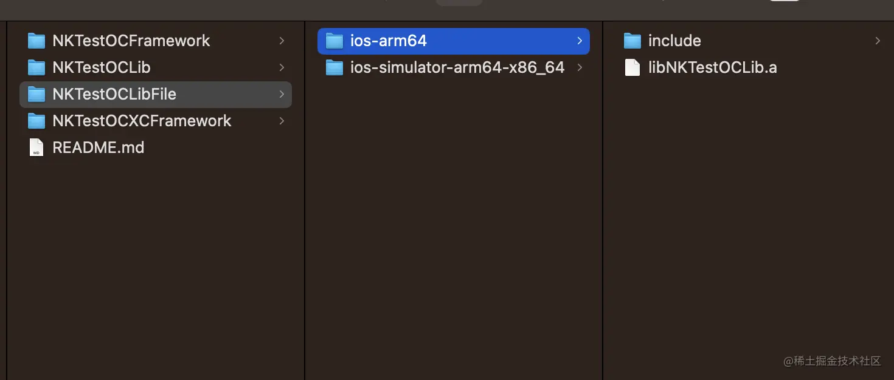

如果是静态库 .a 文件，则需要用`-library`和`-headers`来指定静态库和头文件。

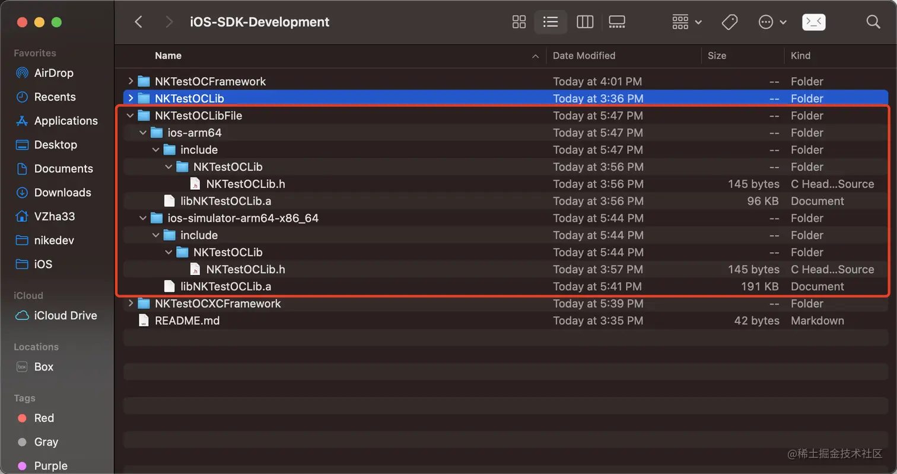

```c
xcodebuild -create-xcframework\
           -library ios-arm64/libNKTestOCLib.a\
           -headers ios-arm64/include/NKTestOCLib\
           -library ios-simulator-arm64-x86_64/libNKTestOCLib.a\
           -headers ios-simulator-arm64-x86_64/include/NKTestOCLib\
           -output NKTestOCLib.xcframework
```

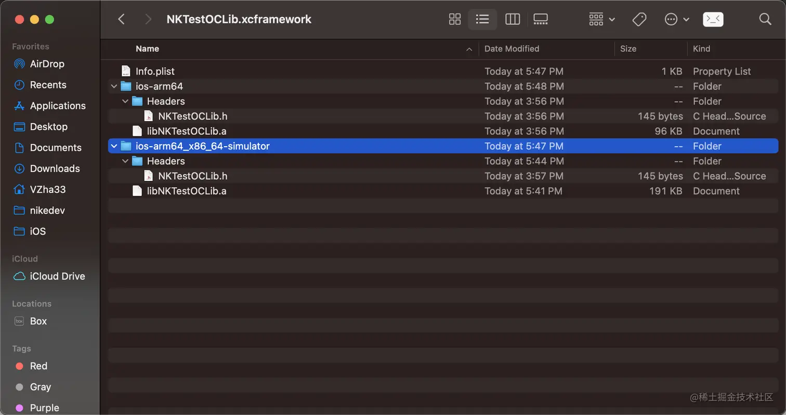

### 4.制作XCFramework的脚本

#### 4.1 创建Framework脚本:`模拟器模式`

```objc
xcodebuild archive -project 'NKTestOCFramework.xcodeproj'\
    -scheme 'NKTestOCFramework'\
    -configuration Release\
    -destination 'generic/platform=iOS Simulator'\
    -archivePath './archives/NKTestOCFramework.framework-iphonesimulator.xcarchive'\
    SKIP_INSTALL=NO
```

- `xcodebuild`: 在Xcode中实际使用的命令
- `archive`: 打包
- `project`: 工程名
- `scheme`: 选择 scheme
- `configuration`: 哪种环境下
- `destination`: 要分发的平台，当前指定的是 iOS Simulator
- `archivePath`: 压缩之后，存放的路径
- `SKIP_INSTALL=NO`:如果设置为YES，则不会将生成的framwork文件存放在Products目录下

#### 4.2 创建Framework脚本:`真机模式`

```objc
xcodebuild archive -project 'NKTestOCFramework.xcodeproj'\
    -scheme 'NKTestOCFramework'\
    -configuration Release\
    -destination 'generic/platform=iOS'\
    -archivePath './archives/NKTestOCFramework.framework-iphoneos.xcarchive'\
    SKIP_INSTALL=NO
```

#### 4.3 创建Framework脚本

> **framework->XCFramework:**


```shell
# 参数
scheme="<your scheme>"
framework_name=${scheme}
archive_path="archives"
archive_iphoneos_path="${archive_path}/iphoneos.xcarchive"
archive_iphone_simulator_path="${archive_path}/iphonesimulator.xcarchive"
out_dir="out"

# 清理
function build_clean() {
    echo "======build_clean======"

    rm -rf ./archives
    rm -rf ./${out_dir}
} 

# 编译
function build_framework {
    echo "======build_framework======"
    
    xcodebuild archive -scheme ${scheme} -sdk iphoneos -archivePath ${archive_iphoneos_path} BUILD_LIBRARY_FOR_DISTRIBUTION=YES SKIP_INSTALL=NO || exit 1

    xcodebuild archive -scheme ${scheme} -sdk iphonesimulator -archivePath ${archive_iphone_simulator_path} BUILD_LIBRARY_FOR_DISTRIBUTION=YES SKIP_INSTALL=NO || exit 1
}

# 合并
function build_xcframework() {
    echo "======build_xcframework======"

    xcodebuild -create-xcframework -framework "${archive_iphoneos_path}/Products/Library/Frameworks/${scheme}.framework" -framework "${archive_iphone_simulator_path}/Products/Library/Frameworks/${scheme}.framework" -output ${out_dir}/${framework_name}.xcframework || exit 1
}

# 压缩
function build_zip {
    echo "======build_zip======"

    cd ${out_dir}
    time=`date +%y%m%d%H%M%S`
    name=${framework_name}_${time}.zip
    zip -r -m -o ${framework_name}.xcframework.zip ${framework_name}.xcframework || exit 1
}

# 调用
build_clean
build_framework
build_xcframework
build_zip
```

**`注意修改参数值`**

- `scheme`="要打包的scheme的具体值"
- `archive_path`="archives文件夹的路径"
- `out_dir`="输出文件夹的路径"

> **.a->XCFramework**


```shell
# 参数
scheme="<your scheme>"
library_name=${scheme}
archive_path="archives"
archive_iphoneos_path="${archive_path}/iphoneos.xcarchive"
archive_iphone_simulator_path="${archive_path}/iphonesimulator.xcarchive"
# 静态库公共头文件目录
library_public_header_path="<your library public header path>" # 如：${scheme}/public_headers
out_dir="out"

# 清理
function build_clean() {
    echo "======build_clean======"

    rm -rf ./archives
    rm -rf ./${out_dir}
} 

# 编译
function build_library {
    echo "======build_library======"
    
    xcodebuild archive -scheme ${scheme} -sdk iphoneos -archivePath ${archive_iphoneos_path} BUILD_LIBRARY_FOR_DISTRIBUTION=YES SKIP_INSTALL=NO || exit 1

    xcodebuild archive -scheme ${scheme} -sdk iphonesimulator -archivePath ${archive_iphone_simulator_path} BUILD_LIBRARY_FOR_DISTRIBUTION=YES SKIP_INSTALL=NO || exit 1
}

# 合并
function build_xcframework() {
    echo "======build_xcframework======"

    xcodebuild -create-xcframework -library "${archive_iphoneos_path}/Products/usr/local/lib/lib${scheme}.a" -headers "${library_public_header_path}/" -library "${archive_iphone_simulator_path}/Products/usr/local/lib/lib${scheme}.a" -headers "${library_public_header_path}" -output ${out_dir}/${library_name}.xcframework || exit 1
}

# 压缩
function build_zip {
    echo "======build_zip======"

    cd ${out_dir}
    time=`date +%y%m%d%H%M%S`
    name=${library_name}_${time}.zip
    zip -r -m -o ${library_name}.xcframework.zip ${library_name}.xcframework || exit 1
}

# 调用
build_clean
build_library
build_xcframework
build_zip
```

## 专题系列文章

### iOS架构设计

- **[1.iOS架构设计|综述](https://juejin.cn/post/7118599362036367391)**
- **[2.iOS架构设计|iOS模块化开发](#)(`待输出`)**
- **[3.iOS架构设计|iOS组件化开发-依赖包管理工具Cocoapods常用实践:组件库(本地库、远程库(公有、私有))创建、模板工程、划分、资源管理、优化等](https://juejin.cn/post/7211072055781261349/)**
- **[4.iOS架构设计|iOS组件化开发【组件管理、组件分类、组件划分、组件开发】](#)(`待输出`)**
- **[5.iOS架构设计|iOS开发包二进制化【.a静态库、.framework(静态库、动态库)、.dyld动态库、.xcfameworks等】](https://juejin.cn/post/7208476031136153655)**

### 探索iOS底层原理

- **[探究iOS底层原理|综述](https://juejin.cn/post/7089043618803122183/)**

