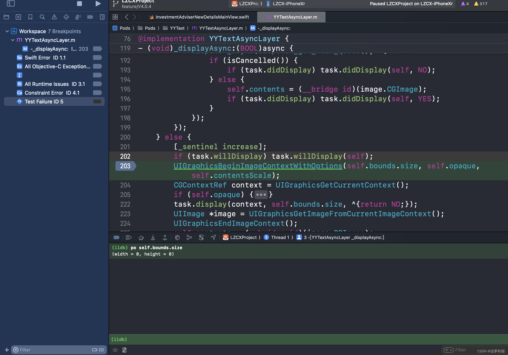
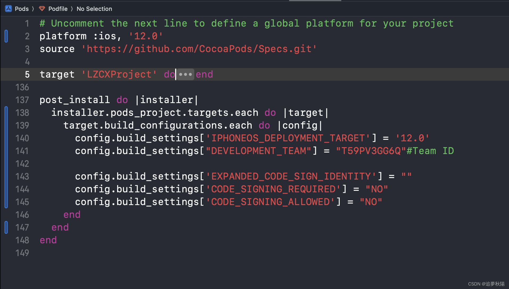

XCode15与iOS17/17.1 真机测试问题处理，网上相关博客很多，摘录了如下实践后能起作用的地址如下：
[Xcode 15 报错处理 - 简书](https://www.jianshu.com/p/ed68ea57d667)
[iOS17版本适配-CSDN博客](https://blog.csdn.net/ZhaiAlan/article/details/131564174)

[Xcode15适配-六虎](https://www.6hu.cc/archives/208992.html)

主要介绍下：Assertion failure in void _UIGraphicsBeginImageContextWithOptions(CGSize, BOOL, CGFloat, BOOL)(), UIGraphics.m:[410](https://so.csdn.net/so/search?q=410&spm=1001.2101.3001.7020) 问题处理，
由于项目较大，使用很多第三方库等，因此此问题不太好排除，后面开启[Xcode调试断点定位](https://blog.csdn.net/weixin_40200876/article/details/102994661)
分分钟定位到具体代码，截图如下：

处理原则，iOS17及以上size 不能为0,加上：

```
if (CGSizeEqualToSize(self.bounds.size, CGSizeZero)) return;
```

2、NWProtocolTCP.Options() crash
此问题参考如下：


