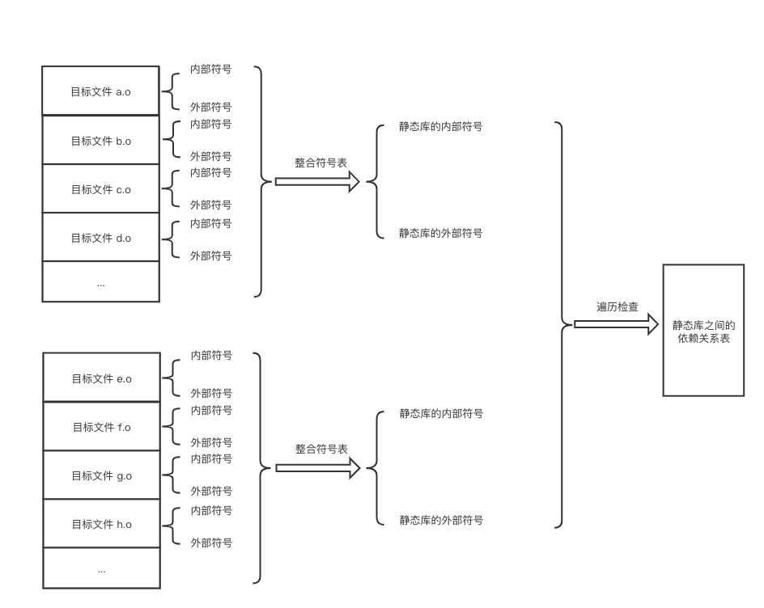

## 导读

业务功能只增不减，图片已无压缩空间，业务代码无法快速下线，一个历经10年，由2000万条指令、6万多个类构成的APP如何才能在业务迭代过程中实现启动优化与下载优化？
## 背景
经过近10年的迭代，iOS客户端已经接入了几十个三方SDK，达到100余个静态库。这些SDK在启动阶段会启动和加载，如某SDK在启动阶段hook大量的系统方法，其中一个类的load方法的耗时就已经达到了数十ms。但是它的业务却处于二级页面，甚至更深的入口，因此很多用户在APP使用过程中都不会触发此业务场景，这就造成了启动任务的浪费。除此之外，iOS客户端一直在致力于降低APP的下载大小。图片压缩、无用代码删除等常规技术手段都经过尝试后，可优化的范围越来越小。通过与苹果的开发者关系部的多次沟通，苹果建议我们使用动态库来实现APP的增量更新。
 在版本迭代中，有些SDK的更新频率较低，也就是说用户更新前后的两个版本的SDK其实并无差异。App Store上提供了增量更新的功能，当APP中的文件前后两个版本不发生变化时，此部分数据不会被重复下载。我们通过测试发现，在iPhone 11 pro max等机型上，我们APP的10.3.1版本全量下载需要88MB流量，但是从10.2.5版本更新到10.3.1版本时只需要74MB的流量。目前我们只检测到App Store具备diff能力，TestFlight包并不具备此能力。基于以上背景，我们开始将APP的部分静态库转为动态库。
## 业界调研
首先我们调研了业界的一部分APP，动态库在一些新APP上使用还是较为广泛的，尤其是引入Swift的APP。但是在一些大型APP上，则相对较为谨慎。除个别大型APP外，极少APP会使用动态库懒加载。
## 方案及过程
在当前APP的架构下，我们是把所有的代码都打包成动态库，还是把一部分业务作出动态库，还是选取耗时且稳定的底层库作为动态库？这涉及到技术成本和收益的问题。由于动态库的吸附性，动态库经过编译链接后会将所依赖的代码和静态库一并打包到动态库中，因此需要避免这种情况，防止代码的重复引入。 （或者通过添加链接参数不将静态库打包到动态库中：other link flags 设置 -undefined dynamic_lookup。）因此现阶段的技术方案为，从架构底层开始，自下而上的进行动态库化。我们决定先将底层的不常变更的SDK优先制作成动态库。目前我们已经将13个SDK做成了动态库，并对其中的10个进行懒加载。
在实际开发过程中，我们遇到了很多的问题。之前提到，很多新的APP都可以使用动态库，为什么老的业务复杂的APP不太容易做到全面动态库化呢？这里涉及到工程配置、项目架构、性能损耗及收益的权衡、动态库的特性等问题。在进行动态库化之前，我们使用的CocoaPods 版本为1.2版本，CocoaPods 1.2版本对动态库的兼容性略差，很多脚本和流程都需要自己引入。好在CocoaPods1.8 对动态库的支持很友好，架构剥离、重签名等流程已经实现了自动化。为了避免多个动态库吸附相同静态库导致包增大，我们目前采用的方式是从架构底层开始，自下而上的进行动态库化。现阶段采用的方式是将静态库放到独立的工程中编译链接成对应的动态库，然后将该动态库接入到项目中。
“自下而上的进行动态库化”看起来很简单，但是实际操作中遇到了很多的问题。

### 1.如何识别SDK之间的依赖关系?
为什么要识别SDK之间的依赖关系？在项目中，三方SDK以及TEG、信安等部门提供的静态库文件数量总数达到了上百个。这些SDK之间存在复杂的依赖关系。这些依赖关系隐含在SDK内部，由于缺乏源码，我们很难直接通过文件来确定。但是如果不确定SDK之间的依赖关系，那么在生成动态库时会将只能目标SDK放入工程中，当缺乏目标SDK所依赖的其他SDK时会报错，然后通过报错提示我们再将所依赖的SDK转成动态库，此种方式效率较为低下。因此我们直接解析静态库的二进制文件，通过对静态库中所有目标文件的内外符号的识别，整理出静态库之间的依赖关系。


首先将静态库中的目标文件的符号表进行整合，梳理出每个目标文件的内部符号表和外部符号表。目标文件中存在一个符号表，符号表用于记录符号的类型和符号对应的地址。以iOS系统中的目标文件的符号表为例,其符号表结构体如下：

```cpp
struct nlist_64 {
union {
uint32_t  n_strx; 
} n_un;
uint8_t n_type;        
uint8_t n_sect;        
uint16_t n_desc;       
uint64_t n_value;      
};


#define N_UNDF  0x0     
#define N_ABS   0x2     
#define N_SECT  0xe     
#define N_PBUD  0xc     
#define N_INDR  0xa
```

在iOS中符号的n_type类型分为：
##### N_UNDF（未定义）;
N_ABS（）;
 N_SECT（有定义）;
N_PBUD（在动态库中定义）;
 N_INDR（间接类型）;
5种类型。首先我们为每个目标文件创建两个集合表：外部符号表和内部符号表。我们将符号表中每个n_type为N_UNDF的符号放入外部符号表中。其他类型的符号放入内部符号表中。
随后我们将静态库的每个目标文件的内部符号表和外部符号表进行整合，形成静态库级别的内部符号表和外部符号表。终根据静态库的内部符号和外部符号确立彼此的依赖关系。在此过程中，我们也发现1个小插曲，我们发现输出的结果存在一定的异常，如公司内部的SDK的依赖了第三方的某个SDK，这显然与事实不符。其原因为外部三方SDK自定义了系统库C函数，导致项目中所有的调用此函数的地方全部走到了这个SDK定义的函数中。
### **2 动态库的依赖配置**
假设有两个静态库A和B，A依赖B。如果A要做成动态库则需要将B打成动态库，然后将A的静态库和B的动态库放入一个动态库的工程项目中，编译链接后将生成A的动态库。假设B不放入动态库工程，则A无法链接成功，也就无法生成动态库。如果将问题进一步复杂化，假设有N个上层SDK，随机依赖了K个底层SDK，那么如何保证这上层SDK所依赖的每个底层SDK版本都是一致的呢？如果一旦更新一个底层SDK，那么是不是要同步修改N个动态库工程呢？这个问题简单的处理方式就是通过CocoaPods来实现管理，创建动态库工程组，当前CocoaPods 1.8 版本非常友好的解决了动态库的问题，在podfile中使用use_frameworks创建N+K个pod，Pod之间的依赖关系交给CocoaPods来管理。
### **3 如何降低业务代码的改动**
为了保持上层业务代码的保持不变，因此我们尽量保持头文件不发生变化。当.a文件转成.framework时，头文件单独剥离，不存放到framework中。如果是.framework静态库转为.framework动态库，则保持framework名称相同。头文件与原来的方式一致。资源方面不要打到动态库的framework中。如果资源加入asserts文件在framework下，那么在编译成动态库原有代码的访问方式无法访问到，可能会造成一些问题。另外，在这里需要提一下，如果静态库转为动态库时如果为同名framework，并且你的工程中将Other Linker Flags设置为-all_load，那么可能会存在报xxx_vers.o符号冲突错误。这是由于在生成framework时，Xcode动态的写入了xxx_vers.m文件并参与了编译和链接。那么在进行二次打包成framework时，编译器会再次写入xxx_vers.m。导致链接冲突。这种情况可以将静态库中每个架构下的xxx_vers.o文件剔除。（如何剔除文件：ar -x 将静态库拆分为目标文件，然后删除指定文件，再通过 libtool -static -o 将目标文件重新合并为静态库。）或者不要使用-all_load，改为-ObjC即可。
### 
4 development target 与bundle id
在创建动态库时需要额外注意一点，动态库工程的development target 版本务必要小于等于iOS工程的版本号。这是由于在某些高版本打包出来的二进制与低版本的二进制不同。如果高版本的动态库运行在低版本的机型上会造成崩溃，这里与代码的API兼容无关，从底层的二进制就不兼容。另外每个动态库的bundle id必须保持，如果一个APP中两个动态库的bundle id 相同，则无法安装成功。用CocoaPods管理则不会出现此类问题。
### **5 懒加载如何配置**

众所周知，苹果不推荐过多的使用自定义动态库，因为非懒加载的动态库会造成额外的启动时间消耗。表 1 接入上述8个静态库demo时的pre main耗时

| System Interface | Static Runtime Initialization |
| --- | --- |
| 154ms

 | 37ms

 |
| 147ms

 | 38ms

 |
| 157ms

 | 34ms

 |


**表 2 接入上述8个静态库demo对应的动态库**

| System Interface | Static Runtime Initialization |
| --- | --- |
| 224ms

 | 40ms

 |
| 224ms

 | 42ms

 |
| 224ms

 | 43ms

 |


业界通常认为的优化方案为进行动态库合并，将多个动态库合并为1个。经过测试后发现，动态库合并在iOS13系统的中高端设备上优化并不明显，但是iOS11上，用5s测试就能看出效果来。

_（推测有两方面原因：_
1、_中高端设备性能太快，测试数据又太小，数据不明显。_
2、_iOS11上使用dyld2加载动态库，ios 13上使用dyld3加载动态库，dyld3优化了启动时间。）_

终我们没有采用动态库合并的方式，这是因为动态库合并违背了我们的架构解耦原则。如果实现动态库合并，那么在多APP代码复用的背景下，业务APP使用了其中的一个SDK，就需要将整个集合引入到APP中，这一点不符合我们的业务背景。

**表 3 接入上述8个demo动态库并懒加载**

|

| System Interface | Static Runtime Initialization |
| --- | --- |
| 150ms

 | 8ms

 |
| 125ms

 | 7ms

 |
| 126ms

 | 7ms

 |


采用懒加载的话，动态库在启动时并不加载，而是在业务使用时再进行加载，从而优化了启动耗时。

那么如何进行懒加载呢？

在升级到CocoaPods1.8后，CocoaPods1.2上可以配置动态库懒加载的入口已经没了，自定义动态库体现在哪里呢？开始怀疑在CocoaPods 自动生成的Pods-xxx-frameworks.sh 脚本中，但是实际上这个脚本并不控制链接，这个脚本负责架构剔除及重签名等。静态库与动态库的链接在xcconfig文件中配置，修改xcconfig每次编译立即生效，如果不生效那么需要检查build setting 中是否还有相关链接配置。

因此可以在pod install 后每次都修改xcconfig文件，让懒加载的动态库只参与签名与拷贝，不参与链接。在这里需要注意的是如果你的动态库没有剥离符号表，那么请在发版前将其从动态库中剥离保存，像我们这样在使用CocoaPods静态库模式来接入动态库的方案，符号表需要自己管理。

### **6 懒加载如何调用**

动态库懒加载由于动态库在代码编译时不参与链接，因此通过原有的方式调用代码会报链接错误，找不到动态库对应的符号。因此调用动态库的地方需要修改为runtime动态调用。目前的懒加载实现方式比较简单，当使用某个类时，动态获取这个类，如果获取不到这个类，则加载相应的动态库。例如：
```swift
 dlopen([path UTF8String], RTLD_LAZY);
```
可能有同学比较关注dlopen可能带来的风险，苹果是不推荐使用dlopen的，但是目前没有遇到相关审核问题。另外可能一部分同学比较关注dlopen的失败率，通过埋点我们监测到，dlopen确实会存在不到万分之一的卡死概率。其实系统库内部也存在一些懒加载，如果感兴趣的话可以通过注册监听来断点查看。
```swift
extern void _dyld_register_func_for_add_image(void (*func)(const struct mach_header* mh, intptr_t vmaddr_slide))    
__OSX_AVAILABLE_STARTING(__MAC_10_1, __IPHONE_2_0);
```
由于懒加载动态库的代码调用为动态调用的方式，因此在接口较多、变更频繁、调用处较多的SDK并不适合做动态库懒加载。而那些代码稳定、接口较为收敛，业务调用收敛的SDK较适合做动态库懒加载。也就是说，如果你能掌握SDK所有的调用处，并且这些SDK即无法推动下线，又不经常使用，那么把它作为动态库懒加载还是比较合适的。在SDK接口收敛的前提下，我们可以将SDK的类映射成对应的协议。如果类的参数递归扩展，那么想办法用ID代替，如果还不能解决收敛问题，那么就不要使用懒加载了，否则可能由1个协议引申出多个协议，工作量大大增加。以科大讯飞SDK为例，终的代码调用如下：
```swift
DylibRedefineClass(IFlySpeechRecognizer) iflySpeechRecognizer = nil;
iflySpeechRecognizer = [DylibObtainClass(IFlySpeechRecognizer) sharedInstance];
```
只需要声明变量和获取类，API和代码调用都不需要变动。runtime虽然灵活，但是也带来1个问题：如果动态库升级了，API存在变动怎么办?
虽然懒加载动态库的前提是不做频繁升级和变更，但是一旦升级则可能引起灾难性的后果，即API发生变更，编译却正常通过。因为我们编译是依赖协议进行的，及时API发生了变更很可能负责升级的同学并没有对协议进行升级。这就容易让后续升级维护的带来风险。因此我们针对这种情况作了自动检测，在启动时通过runtime进行检测。在开发阶段，每个动态懒加载的类都会被自动插入一个自检函数，在启动时会检测该类是否都能响应其对应协议的所有函数。这里有个问题需要注意下，如果协议没有被任何类标记为遵循，那么通过runtime是获取不到的，如果你在开发时发现通过runtime获取不到协议，那么试着将其标记为被遵循。另外，我们在开发中还遇到一个小问题，有些SDK在打成动态库后如果不采用懒加载的方式会报链接失败，这是由于SDK中有些类或符号被标记为隐藏。
__attribute__((visibility("hidden"))) //设置为符号不导出，在export info 中没有相关符号。
遇到这种情况就只能采用懒加载或者是保持静态库的方式了。
### 7 如何量化收益
收益可以分为2部分，一个是APP更新大小的减少，另一个是启动耗时的减少。
• APP更新大小的减少 很遗憾，由于只有App Store包才具备diff下载的能力，通过TF包没法检测，因此这部分数据很难量化。并且，App Store在下载时会对下载数据进行压缩，可能单台设备200MB左右的安装大小，其实下载大小还不到100MB，各个机型下载大小的数据可以在App Store后台看到。
• 启动优化量化 启动优化量化这块还是有现成方案可以借鉴的，但是我们终还是使用instrument来进行统计。之所以使用instrument有以下两点原因：
（1）、我们不需要运行期间收集数据， 开发阶段单台设备采集数据即可。
（2）、rebase 和 bind的优化时间目前通过代码还监控不到。
在这里提一个小问题，大家都知道dyld会先加载可执行程序所依赖的多个动态库，程序在启动时是加载完一个动态库后立即调用这个库中的load方法吗？
之所以提出这个问题是因为开始我们想通过代码拿到动态库从在load方法调用前的耗时。开始选择的技术方案是通过：
```swift
_dyld_register_func_for_add_image
```
注册image的加载时间，当系统加载image时会将事件回调给我们。那么我们在回调开始时打点计时，当连续两个回调打点时，其时间差即可认为是这个动态库的加载耗时。但是在实践时发现，当我们进行注册时，回调函数密集回调，时间间隔极其短，这是因为_dyld_register_func_for_add_image在注册时会将已经加载的镜像一并返回。原因是image在加载后并不是同步立即加载这个库中的所有load方法。如何论证呢？创建一个哨兵动态库，让这个动态库先参与链接。在哨兵动态库的类的load方法中注册_dyld_register_func_for_add_image回调。运行后发现，在执行哨兵库的类的load方法执行时，_dyld_register_func_for_add_image会同步执行多次回调，获取image的名字会发现我们自定义的动态库都已经回调，只是对应的动态库的load方法都还没有执行。因此通过_dyld_register_func_for_add_image无法获取到每个动态库的加载时间。从dyld的源码中也可以看出来dyld是先通知runtime让动态库先初始化，然后再让主应用进行初始化。

```cpp
void initializeMainExecutable()
{
    
    gLinkContext.startedInitializingMainExecutable = true;

    
    ImageLoader::InitializerTimingList initializerTimes[allImagesCount()];
    initializerTimes[].count = ;
    const size_t rootCount = sImageRoots.size();
    if ( rootCount > 1 ) {
        for(size_t i=1; i < rootCount; ++i) {
            sImageRoots[i]->runInitializers(gLinkContext, initializerTimes[]);
        }
    }
    
    
    sMainExecutable->runInitializers(gLinkContext, initializerTimes[]);
    
    
    if ( gLibSystemHelpers != NULL ) 
        (*gLibSystemHelpers->cxa_atexit)(&runAllStaticTerminators, NULL, NULL);

    
    if ( sEnv.DYLD_PRINT_STATISTICS )
        ImageLoader::printStatistics((unsigned int)allImagesCount(), initializerTimes[]);
    if ( sEnv.DYLD_PRINT_STATISTICS_DETAILS )
        ImageLoaderMachO::printStatisticsDetails((unsigned int)allImagesCount(), initializerTimes[]);
}
```

动态库懒加载优化主要在三个方面：

• 将代码从可执行文件中剥离出来，减少了可执行文件rebase 和 bind的时间；

• 懒加载动态库的load、contructor函数、静态变量初始化的时机延后，在dlopen后调用；

• 还有隐藏的一块是被该SDK依赖的系统动态库可能由于我们懒加载相应的SDK后也被间接懒加载。

其实减少系统动态库的依赖数量要比单纯的SDK动态库懒加载要更为有效。如果要做到减少对系统库的依赖，首先我们就要确定哪些SDK或代码依赖了哪些系统库，如果不太复杂那么可以考虑将其处理成动态库进行懒加载。这一步可能还需要跟业务结合做评估。在启动优化方面，这也是个值得努力的方向。

**总结**

目前我们累计通过动态库懒加载所达到的优化在iPhone 6Plus ( iOS 12)设备上为817ms 左右，相当于优化了12%的启动速度。动态库懒加载与其他方案相比，其优势是具有长期优化的空间。缺点为懒加载增加了代码维护成本。另外，在降低更新大小上，不太好量化具体的收益，但是根据苹果的答复应该是有效果的，只是我们还没有找到很好的量化方法。


