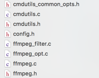

# 11： IOS下利用FFmpeg命令行进行视频裁剪

1. 安装[yasm](http://linux.softpedia.com/get/Programming/Assembler-Tools/Yasm-621.shtml)
• 进入下载后的yasm文件夹，通过编译安装命令yasm:
./configure && make -j 4 && sudo make install

2. [gas-preprocessor](https://github.com/applexiaohao/gas-preprocessor.git)

• 打开终端Terminal，进入下载后的gas-preprocessor文件夹:
1.将文件夹内的gas-preprocessor.pl文件拷贝到/usr/local/bin目录下
2.chmod 777 /usr/local/bin/gas-preprocessor.pl

3. [FFmpeg-iOS-build-script](https://github.com/applexiaohao/FFmpeg-iOS-build-script)
进入FFmpeg-iOS-build-script-master文件夹，执行./build-ffmpeg.sh
• 如果只需要编译真机的静态库
执行./build-ffmpeg.sh arm64
• 最后合并真机和模拟器静态库 （可选）
执行./build-ffmpeg.sh lipo

4. 使用编译完成的FFmpeg静态库
• 编译成功后，即可将FFmpeg-iOS文件夹(包含include和lib)引入到Xcode内
• 加入依赖库libz.lib、libbz2.lib、libiconv.lib
• 导入 AVFoundation.framework、VideoToolbox.framework
• 修改 Build Setting中Header Search Paths = $(SRCROOT)/FFmpeg-iOS/include
• 导入几个所需文件如图（其中有些文件做了些修改，最好从demo中提取）

**点击下载**[demo](https://github.com/fanmaoyu0871/VideoCutterDemo.git)
• 修改liavutil中的time.h为ffmpegtime.h
• 编译所有的版本arm64(5s later)、armv7(5s before)、x86_64(64bit simulator）的静态库

---

> 作者: 宋明  
> URL: https://apolla.cc/posts/live/11-ios%E4%B8%8B%E5%88%A9%E7%94%A8ffmpeg%E5%91%BD%E4%BB%A4%E8%A1%8C%E8%BF%9B%E8%A1%8C%E8%A7%86%E9%A2%91%E8%A3%81%E5%89%AA/  

