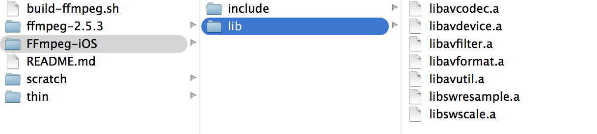
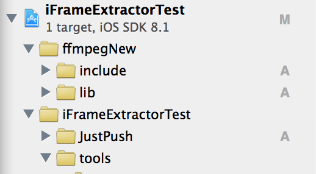
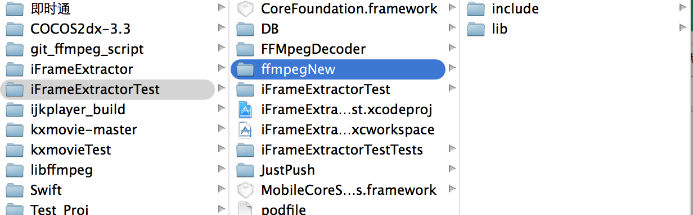
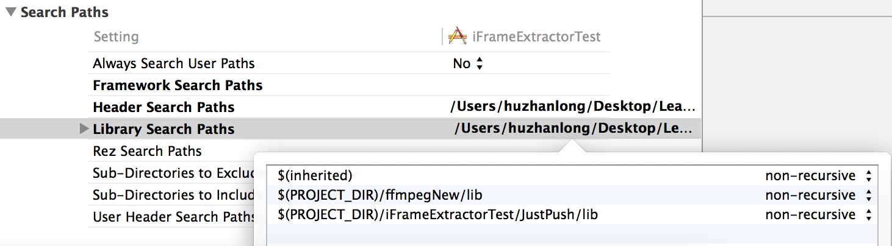
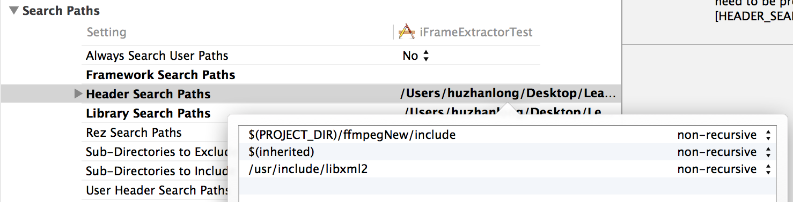
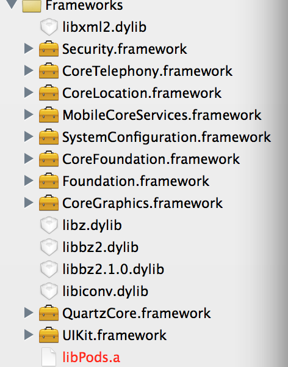
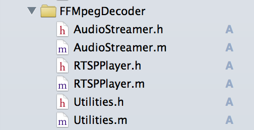

# 9：编译ffmpeg和集成第三方实现直播（监控类）


最近由于项目需要，接触了一下ffmpeg的编译和使用。
由于之前的版本ffmpeg编译的库比较老，对新设备，5s及5s以后的设备支持不太好，重新编译了ffmpeg静态库。

**一，下载并在终端中运行脚本编译ffmpeg**
脚本参考git上的：https://github.com/kewlbear/FFmpeg-iOS-build-script；
终端进入刚刚下载后的脚本文件夹下，运行sh：build－ffmpeg.sh 自动编译，有缺少yasm的按照提示操作，安装yasm
编译的是ffmpeg2.5.3版本，Xcode6下iOS8.1。
按照脚本编译完后的静态库目录如下：


注意:其中的.a文件为静态库文件，include文件夹内的是头文件

**二，将编译好的ffmpeg文件拖人工程，并设置相应的路径**
新建工程，将编译好后包含include和lib文件夹拖进工程


我这里先将FFmpeg－iOS文件夹copy了一分放在工程目录下，并重新命名为ffmpegNew，路径如下图：


到这里要修改工程的Header Search Paths ，要不然会报 
include“libavformat/avformat.h” file not found  错误
根据Library Search Paths 中的lib的路径：


复制路径，添加一份到Header Search Paths 中，再将lib改为include
改好如下：



**三，导入其他库文件**
**其中libz.dylib libbz2.dylib libiconv.dylib 貌似是必须要导入的，其他的按照需求配置**
**个人配置好后的如下供参考：**


**四，将第三方代码导入工程**
**根据工程的定制化需求，这里选择了iFrameExtractor，git代码参考：https://github.com/lajos/iFrameExtractor 或者 RTSPPlayer    **[https://github.com/SutanKasturi/RTSPPlayer](https://github.com/SutanKasturi/RTSPPlayer)
**我这里用的后者的demo里面的代码，直接将（AudioStreamer  RTSPPlayer  Utilities）六个文件拖入工程使用**


**五，实现播放，实现方法可以参考demo中的代码**
**其中的self.playUrl为视频流的地址本工程用的是RTSP 数据流  示例：**

self.playUrl = @"rtsp://xxx.xxx.xxx.xxx/xxx.sdp";

实现播放的代码：
```objectivec
self.videoView = [[RTSPPlayer alloc] initWithVideo:self.playUrl usesTcp:YES];

self.videoView.outputHeight = self.playImage.frame.size.height;

self.videoView.outputWidth  = self.playImage.frame.size.width;

__weak TestViewController *weakself = self;

dispatch_async(dispatch_get_main_queue(), ^{

weakself.playTimer = [NSTimer scheduledTimerWithTimeInterval:1/30.0

target:weakself

selector:@selector(displayNextFrame:)

userInfo:nil

repeats:YES];

});

-(void)displayNextFrame:(NSTimer *)timer {
if (![self.videoView stepFrame]) {
[timer invalidate];
return;
}

if (startframecount < 48) {
startframecount++;
} else {
startframecount++;
[self playVideo];
}
}

-(void)playVideo
{
      NSLog(@"%p,%d",__FUNCTION__,__LINE__);
  主线程更改视图
  视频源尺寸为352*288
__weak TestViewController *weakself = self;
dispatch_async(dispatch_get_main_queue(), ^{
weakself.playImage.image =  weakself.videoView.currentImage;
NSLog(@"%d,%d",self.videoView.sourceWidth,self.videoView.sourceHeight);
});
}
```


---

> 作者: 宋明  
> URL: https://apolla.cc/posts/live/9%E7%BC%96%E8%AF%91ffmpeg%E5%92%8C%E9%9B%86%E6%88%90%E7%AC%AC%E4%B8%89%E6%96%B9%E5%AE%9E%E7%8E%B0%E7%9B%B4%E6%92%AD%E7%9B%91%E6%8E%A7%E7%B1%BB/  

