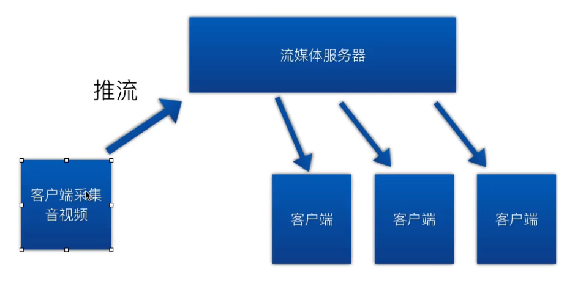
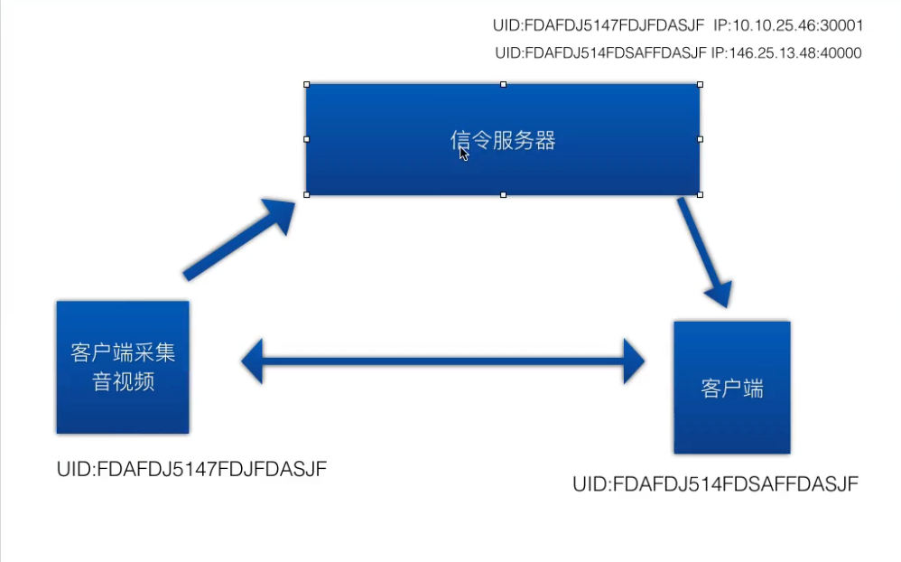

# 传输常见架构

# 流媒体转发

优点
> 支持百万级别以上客户端同时观看，可以存储回放

缺点
> 资源 带宽消耗大

# P2P点对点

优点
> 节省资源 省钱

缺点
> 支持人少

---

> 作者: 宋明  
> URL: https://apolla.cc/posts/media/%E4%BC%A0%E8%BE%93%E5%B8%B8%E8%A7%81%E6%9E%B6%E6%9E%84/  

