# IOS CocoaPods组件平滑二进制化解决方案及详细教程


iOS CocoaPods组件平滑二进制化方案及详细教程
感谢"fly2never_宝贝别哭"。可以使用[cocoapods-packager](https://link.jianshu.com?t=https://github.com/CocoaPods/cocoapods-packager)这个插件来方便生成library（静态库，动态库都可以）。
强烈建议生成framework。
```
IS_SOURCE=1 pod package YTXChart.podspec --library --exclude-deps --spec-sources=http://gitlab.baidao.com/ios/ytx-pod-specs.git,https://github.com/CocoaPods/Specs.git
```
虽然有了这个方便的工具，但是了解一下打包的过程也是好的。
后记，有人问我为什么不改用[Carthage](https://link.jianshu.com?t=https://github.com/Carthage/Carthage)。
可以看看我写的这一篇[Carthage和iOS组件二进制化](https://www.jianshu.com/p/27e9302e56b5)
CocoaPods和Carthage设计目的不一样。
我们的现在组织架构有多个iOS team，多个App。

- 已经使用了CocoaPods，如果要再集成Carthage比较麻烦。我们自己team还好说，还有其他team怎么办。
- 其他team已经用的是CocoaPods。对他们来说只需要升级版本号，要用源码时加上一个IS_SOURCE=1 pod install就可以了。够平滑。
- Carthage我要如何方便的切回源码调试。
- Carthage并不能解决版本更新要编译的问题。除非track那些framework，共享给Team中的其他人。那样的话你的git库就会很大。

说到底Carthage并不能解决实际应用的问提。
### 什么是组件二进制化？
在iOS开发中，事实标准是我们使用CocoaPods生成、管理和使用library。这里的library就是一个模块、组件或库。二进制化指的是通过编译把组件的源码转换成静态库或动态库，以提高该组件在App项目中的编译速度。
我们的方案是转换成静态库，也就是.a格式的文件加上暴露出来的头文件。
### 为什么我们需要二进制化呢？
在我们App开发中，我们逐渐的抽象了很多模块、业务、UI等把他转换成私有CocoaPod库。其中有一个是用C++和Objective-C混写的，源码格式为.mm。在app项目编译时.mm部分代码编译非常慢。这作为一个契机让我们去考虑如何加快编译速度。
这个混写的CocoaPod库叫做YTXChart，之后会以此库为例反复提到。
另外随着业务的扩展，私有CocoaPod库和第三方CocoaPod库越来越多，App项目中的文件也越来越多。每次`pod install`安装新库或`pod update`更新库的时候，重新编译的过程需要等待很长时间。这也向我们提出了加快编译速度的需求。
另外如果想要做组件化的话，一定要做二进制化。
所以我们想到了二进制化的方案来解决这个问题，并且很多大公司也是这么做的。
### 这带来一个新问题？一步就位还是平滑过度。
对我们来说，这是一个尝试，不可能开始就决定把所有的私有CocoaPod库二进制化，也不可能决定把所有第三方CocoaPod库二进制化。当务之急的情况是加快YTXChart库编译速度。所以必须找到一个方案平滑过度。
我们的App中的podflie是这样的
```
target 'jryMobile' do
    pod 'AFNetworking', '~> 2.6.3'
    pod 'Mantle', '~> 1.5.7'
    pod 'DateTools', '~> 1.7.0'
    pod 'ReactiveCocoa', '~> 2.3.1'
    pod 'CocoaAsyncSocket', '~> 7.4.1'
    pod 'FMDB', '~> 2.5'
    pod 'MWPhotoBrowser', '~> 1.4.1'
    pod 'MZFormSheetController', '~> 2.3.6'
    pod 'HMSegmentedControl', '~> 1.5.1'
    pod 'UMengAnalytics', '~> 3.5.8'
    pod 'UMengFeedback', '~> 2.3.4'
    pod 'TSMessagesNW', '~> 0.9.15'
    pod 'TPKeyboardAvoiding', '~> 1.2.9'
    pod 'SDWebImage', '~> 3.7'
    pod 'JHChainableAnimations', '~> 1.3.0' 
    pod 'BarrageRenderer', '~> 1.7.0'
    pod 'MJRefresh', '~> 3.1.7'
    pod 'YTXAnimations', '~> 1.2.4', :subspecs => ["AnimateCSS", "Transformer"]
    pod 'YTXMediaIJKPlayer', '~> 0.2.1'

    pod 'YTXTradeBusinessType', '~> 1.1.0'
    pod 'YTXServerId', '~> 0.1.4'
    pod 'YTXUtilCategory','~> 1.2.0'
    pod 'YTXScreenShotManager', '~> 0.1.7'
    pod 'YTXRequest', '~> 1.0.0'
    pod 'YTXCommonSocket', '~> 0.1.9'
    pod 'YTXChartSocket', '~> 0.5.1'
# 希望是二进制化的
    pod 'YTXChart', '~> 0.17.0'

    pod 'YTXRestfulModel', '~> 1.2.2', :subspecs => ["RACSupport", "YTXRequestRemoteSync", "FMDBSync", "UserDefaultStorageSync"]
    pod 'YTXWebViewJavaScriptBridge', '~> 0.1.2'
    pod 'YTXCheckForAppUpdates', '~> 1.0.0'
    #    pod 'YTXVideoAVPlayer', '~> 0.5.0'
    pod 'YTXChatUI', '~> 0.3.2'
    pod 'PNChart', '~>0.8.9'

    #pod 'EaseMobSDKFull', :git => 'https://github.com/easemob/sdk-ios-cocoapods-integration.git', :tag => '2.2.0'
    # EaseMobSDKFull 更新地址'https://github.com/easemob/sdk-ios-cocoapods-integration.git'
    #pod 'AFgzipRequestSerializer', '~> 0.0.2'

    pod 'AdhocSDK', '~> 2.2.1'

    pod 'FLEX', '~> 2.0', :configurations => ['Debug']

    pod 'React', :path => './ReactComponent/node_modules/react-native', :subspecs => [
    'Core',
    'RCTImage',
    'RCTNetwork',
    'RCTText',
    'RCTWebSocket',
    # 添加其他你想在工程中使用的依赖。
    ]

    pod 'CodePush', :path => './ReactComponent/node_modules/react-native-code-push'
end
```
### 平滑二进制方案需求点

- 其他的CocoaPod库都还是源码。YTXChart为二进制化。
- 以后能够逐步迭代把更多的以YTX开头的CocoaPod库进行二进制化，而不影响主App。
- 能够提供一种方式把二进制化CocoaPod库切换回源码CocoaPod库以便调试。尽量做的方便。
- 解决YTXChart引用依赖的问题。（YTXChart还依赖了第三方AFNetworking和私有YTXServerId。保证生成的静态库中不会含有AFNetworking的内容和YTXServerId的内容并且能够编译通过）
- 利用原来的YTXChart.git，不创建新项目，不创建新的git库。因为我们的二进制化库的生成还是来自于源码，当源码更新时，我们需要一种非常快捷的方式去生成二进制的东西，不希望copy源码到某处，或者增加一个git submodule。
- 希望App源码和YTXChart中的源码尽量少或者没有改动。
- 希望App中的Podfile尽量少或者没有改动。
- 希望Podfile中的版本号保持风格一致，不会出现`'~> 2.2.1.binary'`这种情况。
- 用原来的那一个CocoaPods Repo Spec。
### 以下这个解决方案的教程满足了以上所有需求点
注意，以下的例子基于Cocoapods@1.0.1，而且目前只能是1.0.1
### 第一步：源码生成静态库
如果你是通过命令`pod lipo create`创建的CocoaPod库并且`pod install`的话，它的目录结构应该像这样子（只列出重要的）：
```
YTXChart
  |-Example
    |-YTXChart
    |-Pods
    |-YTXChart.xcodeproj
    |-YTXChart.xcworkspace
    |-Podfile
    \-Podfile.lock
  |-Pod
    |-Assets
    \-Classes
  \-YTXChart.podspec
```
_在xcode中创建新Target YTXChartBinary_`_File->New->Target->Framework & Library->Cocoa Touch Static Library_`
如果你们的项目最低支持到iOS8可以创建Dynamic Framework
注意在Podfile中加入以下这段
```
target 'YTXChartBinary' do

end
```
_然后_`_pod install_`
_解释：Cocoapods@1.0.1会在Header Search Path自动加入内容。如果你用CocoaPods@0.39.0则需要自己加Header Search Path保证依赖库YTXServerId和AFNetwork能够被找到。如图：_
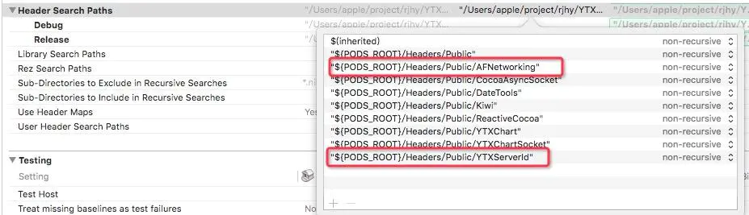
_然后把Pod/Classes中的源码拖入到YTXChartBinary中，这样选择（这样会link源码而不是复制）：_
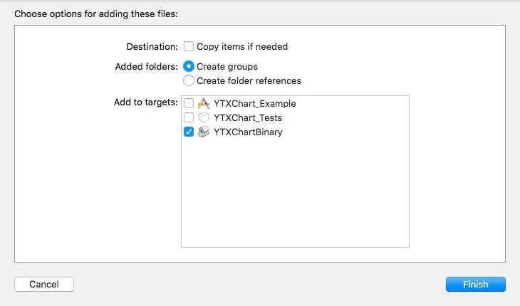
然后变成这样子：
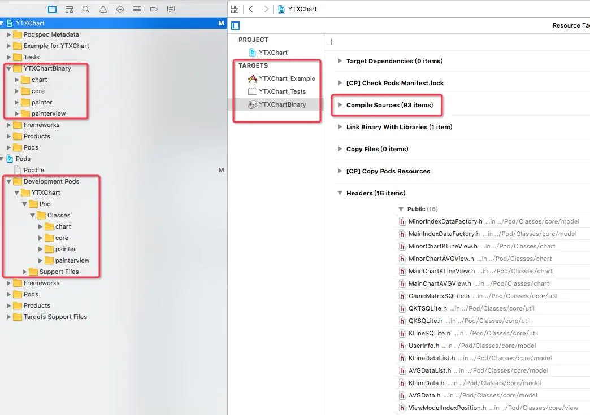
_Headers需要自己加，里面是你需要暴露的头文件_
_在YTXChartBinary Target中的Build Settings下找到iOS Deployment Target选择和YTXChart.podspec中的s.platform保持一致。这里是7.0_`_YTXChartBinary Target->Build Settings->iOS Deployment Target_`
_在根目录创建shell脚本buildbinary.sh_
_你也可以创建一个Aggregate Target用来执行shell脚本_
代码如下：
```
#获得当前目录的名字，一般是YTXChartSocket这种
PROJECT_NAME=${PWD##*/}

# 编译工程
BINARY_NAME="${PROJECT_NAME}Binary"

cd Example

INSTALL_DIR=$PWD/../Pod/Products
rm -fr "${INSTALL_DIR}"
mkdir $INSTALL_DIR
WRK_DIR=build

BUILD_PATH=${WRK_DIR}

DEVICE_INCLUDE_DIR=${BUILD_PATH}/Release-iphoneos/usr/local/include
DEVICE_DIR=${BUILD_PATH}/Release-iphoneos/lib${BINARY_NAME}.a
SIMULATOR_DIR=${BUILD_PATH}/Release-iphonesimulator/lib${BINARY_NAME}.a
RE_OS="Release-iphoneos"
RE_SIMULATOR="Release-iphonesimulator"

xcodebuild -configuration "Release" -workspace "${PROJECT_NAME}.xcworkspace" -scheme "${BINARY_NAME}" -sdk iphoneos clean build CONFIGURATION_BUILD_DIR="${WRK_DIR}/${RE_OS}" LIBRARY_SEARCH_PATHS="./Pods/build/${RE_OS}"
xcodebuild ARCHS=x86_64 ONLY_ACTIVE_ARCH=NO -configuration "Release" -workspace "${PROJECT_NAME}.xcworkspace" -scheme "${BINARY_NAME}" -sdk iphonesimulator clean build CONFIGURATION_BUILD_DIR="${WRK_DIR}/${RE_SIMULATOR}" LIBRARY_SEARCH_PATHS="./Pods/build/${RE_SIMULATOR}"

if [ -d "${INSTALL_DIR}" ]
then
rm -rf "${INSTALL_DIR}"
fi
mkdir -p "${INSTALL_DIR}"

cp -rp "${DEVICE_INCLUDE_DIR}" "${INSTALL_DIR}/"

INSTALL_LIB_DIR=${INSTALL_DIR}/lib
mkdir -p "${INSTALL_LIB_DIR}"

lipo -create "${DEVICE_DIR}" "${SIMULATOR_DIR}" -output "${INSTALL_LIB_DIR}/lib${PROJECT_NAME}.a"
rm -r "${WRK_DIR}"
```
这个脚本写的并不是很好。说说主要做了什么。
_Release不同的静态库，真机和模拟器的。只构建x86_64，不构建i386加快速度_
```
xcodebuild -configuration "Release" -workspace "${PROJECT_NAME}.xcworkspace" -scheme "${BINARY_NAME}" -sdk iphoneos clean build CONFIGURATION_BUILD_DIR="${WRK_DIR}/${RE_OS}" LIBRARY_SEARCH_PATHS="./Pods/build/${RE_OS}"
xcodebuild ARCHS=x86_64 ONLY_ACTIVE_ARCH=NO -configuration "Release" -workspace "${PROJECT_NAME}.xcworkspace" -scheme "${BINARY_NAME}" -sdk iphonesimulator clean build CONFIGURATION_BUILD_DIR="${WRK_DIR}/${RE_SIMULATOR}" LIBRARY_SEARCH_PATHS="./Pods/build/${RE_SIMULATOR}"
```
*通过lipo命令合并。新.a使用project name是因为要和App项目的OTHER_LDFLAGS兼容`-l"YTXChart"`
```
lipo -create "${DEVICE_DIR}" "${SIMULATOR_DIR}" -output "${INSTALL_LIB_DIR}/lib${PROJECT_NAME}.a"
```
结果：
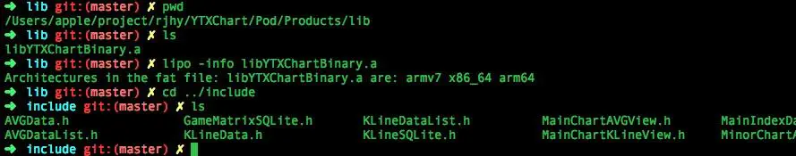
### 为什么要删除i386
实际上，二进制化方案就是以空间换时间。我们这个YTXChart库生成的.a去除i386之后大小有166.3M。上传到git仓库后，git会压缩。增加了33M左右。而作为二进制文件，git是没法做增量的。所以每次上传.a都会大大增加git库大小，增加硬盘使用量。考虑到我们的服务器硬盘只有60个G能用，以后还会二进制化很多组件。
所以得出：尽量压缩二进制文件大小；尽量不上传.a，直到发布某个版本时才上传。
当然，如果你的服务器硬盘是1T的话，我觉得你也可以随便搞。
_现在文件目录是这样子的：_
```
YTXChart
  |-Example
    |-YTXChart
    |-Pods
    |-YTXChart.xcodeproj
    |-YTXChart.xcworkspace
    |-YTXChartBinary //空的
    |-Podfile
    \-Podfile.lock
  |-Pod
    |-Assets
    |-Classes //里面是源码
    \-Products
      |-include
         |-xxx.h
         |-...
         \-xxx.h
      \-lib
         \- libYTXChart.a
  \-YTXChart.podspec
```
### 第二步：测试生成的静态库。
修改YTXChart.podspec如下：
```
Pod::Spec.new do |s|
  s.name             = "YTXChart"
  s.version          = "0.17.7"
  s.summary          = "YTXChart for pod"

# This description is used to generate tags and improve search results.
#   * Think: What does it do? Why did you write it? What is the focus?
#   * Try to keep it short, snappy and to the point.
#   * Write the description between the DESC delimiters below.
#   * Finally, don't worry about the indent, CocoaPods strips it!
  s.description      = "银天下Chart, 依赖AFNetworking"

  s.homepage         = "http://gitlab.baidao.com/ios/YTXChart.git"
  # s.screenshots     = "www.example.com/screenshots_1", "www.example.com/screenshots_2"
  s.license          = 'MIT'
  s.author           = { "caojun-mac" => "78612846@qq.com" }
  s.source           = { :git => "http://gitlab.baidao.com/ios/YTXChart.git", :tag => s.version }
  # s.social_media_url = 'https://twitter.com/<TWITTER_USERNAME>'

  s.platform     = :ios, '7.0'
  s.requires_arc = true

  s.source_files = 'Pod/Products/include/**'
  s.public_header_files = 'Pod/Products/include/*.h'
  s.ios.vendored_libraries = 'Pod/Products/lib/libYTXChart.a'

  s.libraries = 'sqlite3', 'c++'

  s.dependency 'YTXServerId'
  s.dependency 'AFNetworking', '~> 2.0'
end
```
注意s.source_files和s.public_header_files和s.ios.vendored_libraries的路径
_Exampl/Podfile是长这样子的：_
```
source 'http://gitlab.baidao.com/ios/ytx-pod-specs.git'
source 'https://github.com/CocoaPods/Specs.git'

target 'YTXChart_Example' do
  pod "YTXChart", :path => "../"
  pod 'ReactiveCocoa', '~> 2.5'
  pod 'YTXChartSocket'
  pod 'AFNetworking', '~> 2.0'
end

target 'YTXChartBinary' do

end

target 'YTXChart_Tests' do
  pod "YTXChart", :path => "../"
  pod 'Kiwi'
end
```
执行`pod install`后应该是这样子的，然后跑起来没问题
[站外图片上传中...(image-c4e3e-1512559943469)]
执行`pod lib lint --sources='http://gitlab.baidao.com/ios/ytx-pod-specs.git,master'--verbose --use-libraries --fail-fast`也是好的
### 至此我们构建出一个静态库，只包含YTXChart的内容，不包含依赖AFNetwork和YTXServerId的内容
_证明：把_`_s.dependency 'AFNetworking', '~> 2.0'_`_去除再执行_`_pod lib lint 'http://gitlab.baidao.com/ios/ytx-pod-specs.git,master' --verbose --use-libraries --fail-fast_`_会报出找不到AFNetwork相关文件。_
题外话：因为CocoaPods1.0.1不支持C++项目的lint（这是一个[defect](https://link.jianshu.com?t=https://github.com/CocoaPods/CocoaPods/issues/5152)），所以这个时候我会切回CocoaPods@0.39.0来lint和publish。而前面pod instal增加Search Path是依靠CocoaPods@1.0.1。如果你不是.mm混写的，是不会有这个问题的。尽管使用CocoaPods@1.0.1。强行当作没看到这个题外话。
_下一步解决如何在源码和二进制中切换_
_修改YTXChart.podspec为以下内容：_
```
#
# Be sure to run `pod lib lint YTXChart.podspec' to ensure this is a
# valid spec before submitting.
#
# Any lines starting with a # are optional, but their use is encouraged
# To learn more about a Podspec see http://guides.cocoapods.org/syntax/podspec.html
#

Pod::Spec.new do |s|
  s.name             = "YTXChart"
  s.version          = "0.17.7"
  s.summary          = "YTXChart for pod"

# This description is used to generate tags and improve search results.
#   * Think: What does it do? Why did you write it? What is the focus?
#   * Try to keep it short, snappy and to the point.
#   * Write the description between the DESC delimiters below.
#   * Finally, don't worry about the indent, CocoaPods strips it!
  s.description      = "银天下Chart, 依赖AFNetworking"

  s.homepage         = "http://gitlab.baidao.com/ios/YTXChart.git"
  # s.screenshots     = "www.example.com/screenshots_1", "www.example.com/screenshots_2"
  s.license          = 'MIT'
  s.author           = { "caojun-mac" => "78612846@qq.com" }
  s.source           = { :git => "http://gitlab.baidao.com/ios/YTXChart.git", :tag => s.version }
  # s.social_media_url = 'https://twitter.com/<TWITTER_USERNAME>'

  s.platform     = :ios, '7.0'
  s.requires_arc = true

 if ENV['IS_SOURCE']
    puts '-------------------------------------------------------------------'
    puts 'Notice:YTXChart is source now'
    puts '-------------------------------------------------------------------'
      s.source_files  = "Pod/Classes/painter/*.{h,m,mm}", "Pod/Classes/painterview/*.{h,m,mm}", "Pod/Classes/chart/*.{h,m,mm}", "Pod/Classes/core/*.{h,mm}", "Pod/Classes/core/**/*.{h,m,mm,inl}"  
  else
    puts '-------------------------------------------------------------------'
    puts 'Notice:YTXChart is binary now'
    puts '-------------------------------------------------------------------'
    s.source_files = 'Pod/Products/include/**'
    s.public_header_files = 'Pod/Products/include/*.h'
    s.ios.vendored_libraries = 'Pod/Products/lib/libYTXChart.a'
  end

  s.libraries = 'sqlite3', 'c++'

  s.dependency 'YTXServerId'
  s.dependency 'AFNetworking', '~> 2.0'
end
```
_注意这段_`_if ENV['IS_SOURCE']_`_。我们的需求是优先使用二进制，偶尔才会切回源码。_
删除Example/Pods目录。
_执行_`_IS_SOURCE=1 pod install_`_。你会看到Example/Pods/YTXChart/里面都是源码_
_输出_Notice:YTXChart Now is source
_进一步跑起模拟器，因为是源码编译用了很长时间，模拟器起来，一切也是好的_
_再试下_`_pod cache clean --all && IS_SOURCE=1 pod lib lint_`_也是好的_
_再试下_`_pod cache clean --all && pod lib lint_`_也是好的_
_现在我们通过_`_if else_`_简单地实现了本地Example App项目切换源码和二进制。_
### 发布到自己的pod repo spec
_发布就和正常发布没有任何区别。_
### 检查从spec repo的source中安装
_Podfile修改为_`_pod 'YTXChart', '~> 0.17.7'_`
以下两步很重要
`pod cache clean --all`
删除Example/Pods
_然后_`_pod install_`
_检查Example/Pods/YTXServerId/和Example/Pods/AFNetwork/发现都是.h .m源码。_
_检查Example/Pods/YTXChart/里的是二进制.a和头文件。跑起App并没有问题。_
### 尝试切回源码
_如果你直接_`_IS_SOURCE=1 pod install_`_你会发现Example/Pods/YTXChart/里的内容都变成了空_
_这是为什么呢，因为pod cache了一个podspec.json。可以通过_`_pod cache list_`_查看。他cache了一个描述如何从s.source中找到相关文件。现在的描述还是从Pod/Products/下去找，自然为空。_
_为了避免这个问题，所以必须执行上面两步。这个是唯一的问题，目前我还找不到更好的解决方案。切换的行为只是偶尔发生，这是可以接受的。_
_执行2步。再次_`_IS_SOURCE=1 pod install_`_你就发现Example/Pods/YTXChart/里的内容都变成了.h .mm源码。跑起App也是好的。_
为什么lint之前要cache clean。原理是一样的。如果YTXChart依赖的YTXServerId也被做成了二进制化就需要cache clean。不过你也可以这样`pod cache clean YTXServerId`
### 特别注意IS_SOURCE应当作为一个所有非二进制化Pod库的统一标识，并且通知你们的项目组里所有成员。`pod install`可能会有某几个已经二进制化的库使用二进制的内容。`IS_SOURCE=1 pod install`时，所有的库都将会是源码的内容。
### 版本管理
请参考这篇我的文章[CocoaPod版本规范](https://link.jianshu.com?t=http://www.yiqixiabigao.com/yin-tian-xia-cocoapodshi-yong-gui-fan/)
#### 完整分析
_当你发布完成之后，查看。我们发现在Spec Repo中对应版本的podspec就是我们的YTXChart/podspec。_
_CocoaPod从_`_s.source_`_git地址和tag下载对应的代码，Pod/Products和Pod/Classes里的内容都存在_
_当你使用_`_IS_SOURCE=1_`_时_`_ENV['IS_SOURCE']_`_会为true。_`_CocoaPods通过_`_s.source_files_`_从下载代码的路径找到源码构建Example/Pods和YTXChart.xcworkspace_`
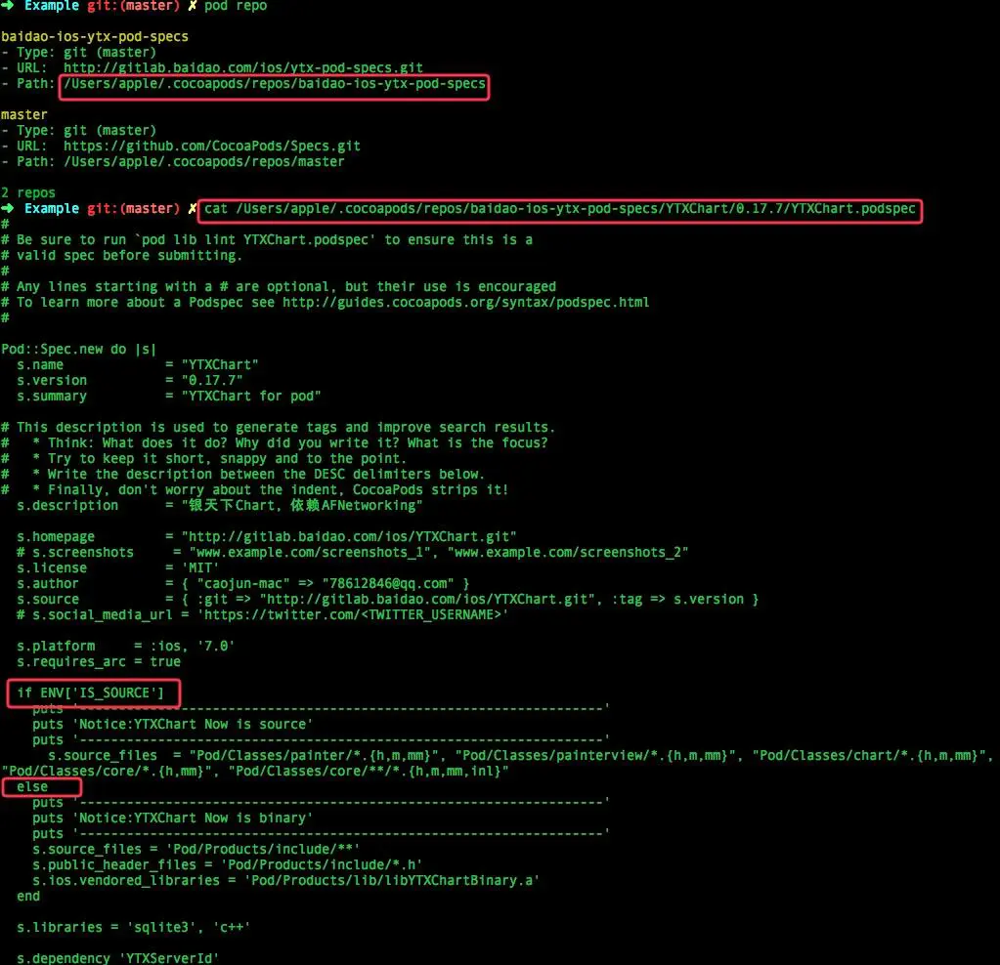
_明白了上面的过程，来再分析下为什么要在切换源码和二进制化时删除cache和Pods目录。放几张图就明白了_
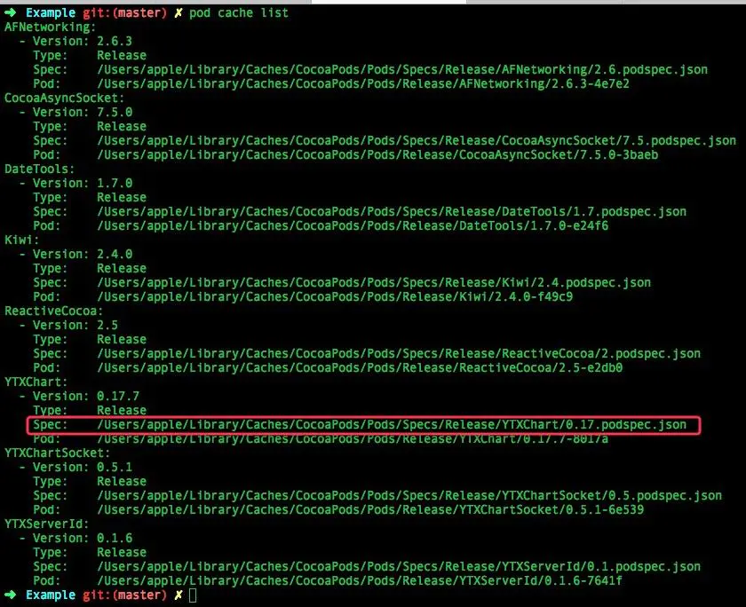
podcachelist

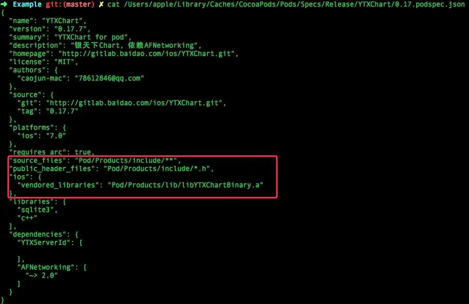
cachejson
_删除cache和Pods目录。_`_IS_SOURCE=1 pod install_`_观察json。_
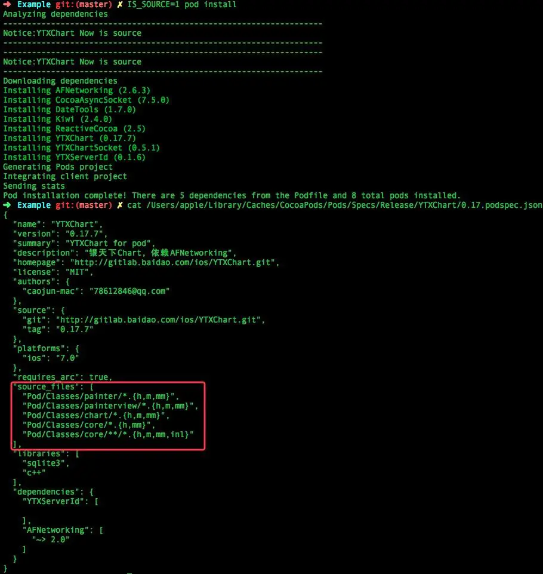
#### 再进一步
当你删除了所有cache之后再`pod install`会比较慢，有时候我们只是想要查看某个库的源码，怎么办。

- podspec中变成这样子`if ENV['IS_SOURCE'] || ENV["YTXChart_SOURCE"]`
- 删除Pods/Pods.xcodeproj
- 删除Pods/YTXChart
- 删除YTXChart的cache`pod cache clean YTXChart`
- 最后`YTXChart_SOURCE=1 pod install`
### 总结：

- 没有使用submodule或新的git仓库来构建出一个不包含依赖内容的静态库。一份原来的git仓库。
- 没有因为构建二进制库而需要增加冗余的源代码。所以当你修改Pod/Classes中的源码，可以方便简单地执行buildbinary.sh脚本来构建出静态库。一份源码。
- 共用了一份YTXChart.podspec
- 没有大量修改YTXChart.podspec
- 使用`pod lib lint`和`IS_SOURCE=1 pod lib lint`检查通过。
- 没有修改Podfile。这个Example的Podflie只是测试需要才改的。�主App项目中的Podfile可以一行都不改。不会出现`'~> 2.2.1.binary'`。
- App中的源码不会因为使用了二进制CocoaPods组件而做任何修改。
- 没有手动配置Search Path，这样更容易。
- 在Example App中可以通过`IS_SOURCE`灵活地切换源码和二进制静态库。唯一一个问题每次切换要删除Pods目录和`pod cache clean --all`
- 跑起Example App总是好的。
- 没有影响到其他库，我可以逐步平滑地把YTXXXX一个一个做成二进制。
### 下一步目标
_逐步平滑地把YTXXXX一个一个做成二进制_
_进一步的把第三方如AFNetwork在私有spec repo中做份镜像也提供二进制化_
_把Podfile中绝大部分组件都做成二进制（RN这种本地安装模式和有sub spec的库目前不打算二进制化）_
### 关于资源文件，资源文件在二进制化中的配置是一样的
### 另外，使用二进制化的CocoaPods库不会增加ipa的大小。所以我们应当优先用二进制化的东西，这可以加快Archive速度。
### 关于有sub spec的CocoaPods组件
两个方案：

- 提供一个全集
- 对每一个sub spec都做份二进制并保持它们之间依赖的相互关系
### 走过的弯路！！！！！！！！！！！！！！！！！！！！！！！！！！！！！！！！！
_现在这个解决方案看起来简单，但在当初的探索过程中并不是那么顺利。以下是不成功的尝试！_
#### 创建另一个YTXChartBinary.podspec

- 把生成的Products目录放到YTXChartBinary下
- 把YTXChartBinary.podspec目录放到YTXChartBinary下
- Podfile中通过增加Binary字段安装二进制化如`pod 'YTXChartBinary', '~> 0.17.7'`

_问题_

- 要维护2个podspec。版本号很可能不统一。
- 当`pod spec lint`报错：找不到相关文件。
- Podfile中通过增加Binary字段来切换，非常不方便。
- 要改App源码。当安装二进制的时候`<YTXChart/YTXChart.h>`需要改成`<YTXChartBinary/YTXChart.h>`。来回切换都需要改，极不方便。
- 要改App源码。这次一劳永逸。直接这样使用`"YTXChart.h"`。但这样也不好。
#### 创建另一个专门放二进制化的Spec Repo，通过不同的Source来区分
_解决了要改App源码的问题。只需要在Podfile中加个source。_
不同的source例子
```
source 'http://gitlab.baidao.com/ios/ytx-binary-pod-specs.git'
source 'http://gitlab.baidao.com/ios/ytx-pod-specs.git'
```
_问题_

- 发布两次，lint两次。
- 创建了2个Spec Repo。
## 后记加强篇
_解决每次切换要删除Pods目录和需要_`_pod cache clean --all_`
唯一额外要付出的是需要一个静态资源服务器。
其实这部分内容我在《[iOS App组件化开发实践](https://www.jianshu.com/p/48fbcbb36c75)》提过一下，没有展开说。可能有些小伙伴只看了这篇文章从而没有了解到。
如果小伙伴们耐心看到了最后，现在这些算是惊喜吧。
请看这个模板[NAME.podspec](https://link.jianshu.com?t=https://github.com/mdsb100/ytx-pod-template/blob/master/NAME.podspec)
```
# ...省去不相关内容
ytx_zipURL='http://ios-pod.baidao.com/binaryfiles/${POD_NAME}.zip'

  if ENV['IS_SOURCE'] || ENV["#{s.name}_SOURCE"]
      # 如果是源码，则使用git地址
      s.source           = { :git => "http://gitlab.baidao.com/ios/#{s.name}.git", :tag => s.version.to_s }
  else
     # 如果是二进制，则是用zip地址
      s.source           = { :http => ytx_zipURL}
  end

  if ENV['IS_SOURCE'] || ENV["#{s.name}_SOURCE"]
      # 因为源码使用的是git，所以执行downlolad_zip去把zip下载下来
      # prepare_command这一段是pod install时会执行的脚本
      s.prepare_command = <<-'END'
        test -f download_zip.sh && sh download_zip.sh ${POD_NAME}
      END

      puts '-------------------------------------------------------------------'
      puts "Notice:#{s.name} is source now"
      puts '-------------------------------------------------------------------'
      s.source_files = '${POD_NAME}/Classes/**/*'
  else
      puts '-------------------------------------------------------------------'
      puts "Notice:#{s.name} is binary now"
      puts '-------------------------------------------------------------------'
      s.source_files = '${POD_NAME}/Classes/*.h'
      # 如果是framework，public_header_files就不需要了
      s.public_header_files = '${POD_NAME}/Classes/*.h'
      s.ios.vendored_libraries = "${POD_NAME}/lib/lib#{s.name}.a"
  end
  # preserve_paths是受保护的路径也就是会一起安装到目录下/进入cache(哪怕可能根本不参与编译)
  s.preserve_paths = "#{s.name}/lib/lib#{s.name}.a","#{s.name}/Classes/**/*", "download_zip.sh"
# ...省去不相关内容
```
附上[ytx-pod-template](https://link.jianshu.com?t=https://github.com/mdsb100/ytx-pod-template)里面有download_zip.sh和zip.sh给大家参考。download_zip.sh值得一说的是，它会判断相关目录下有没有文件，有文件的话则不会每次下载。
思路是保证无论是`IS_SOURCE`还是非`IS_SOURCE`都要保证你的pod/cache目录下既有.h,.m,.a/.framework，但又不会冲突。
.a/.framework不要进git，否则会造成git越来越大，但是放在静态服务器就没事。
当你发版时CI也会自动zip文件.h, .m .a，传上静态服务器。
当你`pod install`的时候，cache/pods里面的内容是cocoapods直接用的zip地址，所有文件都有。没问题。
当你`IS_SOURCE pod install`的时候，不会有.a(.a没进git)，所以执行`prepare_command`去下载zip的地址，解压，把.a解压到相关目录。
因为`preserve_paths`，你的Pods/XX的目录下或者cache目录下都是这个样子的：
```
XX
|- Classes
   |- XX.h
   |- XX.m
   |- AA.h
   \- AA.m
\- lib
   \- libXX.a
```
最后无论你进了if还是else，你podspec中描述的文件总能找到。
完美。
`pod cache list`

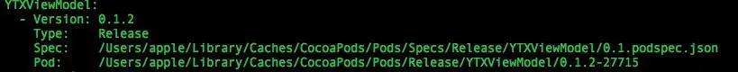
1513045548954.jpg
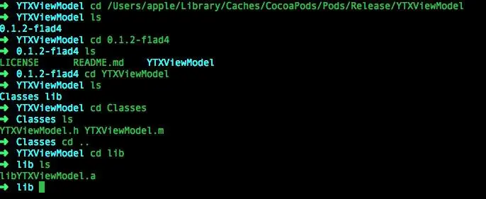
1513045760188.jpg
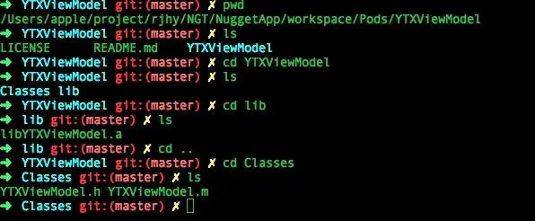
1513045953521.jpg


---

> 作者: 宋明  
> URL: https://apolla.cc/posts/modularization/ios-cocoapods%E7%BB%84%E4%BB%B6%E5%B9%B3%E6%BB%91%E4%BA%8C%E8%BF%9B%E5%88%B6%E5%8C%96%E8%A7%A3%E5%86%B3%E6%96%B9%E6%A1%88%E5%8F%8A%E8%AF%A6%E7%BB%86%E6%95%99%E7%A8%8B/  

