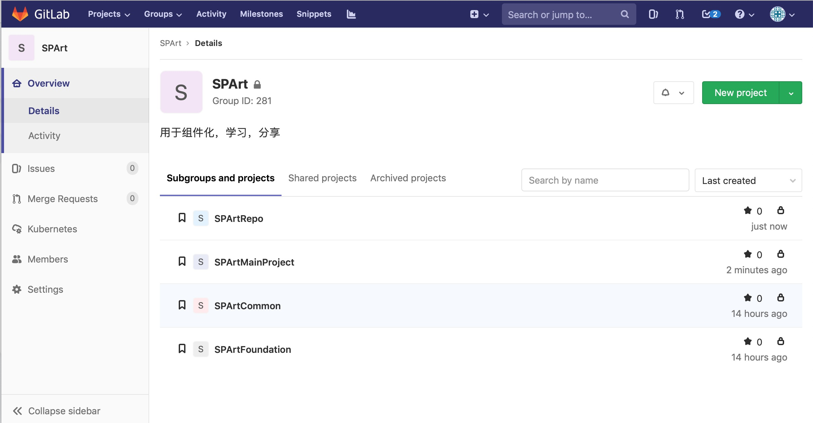
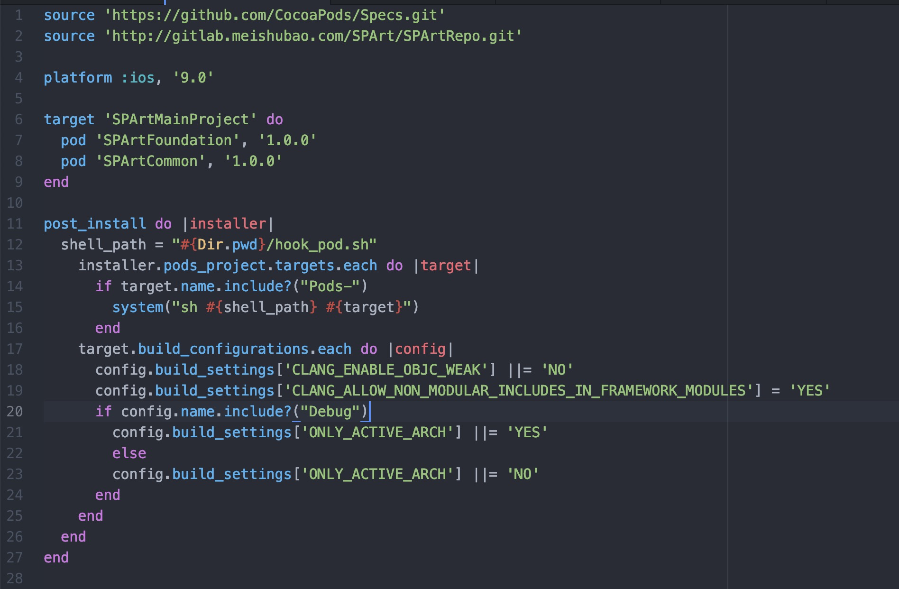
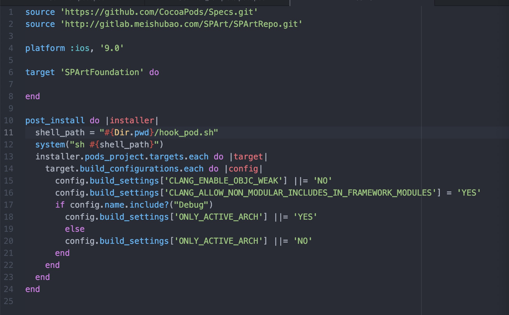
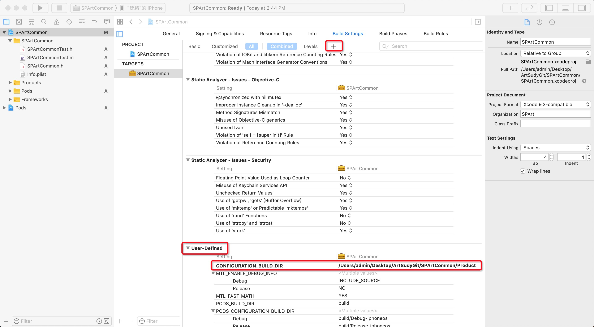
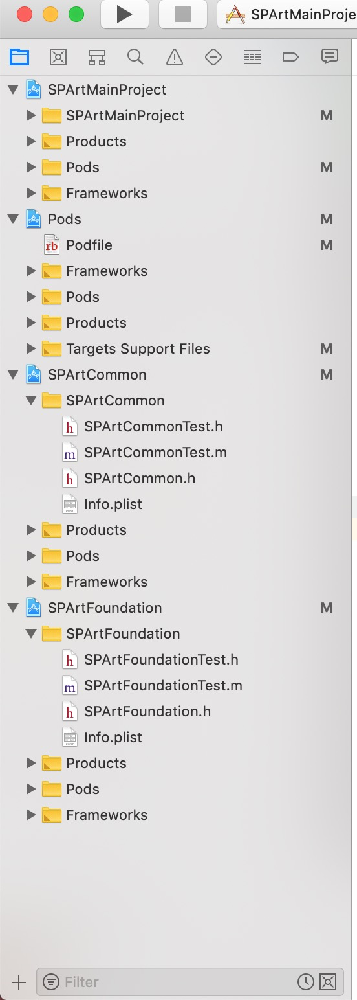
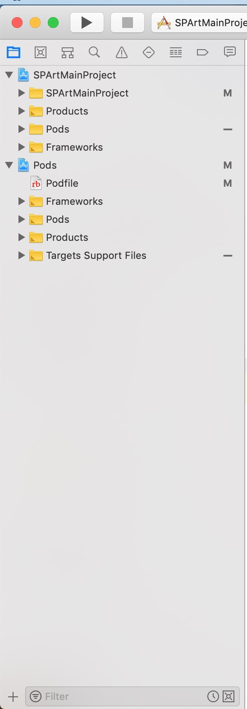

# 美术宝组件化架构工程步骤

**一、新建SPArt用于存储学习的各个仓库**
[http://gitlab.meishubao.com/SPArt](http://gitlab.meishubao.com/SPArt)
**1、准备仓库：**
SPArtRepo：私有源podspec
SPArtMainProject ：测试主工程
SPArtCommon：通用层
SPArtFoundation：基础层

**2、创建SPArtMainProject项目**
配置podfie

**3、创建Framework类型项目SPArtCommon，SPArtFoundation**
3.1、配置podfile

3.2、配置最低版本号：9.0
3.3、修改Macho 为 Static Library静态库
3.4、Build Setting 中添加key：CONFIGURATION_BUILD_DIR， value：$(PROJECT_DIR)/Product（作用于后续自动化配置）    

3.5、新建一个测试的.h.m（后续可删除，保证子库工程中有一个.h.m文件目的是为了保证pod install 配置文件.xcconfig配置中的 FRAMEWORK_SEARCH_PATHS= ${PODS_ROOT}/SPArtFoundation/Framework的标记，作用于后续自动化配置）
3.6、Build Phases 的Header 将 .h 放在Public Headers下
3.7、配置SPArtFoundation.podspec和SPArtCommon.podspec（各个配置项详见工程）
二进制Fremework的项目，创建需要注意几点：
xcode11 取消了编译路径的，修改但是 我们要这么做CONFIGURATION_BUILD_DIR = "$(PROJECT_DIR)/Product";
xcode 11将老工程的CONFIGURATION_BUILD_DIR 设置到了User-Define-Setting
主工程build 先是Pods build 这个build的路径修改成 $(PROJECT_DIR)/../Product 目的是为了能够找到这个libPods-xx.a
修改 Pods Pods-xxx 的build product 路径CONFIGURATION_BUILD_DIR$(PROJECT_DIR)/../Product
Per-configuration Build Products Path
$(BUILD_DIR)/$(CONFIGURATION)$(EFFECTIVE_PLATFORM_NAME)
$(PROJECT_DIR)/Product

CONFIGURATION_BUILD_DIR = "$(PROJECT_DIR)/Product";
默认为$(BUILD_DIR)/$(CONFIGURATION)$(EFFECTIVE_PLATFORM_NAME)
等于$(BUILT_PRODUCTS_DIR)
build
$(BUILD_DIR)/$(CONFIGURATION)$(EFFECTIVE_PLATFORM_NAME)
$(SYMROOT)
3.8、关于SPArtRepo私有源首次拉取
1、新建私有源SPArtRepo并添加将远程私有库拉倒本地私有库便于推送 pod repo add SPArtRepo [http://gitlab.meishubao.com/SPArt/SPArtRepo.git（此处的新工程不能是空的否则](http://gitlab.meishubao.com/SPArt/SPArtRepo.git（此处的新工程不能是空的否则) 还需要重新引入，第一次上传子库会有Your configuration specifies to merge with the ref 'refs/heads/master'
from the remote, but no such ref was fetched.的报错）
或者 git clone [http://gitlab.meishubao.com/SPArt/SPArtRepo.git](http://gitlab.meishubao.com/SPArt/SPArtRepo.git) ~/.cocoapods/repos/SPArtRepo
//     git remote add origin [http://gitlab.meishubao.com/SPArt/SPArtRepo.git](http://gitlab.meishubao.com/SPArt/SPArtRepo.git)
//      git remote add upstream [http://gitlab.meishubao.com/SPArt/SPArtRepo.git](http://gitlab.meishubao.com/SPArt/SPArtRepo.git)
**二、添加自动化挂载源码开发脚本**

脚本功能和使用方式方法
**  Shell/install.sh（主动执行）**     : 执行安装源码 格式为 Shell/install.sh FrameworkName1:BranchName FrameworkName2:BranchName
**uninstall.sh（主动执行）**             :解除源码开发模式，回到二进制build的模式 格式为 ：Shell/uninstall.sh all
hook_pod.sh（关联被动执行）       : 执行 Shell/install FrameworkName:BranchName过程中替换Framework Search Path 和 Header Search Path 的值 将pod install 之后链接Framework库的路径，修改成本地Framework对应路径
ggrep，gsed       :命令工具
library_parent_relation：向上依赖关系
library_sub_relation     ：向下依赖关系 如：SPArtCommon=SPArtFoundation 指的是SPArtCommon库 依赖SPArtFoundation
pod-config                  :包含的是 子库的源码地址Framework=http://gitlab.xxx.com/xxx/Framework.git 可包含多个
copy_framework_resources：解决关于源码挂载开发中，组件库中资源无法同步到项目中去，配置在主工程的Run Script中
**三、示例：业务需求跟进需要扩展SPArtCommon，SPArtFoundation 中的代码，同时需要修改**

（1）新建需求分支：
SPArtMainProject（主工程），SPArtCommon，SPArtFoundation 创建相同分支 future/newbranch名（相同名称便于区分管理）
（2）挂载组件源码开发：
执行install 脚本，Shell/install.sh SPArtCommon:future/newbranch SPArtFoundation:future/newbranch（前后顺序影响工程中挂载组件源码的上下位置顺序，不影响依赖关系），挂载组件源码开发，挂载组件源码工程结构图与原始结构对比：

（3）挂载源码开发完毕：
提交SPArtCommon，SPArtFoundation组件代码，推到对应future/newbranch分支的远程仓库
（4）执行uninstall.sh all 脚本：
卸载挂载模式，还原工程配置，提交主工程代码，推到对应future/newbranch的远程仓库
（5）通过Jenkins平台打包以及上传测试分发平台：
配置future/newbranch进行打测试包，Jenkins配置的，自动化脚本进行挂载源码打包，出包上传蒲公英平台
（6）如遇相应的库有bug，进行第(2)步install操作，再次进入源码挂载模式进行 bugfix，commit，push，uninstall等操作
（7）测试完毕，准备打appStore包前
（7.1）修改组件版本到线上最近的版本号+需求号，（如：线上版本SPArtCommon，SPArtFoundation，组件版本1.0.1.0或者1.0.1.1（第3位为对应需求位），升级后的版本号为1.0.1.0），修改完成，推送到SPArtRepo私有源仓库中，完成组件版本迭代（可以通过脚本实现自动升级）
（7.2）SPArtCommon，SPArtFoundation的future/newbranch分支合并到master主分支
（7.3）将本此需求的SPArtMainProject（主工程）future/newbranch分支合并到master主分支，主工程根据需求版本自主升级版本号，修改主工程中podfile中的SPArtCommon，SPArtFoundation对应版本号，完成主工程配置迭代。（此处修改版本，以及buildversion可以通过配置脚本自动升级）
（7.4）通过Jenkins进行master分支打线上TestFlight包配合API进行线上环境回归测试 
（7.5）测试无误，提包审核

---

> 作者: 宋明  
> URL: https://apolla.cc/posts/modularization/%E7%BE%8E%E6%9C%AF%E5%AE%9D%E7%BB%84%E4%BB%B6%E5%8C%96%E6%9E%B6%E6%9E%84%E5%B7%A5%E7%A8%8B%E6%AD%A5%E9%AA%A4/  

