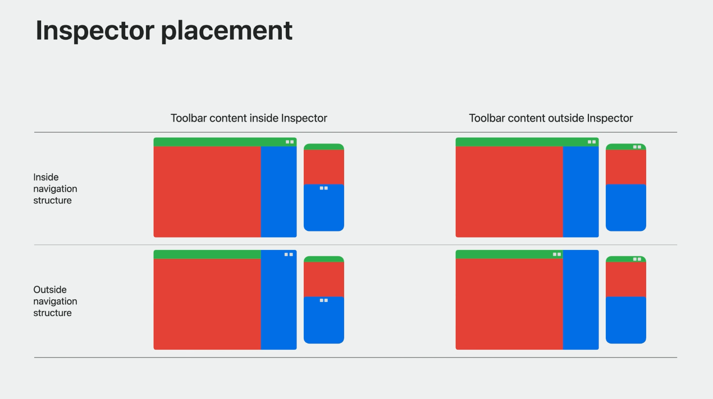

# 1.3.3 模态（Modal）


<br>


<br>

模态是除导航之外的另一种重要的信息呈现方式，它通常以一种临时的界面和用户交互。如果把导航栈内的界面比作“主线”的话，模态就是分出来的“支线”。模态视图完成它的使命后，用户最终会回归至“主线”情景。

关于模态的更多设计语言以及使用场景，可以参考 [《人机界面指南》](https://developer.apple.com/design/human-interface-guidelines/patterns/modality)。

以下将介绍 SwiftUI 在不同平台上常用的模态视图。

# Sheet

Sheet 有以下两个修饰器方法：

- [sheet(isPresented:onDismiss:content:)](https://developer.apple.com/documentation/swiftui/button/sheet(ispresented:ondismiss:content:)) 
- [sheet(item:onDismiss:content:)](https://developer.apple.com/documentation/swiftui/gaugestyleconfiguration/currentvaluelabel-swift.struct/sheet(item:ondismiss:content:)) 

`onDismiss` 都是可选的，表示 sheet 视图消失时的回调。

第一个方法的使用如下：

```swift
@State private var isPresented = false

Button {
  isPresented.toggle()
} label: {
	...
}
.sheet(isPresented: $isPresented) {
  printLog("Dismissed")
} content: {
  SheetView(isPresented: $isPresented)
}
```

`isPresented` 为 true 时，SheetView 实例会呈现，反之则消失。

<span style="background: #007BFF; color: white; padding: 3px 10px; border-radius: 5px">> 查看示例</span>

SheetView 可以通过如下两种方式消失：

- @Binding 变量双向绑定。
- 环境变量 [dismiss](https://developer.apple.com/documentation/swiftui/environmentvalues/dismiss) 。

```swift
fileprivate struct SheetView: View {
  @Binding var isPresented: Bool
  @Environment(\.dismiss) var dismiss
  
  var body: some View {
    VStack(spacing: 20) {
      Button("isPresented") {
        isPresented.toggle()
      }
      
      Button("dismiss") {
        dismiss()
      }
    }
  }
}
```

第二个方法中的 item 参数类型为 `Binding<Item?>`，content 闭包内获取的是非空的 item 值。它非常适合于可选类型的数据绑定，比如从服务器获取版本升级信息，其模型定义如下：

```swift
fileprivate struct VersionInfo: Identifiable {
  let id = UUID()
  var version: String
  var desc: String
}
```

服务端返回的该字段可能为空，我们想要实现该字段有值时显示升级信息，反之则不显示：

```swift
@State private var versionInfo: VersionInfo?

Button {
  versionInfo = .init(version: "1.0.1", desc: "Bug fixes.")
} label: {
	...
}
.sheet(item: $versionInfo) {
  printLog("Dismissed")
} content: { versionInfo in
  Text("版本升级信息")
  .onTapGesture {
    self.versionInfo = nil
  }
}
```

Sheet 视图默认是尽可能的铺满屏幕高度的，通过如下两个方法可以控制其停留在多种不同的高度：

```swift
func presentationDetents(_ detents: Set<PresentationDetent>) -> some View

func presentationDetents(
    _ detents: Set<PresentationDetent>,
    selection: Binding<PresentationDetent>
) -> some View
```

`detents` 是集合类型，表示 sheet 视图可以停留在不同高度。第二个方法中的 `selection` 参数可以通过程序控制 sheet 视图停留在指定高度，具体效果见示例。

[PresentationDetent](https://developer.apple.com/documentation/swiftui/presentationdetent) 支持以下几种样式：

- 内置样式
  - `.large`：屏幕高度。
  - `.medium`：屏幕高度一半。
- 自定义样式：
  - `.fraction(_:)`：相对屏幕一定比例的高度。
  - `.height(_:)`：绝对高度。
  - `custom<D>(_ type: D.Type)`：自定义样式。

最后一种样式的使用方法：

```swift
fileprivate struct CustomDetent: CustomPresentationDetent {

  static func height(in context: Context) -> CGFloat? {
    printLog(context.maxDetentValue)
    return min(750, context.maxDetentValue)
  }
}
```

这段代码表示，自定义的 Detent 样式取 750 和屏幕最大高度的较大值，如果 750 已经大于屏幕高度，那么 sheet 视图就是屏幕高度。

虽然 `.presentationDetents` 支持多个平台，但据笔者测试，目前只在 iPhone 设备上有效果。

此外，使用方法 `.presentationDragIndicator(.visible)` 可以在 sheet 视图上显示一个表示可拖拽的指示条，提供更好的用户体验。

如果需要禁止使用手势让视图消失，调用这个方法：[interactiveDismissDisabled(_:)](https://developer.apple.com/documentation/swiftui/view/interactivedismissdisabled(_:)) 。

iOS 16.4/macOS 13.3 新增了以下几个方法增强了 sheet 的交互性，具体效果参见示例。

```swift
// 自定义背景
.presentationBackground(.regularMaterial)
// 设置背景的可交互性
.presentationBackgroundInteraction(backgroundInteraction.value)
// 设置 sheet 的交互
.presentationContentInteraction(contentInteraction.value)
// 设置在 compact size 上的尺寸
.presentationCompactAdaptation(compactAdaptation.value)
// 设置圆角
.presentationCornerRadius(30)
```

# Alert

理解了 Sheet 之后，Alert 就相对简单，具体可以直接看示例和源码。

此外，示例中没有演示如下两个方法：

- [alert(_:isPresented:presenting:actions:)](https://developer.apple.com/documentation/swiftui/lazyvstack/alert(_:ispresented:presenting:actions:)-heur) 

- [alert(_:isPresented:presenting:actions:message:)](https://developer.apple.com/documentation/swiftui/lazyvstack/alert(_:ispresented:presenting:actions:message:)-13xwi) 

其中 `presenting data: T?` 都是可选参数，这和上面 Sheet 提到的可选参数 item 是类似的，省去了我们对可选参数进行解包的操作。

# Dialog

见示例，略。


# Inspector

iOS 17/macOS 14 新增了几个名为 `inspector` 的方法，见 [Presenting an inspectorin page link](https://developer.apple.com/documentation/swiftui/modal-presentations#presenting-an-inspector)。

比起 Sheet，它对不同平台有更好的适配效果：



使用比较简单，可以直接观看这个 Session：[Inspectors in SwiftUI: Discover the details](https://developer.apple.com/videos/play/wwdc2023/10161/)。


---

> 作者: 宋明  
> URL: https://apolla.cc/posts/swiftui-eul/1.3.3-%E6%A8%A1%E6%80%81modal/  

