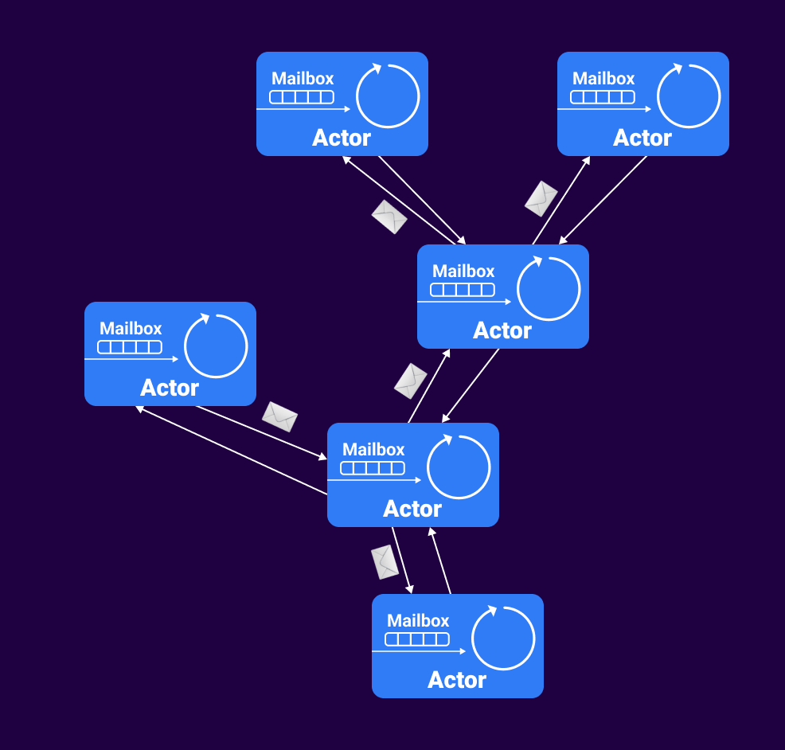

# 4.1 Actor 的使用


# Actor 并发模型



actor 并发模型首次发表于 1973 年，是一个用于并发计算的数学模型。

在 actor 并发模型中，万物皆为 actor。一个 actor 就是一个轻量级的基本计算单元，各个 actor 是完全隔离的，维护各自的私有状态，它们不共享包括内存、状态在内的任何东西，而是通过传递消息来进行通信。一个 actor 一次只能处理一个消息，每个 actor 都有一个绑定的邮箱（Mailbox）用于存储消息，接收、处理消息只能串行执行，而多个 actor 可以同时异步运行。

下面的例子是上面这段描述的形象化表达，你也可以理解为 actor 并发模型抽象于这个贴近现实的例子：

有个邮局需要负责收发某一地区的信件，它本身就是一个 actor。它会将任务分派给很多不同的邮差，它们分别负责某一片区的业务，每个邮差其实也是一个 actor。邮局以及各个邮差是互为隔离的，只有自身能够访问和修改内部状态，外部只能通过发送消息来通信。比如某个邮差想知道另一个同事的工作进展，他只能发消息给他去询问，而不能通过其它途径直接获取。邮局 actor 在将任务分派给各个邮差 actor 后，邮差可以选择自己去送信，也可以发展下线 actor 去送信。每个邮差 actor 有个邮箱来存储邮件或者其它任务，他会按顺序将信件送到不同的地址。信件的接收者其实也是一个 actor，他不必在家门口等待邮差，邮差只需将信件放在家门口的信箱即可，收信人会在闲暇时取走信件。

数据竞争导致的安全问题是并发世界的一大难点，常用的解决方案是使用多线程加锁的模型。但锁的滥用导致的性能损耗以及难以调试的问题，令人生畏，而 actor 模型的强隔离机制带来了便于单测、容错性高、易于分布式等优点。当然，任何事物都有优缺点，actor 并发模型亦是如此。比如邮箱溢出问题，就是 actor 模型特有的缺陷。不过，它的长处带来的优势优于短处带来的劣势。

受 actor 并发模型的启发，Swift 引入了 actor 类型来确保并发访问可变状态的安全性。

# Swift 中的 Actors

## actor 类型

actor 与 class、struct、enum、protocol 类型一样，同属于命名类型。它和 class 类似，但也有显著的不同：

- actor 和 class 一样可以定义属性、方法、下标、初始化方法，可以遵循协议，可以当作泛型使用。
- actor 也是引用类型，因为 actor 的初衷就是在并发环境中安全地共享可变状态，只有引用类型才有“共享”一说。
- actor 的内部状态和外部是隔离的，支持安全的并发访问，而 class 不支持。
- class 可以继承，但是 actor 不可以。原因很简单，继承支持重写，这和 actor 的状态隔离是冲突的。
- 所有的 actor 隐式遵循 [Actor 协议](https://developer.apple.com/documentation/swift/actor)，这是一个比较特别的协议，它无法用于被声明的具体类型，比如 `class ClassName: Actor { ... }` 这样的写法是无法通过编译的。

我们来看下面的示例，使用 class 类型声明了一个产品，每卖出去一个，库存就会相应地减少：

```swift
class Product {
  let name: String
  var inventory: UInt
  
  init(name: String, inventory: UInt) {
    self.name = name
    self.inventory = inventory
  }
  
  func sell() -> UInt {
    if inventory == 0 { return 0 }
    inventory -= 1
    return inventory
  }
}

let product = Product(name: "Book", inventory: 100)
Task.detached {
  printLog(product.sell())
}
Task.detached {
  printLog(product.sell())
}
```

上面两次调用 `sell()` 都是异步的，由于 `Product` 内部没有同步机制，因此库存的数量会因为数据竞争导致偏差。使用线程加锁的方法固然可以解决问题，但比较繁琐。我们试着使用 actor 来替换 class：

```swift
actor Product {
  ... // 代码同上
}

let product = Product(name: "Book", inventory: 100)
Task.detached {
  printLog(await product.sell())
}
Task.detached {
  printLog(await product.sell())
}
```

就是这么简单！当我们将 `Prodcuct` 声明为 actor 类型时，就表示它的内部状态与外界是隔离的，其内部的可变状态只能由自身维护，这和 actor 并发模型的理念是一致的。直接从外部修改库存变量 `inventory` 是不合法的，因为外部环境脱离了 `Product` 实例内部的隔离环境。`sell()` 方法就是上文提到的 actor 并发模型中的消息传递，每次调用 `sell()` 方法相当于传递了一个消息，它会被放进一个按顺序执行的队列中，这个队列其实就是上文提到的 actor 绑定的邮箱。`sell()` 被放进邮箱后，并不一定马上会执行并返回结果，这是一个异步过程，因此，当我们从外部调用它时，需要使用 `await` 标记来表明该访问是异步的，它可能会被挂起。

actor 的状态隔离保护了其内部的可变状态，外部异步访问可变状态的行为，在内部会按照顺序串行执行，这保证的数据的同步性。状态隔离和同步机制阻止了外部对可变状态的并发访问，更重要的是，在编译期间我们就可以借助 actor 最大程度地消除数据竞争带来的安全隐患。

actor 外部对不可变状态进行访问时，我们无需担心数据同步问题。因此，当我们获取 `product.name` 时，无需使用 `await` 关键字标记。actor 内部访问属性、方法、下标时，也无需使用 `await` 标记，因为 actor 内部是一个隔离环境，所有的访问本身就是同步行为。

actor 和 class 一样可以使用 static 关键字声明静态属性和方法，但不具备隔离特性。因为 actor 实例内部的私有状态只有它自身能够修改，即实例的隐式属性 `self` 所代表的实例本身才能访问不可变状态。而 actor 静态属性、方法的内存布局和 class 是一样的，不属于 `self` 范畴。

## nonisolated 关键字

actor 实例内的方法、计算属性默认是被隔离的，因此调用时总是需要使用 `await` 进行访问。

```swift
extension Product {
  nonisolated func showName() {
    print("The name is: \(name).")
  }
}
```

上面我们给 `Product` 扩展了一个方法，展示最新的库存，调用如下：

```swift
Task.detached {
  await product.showName()
}
```

但这里似乎有点不对劲，我们只是读取了 `name` 的值，但没有写操作，这不会导致数据竞争。actor 的状态隔离和同步机制反而导致并发访问 `name` 的效率会降低，这简直是画蛇添足。

为此，Swift 引入了 `nonisolated` 关键字来解决这一问题，该关键字向编译器宣告被它修饰的方法、计算属性无需被隔离：

```swift
extension Product {
  nonisolated func showName() {
    print("The name is: \(name).")
  }
}

Task.detached {
  product.showName()
}
```

## actor 的可重入特性

actor 能从编译层面消除绝大部分数据竞争带来的并发安全问题，但没有编译错误的代码，并不意味着绝对的安全。

我们来看一段选自 [WWDC21/Protect mutable state with Swift actors](https://developer.apple.com/videos/play/wwdc2021/10133/) 的示例代码：

```swift
actor ImageDownloader {
  private var cache: [URL: Image] = [:]

  func image(from url: URL) async throws -> Image {
    if let cached = cache[url] {
      return cached
    }

    let image = try await downloadImage(from: url) // 1

    cache[url] = image

    return image
  }
}
```

这段代码实现的是单张图片的网络下载功能。如果缓存有值，返回缓存图片，如果没有，下载图片并缓存，同时返回下载的图片。乍一看，似乎没有什么问题。但是在某些情况下，结果会出乎我们的意料，这是由**actor 的可重入特性**所导致的。

当 actor 内执行的任务暂停时，在它恢复运行之前，可重入性允许 actor 可以去执行其它的任务。

以上面为例，假设程序中有多个视图展示同一张图片，那么有可能会导致同一个 url 的图片下载操作会同时进行。这里我们仅以两个同时下载操作为例：

- A 操作调用 `image(from:)` 开始下载图片，运行至 // 1 处会暂停，等待图片下载完成。此时图片的下载会在另一个线程执行，但函数所在的线程不会被阻塞，它会继续执行其它由系统分派的任务。
- A 操作在暂停时，B 操作可以重新进入 actor 下载图片，此时 A、B处于“交织执行”的状态。B 操作进入 `image(from:)` 函数时，由于 A 尚未下载完图片，缓存中找不到图片，B 操作会继续执行后面的代码，再次下载同一个 url 的图片。
- A、B 操作是两个几乎同时进行的异步操作，完成的先后顺序是不确定的。假设 A 操作先完成，它更新了缓存。此时服务端恰好将图片更新了，B 操作下载回来的图片和 A 的结果是不一致的，这就是问题所在。

由上可知，actor 的可重入特性，会导致如下问题：

- 如果图片没有更新，多次下载会导致资源的浪费。
- 如果图片更新，不仅会导致资源浪费，还会导致数据错误。

既然如此，为何 Swift 仍然要将 actor 函数设计为可重入呢？基于两个原因：

- 防止死锁：如果两个 actor 互相调用，会造成相互等待，造成死锁。
- 提升性能：可重入减少了非必要阻塞，提高了整体性能。另外，系统可以更方便地调度任务，优先级高的任务将有机会被优先执行。

WWDC 21 的另一个 session 也有助于理解 actor 的可重入性，建议观看：[Swift concurrency: Behind the scenes](https://developer.apple.com/videos/play/wwdc2021/10254/?time=1975)。

actor 函数的可重入特性对于高效并发是必要的存在，但它带来了副作用。如何解决呢？可以参考以下两点：

- 在同步环境中修改 actor 的可变状态。
- 在 `await` 之后，检查 actor 内部的最新状态，然后据此执行后续逻辑。

回到上面的例子，我们可以将缓存中保存的 url 对应的数据改为一个枚举值，它表示对应图片的下载状态。如果正在下载，那么就不需要开启新的下载，直接等待正在执行的下载 任务返回图片。如果已经下载完成，直接返回缓存的图片即可。优化后的代码如下：

```swift
actor ImageDownloader2 {
  private enum ImageStatus {
    case downloading(_ task: Task<Image, Error>)
    case downloaded(_ image: Image)
  }
  
  private var cache: [URL: ImageStatus] = [:]
  
  func image(from url: URL) async throws -> Image {
    if let status = cache[url] {
      switch status {
      case let .downloading(task):
        return try await task.value
      case let .downloaded(image):
        return image
      }
    }
    
    let task = Task {
      try await downloadImage(from: url)
    }
    
    cache[url] = .downloading(task)
    
    do {
      let image = try await task.value
      cache[url] = .downloaded(image)
      return image
    } catch {
      cache.removeValue(forKey: url)
      throw error
    }
  }
}
```

如何嗅到可重入导致的 bad smell 呢？有一个快速判断的依据：是否有跨 `await` 访问 actor 的可变状态。

以上面的下载图片为例，在异步等待下载图片返回时，我们使用了 `await` 标记。在 `await` 之前，我们读取了 `cache` 来判定是否有缓存。在图片下载完成后，即 `await` 之后，我们更新了 `cache`。这就是跨 `await` 访问，在 `await` 前后，`cache` 可能会发生变化，这也是导致结果可能异常的原因，而我们要做的就是消除跨 `await` 导致状态变化带来的数据不一致性。


---

> 作者: 宋明  
> URL: https://apolla.cc/posts/swiftui-eul/4.1-actor-%E7%9A%84%E4%BD%BF%E7%94%A8/  

