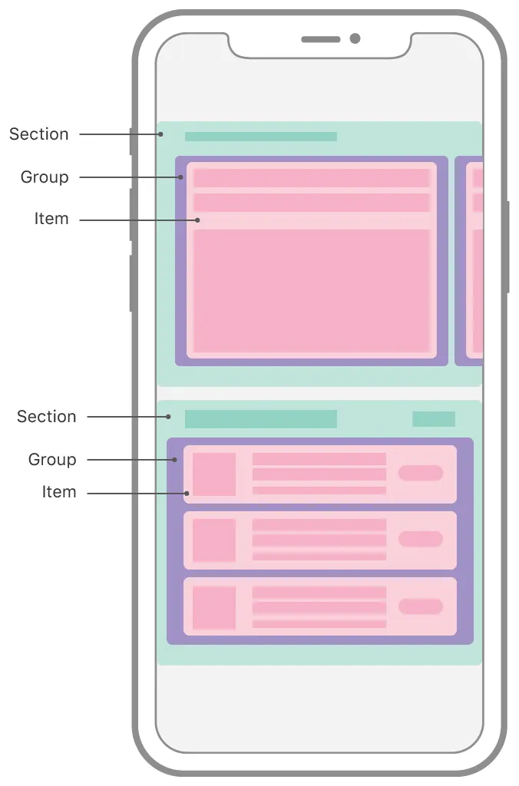
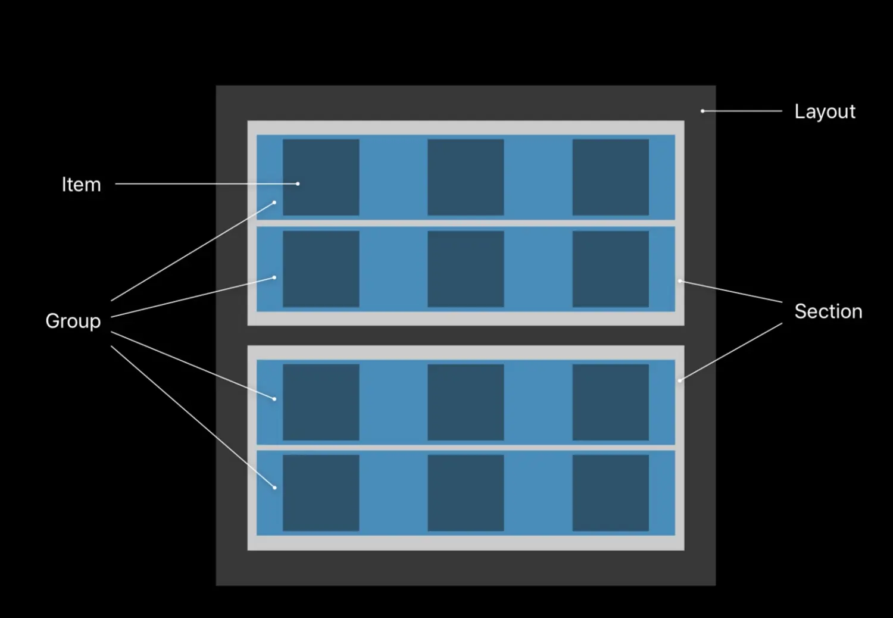
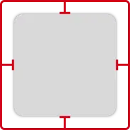
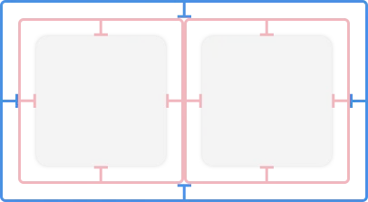
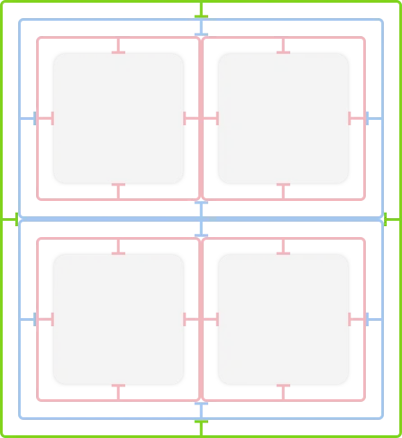
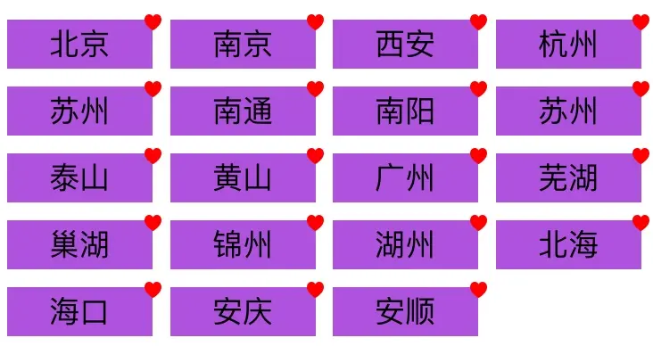

# IOS开发之UICollectionViewCompositionalLayout


> 横向滚动+竖向滚动的collectionView iOS13.0开始支持

日常开发中最常用的控件莫过于 UITableView 和 UICollectionView，随着应用越来越复杂，以前的 UICollectionViewFlowLayout 布局已经满足不了需求，而自定义布局又过于复杂，所以在 iOS 13 中 Apple 为 UICollectionView 推出了组合布局 UICollectionViewCompositionalLayout，这对于 UICollectionView 是一个全新的升级，它将赋予 UICollectionView 更多的可能性。

## 特点

- Composable：可组合，使用简单的组合成复杂的。
- Flexible：灵活，可以用组合布局来写任何的布局。
- Fast：运行速度快。

## 概念

UICollectionViewCompositionalLayout 是在已有的 Item 和 Section 的基础上，增加了一个 Group 的概念。多个 Item 组成一个 Group ，多个 Group 组成一个 Section，层级关系变为：`Item -> Group -> Section -> Layout`。

- 粗粒度



整体.png

- 细粒度



细节.jpg

## 布局核心

### NSCollectionLayoutSize

决定了一个元素的大小。表达一个元素的 Size 有三种方法：

- fractional：表示一个元素相对于他的父视图的比例。（Item 的父视图是 Group，Group 的父视图是 Section） 。

```
 let itemSize = NSCollectionLayoutSize(widthDimension: .fractionalWidth(0.25), heightDimension: .fractionalHeight(0.25))
```

- absolute：表示将元素的宽或者高写成固定一个值。

```
let widthDimension = NSCollectionLayoutDimension.absolute(200)
let heightDimension = NSCollectionLayoutDimension.absolute(200)
```

- estimated：表示预估高度。一般用于自适应大小，会根据自动布局决定元素的大小。

```
let widthDimension = NSCollectionLayoutDimension.estimated(200)
let heightDimension = NSCollectionLayoutDimension.estimated(200)
```

### NSCollectionLayoutItem

描述一个 Item 的布局，通过 NSCollectionLayoutSize 决定一个 Item 的大小，定义如下：

```
class NSCollectionLayoutItem {
    convenience init(layoutSize: NSCollectionLayoutSize)
    var contentInsets: NSDirectionalEdgeInsets
}
```

### NSCollectionLayoutGroup

- Group 是新引入的组成布局的基本单元，它有三种形式 
   - 水平（horizontal）
   - 垂直（vertical）
   - 自定义（custom）
- Group 的大小页需要通过 NSCollectionLayoutSize 决定。如果是自定义布局，需要传入一个 NSCollectionLayoutGroupCustomItemProvider 来决定这个 Group 中 Item 的布局方式。
- 通过 Group 可以在同一个 Section 中实现不同的布局方式。定义如下：

```
class NSCollectionLayoutGroup: NSCollectionLayoutItem { 
    class func horizontal(layoutSize: NSCollectionLayoutSize, subitems: [NSCollectionLayoutItem]) -> Self 
    class func vertical(layoutSize: NSCollectionLayoutSize, subitems: [NSCollectionLayoutItem]) -> Self 
    class func custom(layoutSize: NSCollectionLayoutSize, itemProvider: NSCollectionLayoutGroupCustomItemProvider) -> Self
}
```

### NSCollectionLayoutSection

和之前 UICollectionView 的 Section 的定义类似，定义如下：

```
class NSCollectionLayoutSection {
    convenience init(layoutGroup: NSCollectionLayoutGroup) 
    var contentInsets: NSDirectionalEdgeInsets
}
```

## 基本使用

### 使用步骤

1. 创建 Item 的 NSCollectionLayoutSize，然后创建 NSCollectionLayoutItem。
2. 创建 Group 的 NSCollectionLayoutSize，然后根据 Item 创建 NSCollectionLayoutGroup。
3. 根据 Group 创建 NSCollectionLayoutSection。
4. 根据 Section 创建 UICollectionViewCompositionalLayout。

### 案例一

```
func generateLayout() -> UICollectionViewCompositionalLayout {
    
    let itemSize = NSCollectionLayoutSize(
        widthDimension: .fractionalWidth(0.25),
        heightDimension: .fractionalHeight(1.0))
    
    
    let item = NSCollectionLayoutItem(layoutSize: itemSize)
    
    
    let groupSize = NSCollectionLayoutSize(
        widthDimension: .fractionalWidth(1.0),
        heightDimension: .fractionalWidth(0.1))
    
    
    let group = NSCollectionLayoutGroup.horizontal(
        layoutSize: groupSize,
        subitems: [item])
    
    
    let section = NSCollectionLayoutSection(group: group)
    
    
    let layout = UICollectionViewCompositionalLayout(section: section)
    
    return layout
}
```

### 案例二

```
func generateLayout() -> UICollectionViewCompositionalLayout {
    
    let topItemSize = NSCollectionLayoutSize(widthDimension: .fractionalWidth(1.0), heightDimension: .fractionalWidth(9/16))
    let topItem = NSCollectionLayoutItem(layoutSize: topItemSize)
    topItem.contentInsets = NSDirectionalEdgeInsets(top: 8, leading: 8, bottom: 8, trailing: 8)
    
    
    let bottomItemSize = NSCollectionLayoutSize(widthDimension: .fractionalWidth(0.5), heightDimension: .fractionalHeight(1.0))
    let bottomItem = NSCollectionLayoutItem(layoutSize: bottomItemSize)
    bottomItem.contentInsets = NSDirectionalEdgeInsets(top: 8, leading: 8, bottom: 8, trailing: 8)
    
    
    let bottomGroupSize = NSCollectionLayoutSize(widthDimension: .fractionalWidth(1), heightDimension: .fractionalWidth(0.5))
    let bottomGroup = NSCollectionLayoutGroup.horizontal(layoutSize: bottomGroupSize, subitem: bottomItem, count: 2)
    
    
    let fullGroupSize = NSCollectionLayoutSize(widthDimension: .fractionalWidth(1.0), heightDimension: .fractionalWidth(9/16 + 0.5))
    let nestedGroup = NSCollectionLayoutGroup.vertical(layoutSize: fullGroupSize, subitems: [topItem, bottomGroup])
    
    
    let section = NSCollectionLayoutSection(group: nestedGroup)
    
    
    let layout = UICollectionViewCompositionalLayout(section: section)
    
    return layout
}
```

## 间距

间距主要分 3 种：Item 与 Item 之间，Group 与 Group 之间，Section 与 Section 之间，主要有两种设置方式：

### contentInsets

Item、Group 和 Section 都有一个属性 contentInsets 用于设置边距。

#### Item的contentInsets

- 设置语法

```
item.contentInsets = NSDirectionalEdgeInsets(top: 8, leading: 8, bottom: 8, trailing: 8)
```

- 当给 Item 设置`contentInsets`后的示意图：



Item 设置contentInsets.png

灰色区域是 Item，红色框是 Item 的边界，红色的上下左右边距就是设置的 contentInsets。

#### Group的contentInsets

- 设置语法

```
group.contentInsets = NSDirectionalEdgeInsets(top: 8, leading: 8, bottom: 8, trailing: 8)
```

- 当给 Group 设置`contentInsets`后的示意图：



Group 设置contentInsets.png

灰色区域是 Item，红色框是 Item 的边界，蓝色框是 Group 的边界，蓝色的上下左右边距就是设置的 contentInsets。

#### Section的contentInsets

- 设置语法

```
section.contentInsets = NSDirectionalEdgeInsets(top: 8, leading: 8, bottom: 8, trailing: 8)
```

- 当给 Section 设置`contentInsets`后的示意图：



Section 设置contentInsets.png

灰色区域是 Item，红色框是 Item 的边界，蓝色框是 Group 的边界，绿色框是 Section 的边界，绿色的上下左右边距就是设置的 contentInsets。

> 为了使整体的上下左右边距一样，通常需要同时设置 Item 和 Group 的`contentInsets`。


### Spacing

可以直接给 Group 和 Section 设置相应的 Spacing 以达到设置 Item 和 Group 之间间距的目的，但这种需要精确计算间距的值，因为间距会挤占 Item 和 Group 的空间。

```
 group.interItemSpacing = .fixed(8) 
group.edgeSpacing = NSCollectionLayoutEdgeSpacing(leading: .fixed(8), top: .fixed(8), trailing: .fixed(8), bottom: .fixed(8))

section.interGroupSpacing = 8
```

## NSCollectionLayoutBoundarySupplementaryItem

附加视图，一般用于设置头部和尾部。

```
let headerSize = NSCollectionLayoutSize(widthDimension: .fractionalWidth(1.0), heightDimension: .estimated(44))

let header = NSCollectionLayoutBoundarySupplementaryItem(layoutSize: headerSize, elementKind: "header", alignment: .top)

let footerSize = NSCollectionLayoutSize(widthDimension: .fractionalWidth(1.0), heightDimension: .estimated(44))

let footer = NSCollectionLayoutBoundarySupplementaryItem(layoutSize: footerSize, elementKind: "footer", alignment: .bottom)

header.pinToVisibleBounds = true

section.boundarySupplementaryItems = [header, footer]
```

> 使用之前需要注册，下面会讲解。


## NSCollectionLayoutAnchor

在 Item 中，可能需要给他加上小红点或者未读消息数，在 UICollectionViewCompositionalLayout 中，可以通过 NSCollectionLayoutSupplementaryItem 和 NSCollectionLayoutAnchor 这两个类来去定义一个这样的视图。

- 实现一个UICollectionReusableView

```
class BadgeView: UICollectionReusableView {
    static let reuseIdentifier = "badge"
    let imageView = UIImageView(image: UIImage(systemName: "heart.fill"))
    
    override init(frame: CGRect) {
        super.init(frame: frame)
        configure()
    }
}
```

- 注册SupplementaryView

```
collectionView.register(
            BadgeView.self,
            forSupplementaryViewOfKind: "badge",
            withReuseIdentifier: BadgeView.reuseIdentifier)
```

- 设置SupplementaryView

```
dataSource.supplementaryViewProvider = {
            (collectionView: UICollectionView, kind: String, indexPath: IndexPath)
            -> UICollectionReusableView? in
        
            if let badgeView = collectionView.dequeueReusableSupplementaryView(
                ofKind: kind,
                withReuseIdentifier: BadgeView.reuseIdentifier,
                for: indexPath) as? BadgeView {
                return badgeView
            } else {
                fatalError("Cannot create Supplementary")
            }
        }
```

- 设置Badge

```
let badgeAnchor = NSCollectionLayoutAnchor(edges: [.top, .trailing],
fractionalOffset: CGPoint(x: 0.5, y: -0.5))

let badgeSize = NSCollectionLayoutSize(widthDimension: .absolute(16),
heightDimension: .absolute(16))

let badge = NSCollectionLayoutSupplementaryItem(layoutSize: badgeSize, elementKind: "badge", containerAnchor: badgeAnchor)

let item = NSCollectionLayoutItem(layoutSize: itemSize, supplementaryItems: [badge])
```

- 效果



效果.jpg

## 滚动Section

通过设置 Section 的 orthogonalScrollingBehavior 参数，可以实现 Section 的不同的滚动方式。

- 滚动类型

```
public enum UICollectionLayoutSectionOrthogonalScrollingBehavior : Int {
    
    case none = 0    
    case continuous = 1 
    case continuousGroupLeadingBoundary = 2
    case paging = 3
    case groupPaging = 4
    case groupPagingCentered = 5
}
```

- 设置滚动

```
section.orthogonalScrollingBehavior = .continuous
```

## 总结

UICollectionViewCompositionalLayout 彻底颠覆了 UICollectionView 的布局体验，大大拓展了 UICollectionView 的可塑性，甚至从某种程度上来说，UI 开发中的复杂布局已经非它莫属。

## 源代码

[UICollectionViewCompositionalLayout案例](https://links.jianshu.com/go?to=https%3A%2F%2Fgithub.com%2Fyungfan%2FiOS-continuous-learning%2Ftree%2Fmaster%2FiOS%252013%2FDiffableDataSource-UICollectionView)


---

> 作者: 宋明  
> URL: https://apolla.cc/posts/tips/ios%E5%BC%80%E5%8F%91%E4%B9%8Buicollectionviewcompositionallayout/  

