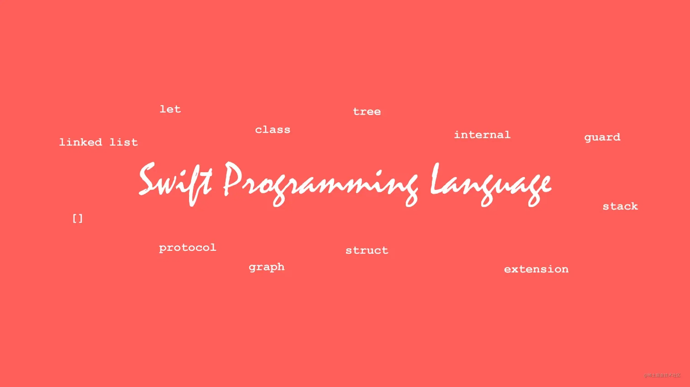
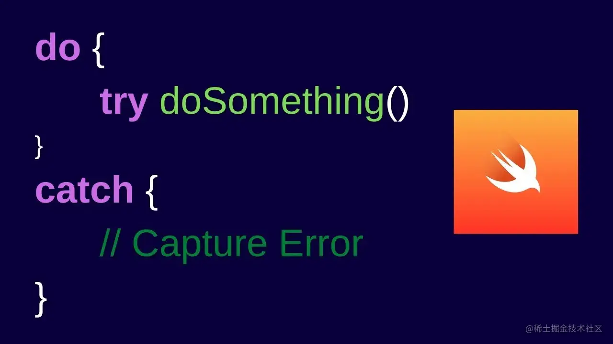
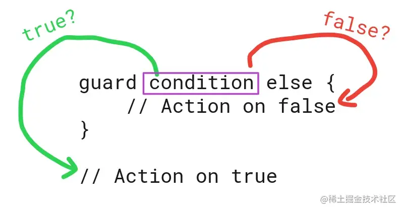
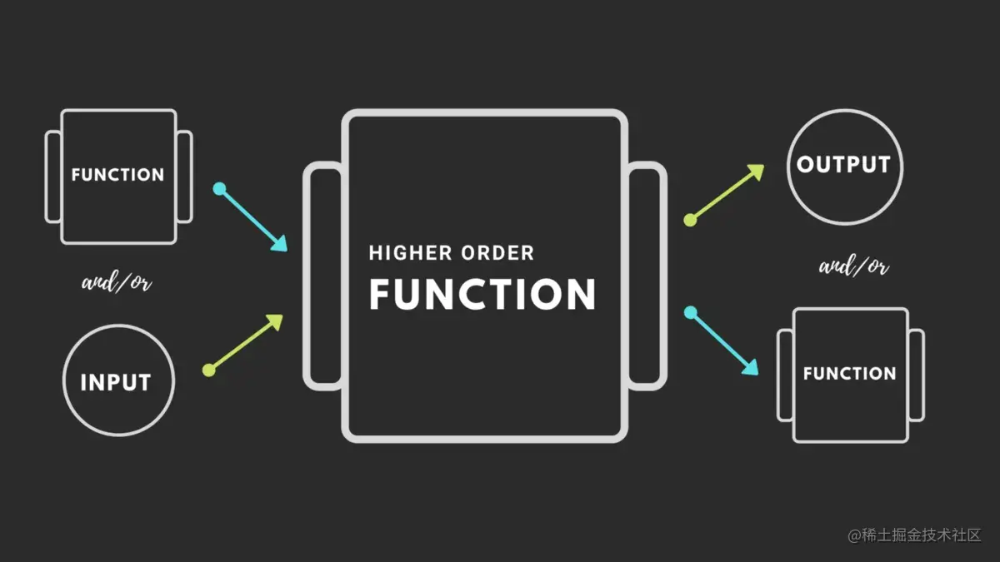

# Swift 开发者常犯的十大错误

### ❌ 错误一
> 没有正确处理可选项。可选项在 Swift 中是一个强大的工具，但是不能正确处理它们 可能会导致运行时崩溃。在展开可选项之前，请确保始终检查 nil 值。 通常用 if-let 或者 guard-let 来检查 nil 值。 

---

### ❌ 错误二
> 没有正确处理错误。Swift 使用 do-try-catch 语法来处理函数抛出的错误。 忽略捕获和处理错误可能导致意外行为或崩溃。 

### ❌ 错误三
> 没有使用 guard 语句。guard 语句有助于确保在执行代码块之前满足某些条件。 不使用 guard 语句会使代码不易读和不易调试。 

### ❌ 错误四
> 不使用类型推断。Swift 具有强大的类型推断功能， 它允许编译器根据变量的值推断变量的类型。 不使用类型推断会使代码更加冗长，可读性更差 

### ❌ 错误五
> 不使用 OptionSet。OptionSet 是一个强大的工具，可以用简洁明了的方式表示 选项组。不使用 OptionSet 可能会导致代码更加冗长，可读性更差。 

### ❌ 错误六
> 没有有效地使用枚举。Swift 中的枚举是一个很强大的工具，以简洁的方式表示一组 有限的值。 相较于 Objective-C，Swift 中的枚举得到了很多的强化。 不有效地使用枚举可能会导致代码更加冗长，可读性更差。 

### ❌ 错误七
> 没有有效地使用协议。协议是在 Swift 中定义契约的强大工具。 如果不能有效地使用协议，则会导致代码的灵活性降低，并且更难于维护。 

### ❌ 错误八
> 在协议中没有使用关联类型。关联类型是协议的一个强大特性， 它允许你定义在协议中使用的占位符类型。 如果不使用关联类型，则可能导致代码的灵活性降低，并且更难于维护。 

### ❌ 错误九
> 没有使用高阶函数。高阶函数是将其他函数作为参数或返回结果的函数。 不使用高阶函数会导致代码不够简洁和表达能力差。 

### ❌ 错误十
> 没有使用正确的数据结构。Swift 提供了各种数据结构，比如数组、集合和字典， 每种数据结构都具有特定的优势和用例。 如果不能选择正确的数据结构，则可能导致代码效率降低或表达能力降低。 

---

> 作者: 宋明  
> URL: https://apolla.cc/posts/tips/swift-%E5%BC%80%E5%8F%91%E8%80%85%E5%B8%B8%E7%8A%AF%E7%9A%84%E5%8D%81%E5%A4%A7%E9%94%99%E8%AF%AF/  

