# 如何实现 IOS 16 带来的 Depth Effect 图片效果


原文链接：[https://juejin.cn/post/7197608023430283319?](https://juejin.cn/post/7197608023430283319?)
## 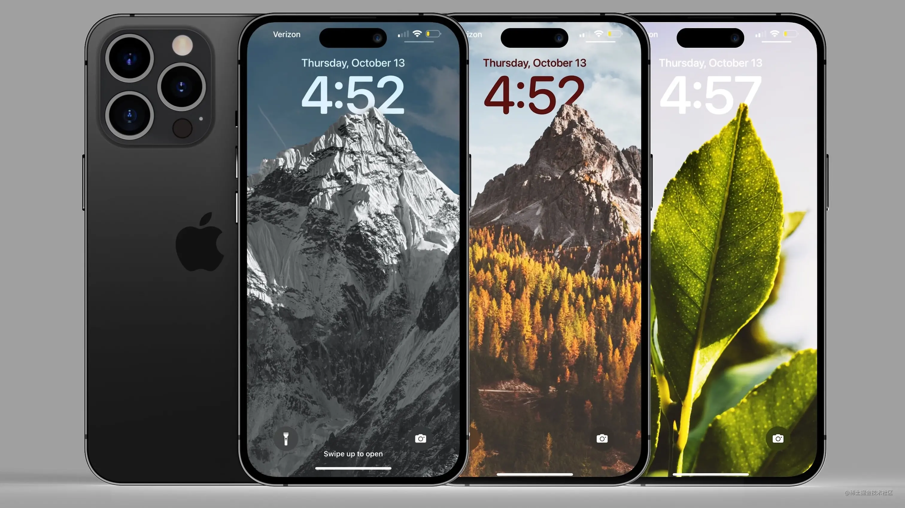
## 0x01 前言
iOS 16 系统为我们带来了比较惊艳的桌面锁屏效果：Depth Effect。它可以使用一张普通图片当背景，同时可以在适当的地方遮拦住部分桌面组件，形成一种景深的效果（如下图）。
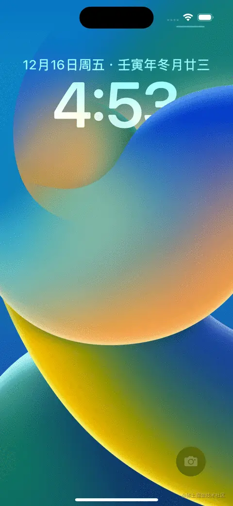


那么我们可以在自己的 App 实现类似的效果吗？一开始我以为 iOS 16 新增了新的的 UIKit 控件，可以像 UIVisualEffectView 一样几行简单的 **API** 就可以实现，但最后发现没有。如果给的图片是已经分好层的多张图，那么实现就是简单的将时钟控件像夹心饼干一样夹在中间即可。然而实践中发现，网上随便下载的单张图片设置为锁屏背景它也可以达到这种效果。联想到 iOS 16 的系统相册在重按后可以将照片中的主体直接分割拖拽出来，于是认为它一定是利用了某些图像分割算法将前景和背景分离开来，这样就得到了多层的图像

## 0x02 图像分割（Image Segmentation）
比较经典的图像分割算法是 [分水岭算法](https://link.juejin.cn/?target=https%3A%2F%2Fdocs.opencv.org%2F4.x%2Fd3%2Fdb4%2Ftutorial_py_watershed.html)（Watershed），它分割出来的图像很精准，且边缘处理非常好，但它要求人工在前景和背景的大概位置上分别画上一笔（仅一笔就好，后面算法将自动分离出前景和背景），并不适用本文全自动的要求。最近几年机器学习涌现出了不少的成果，其中之一就是全自动化的图像分割。果然在经过简单的搜索后，发现苹果已经提供预训练好的模型。
访问苹果机器学习官网 [developer.apple.com/machine-lea…](https://link.juejin.cn/?target=https%3A%2F%2Fdeveloper.apple.com%2Fmachine-learning%2Fmodels%2F) 下载训练好的模型 **DeeplabV3**。将模型文件拖到 Xcode 工程中，选中后可以查看它的一些信息：
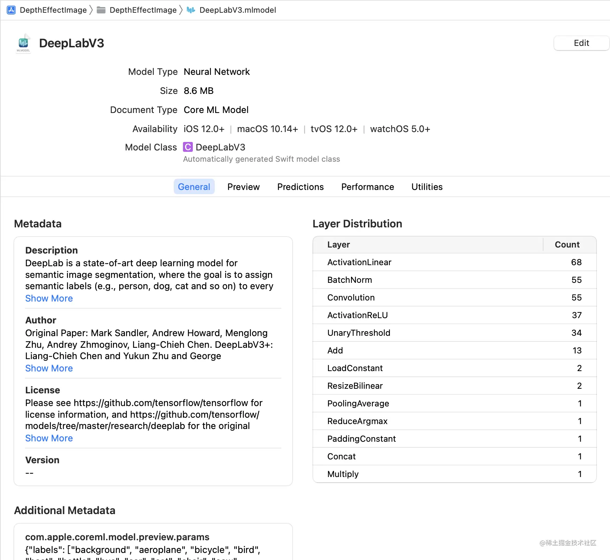
这里其实我们主要关注模型的输入、输出就好，点击 Predictions 标签页，可以看到，模型要求输入 513x513 的图片，输出是成员类型为 Int32，大小 513x513 的二维数组，每个数值表示对应图像像素点的分类。这里的成员之所以是 Int32 而不是简单的 Bool，是因为该模型可以将图像分割为多个不同的部分，不只是前景和背景。实践中我们发现，数值为 0 可以认为是背景，非 0 值为前景。
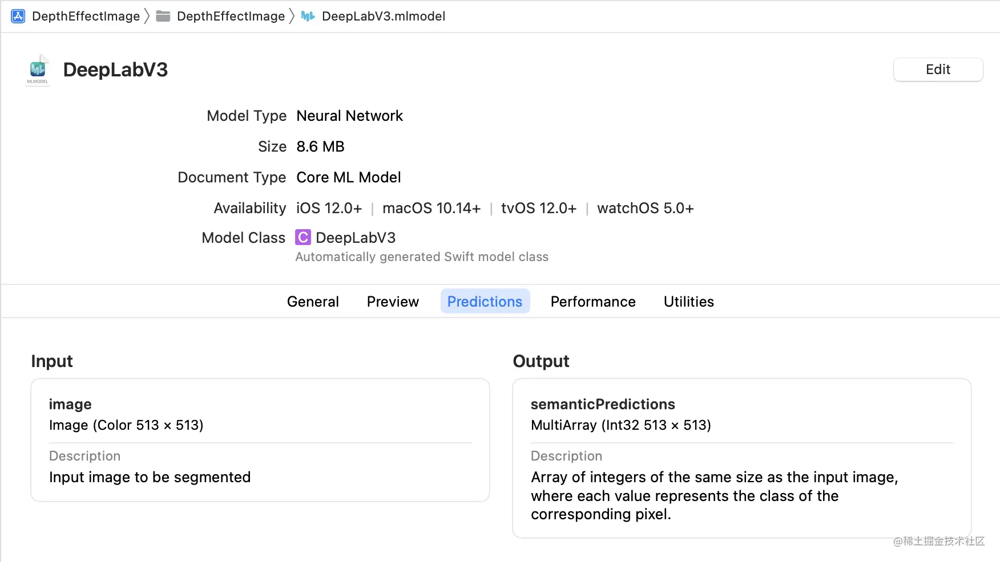
下面是一张样例图片运行分割之后得到的结果：
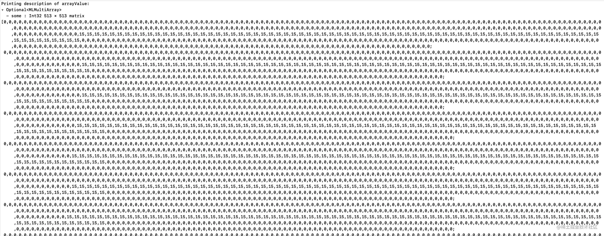
它被分为了 0 和 15 两个值，分别就是背景和前景了。
## 0x03 实践
模型已经有了，实现方案也差不多了，接下来就是具体的实践了。
模型拖到 Xcode 工程中后，Xcode 将自动为我们生成一个类：DeepLabV3。我们可以直接创建它的实例而无需任何的 **import**：
```swift
lazy var model = try! DeepLabV3(configuration: {
        let config = MLModelConfiguration()
        config.allowLowPrecisionAccumulationOnGPU = true
        config.computeUnits = .cpuAndNeuralEngine
        return config
    }())
```
然后，用这个实例创建一个 VNCoreMLRequest，请求通过机器学习引擎来分析图片，并在回调中得到结果：
```swift
    lazy var request = VNCoreMLRequest(model: try! VNCoreMLModel(for: model.model)) { [unowned self] request, error in
        if let results = request.results as? [VNCoreMLFeatureValueObservation] {
            // 最终的分割结果在 arrayValue 中
            if let feature = results.first?.featureValue, let arrayValue = feature.multiArrayValue {
                let width = arrayValue.shape[0].intValue
                let height = arrayValue.shape[1].intValue
                let stride = arrayValue.strides[0].intValue
                // ...
            }
            
        }
    }
```
最后在合适的地方创建 VNImageRequestHandler 发起请求：
```swift
    private func segment() {
        if let image = self.imageView.image {
            imageSize = image.size
            DispatchQueue.global().async { [unowned self] in
                self.request.imageCropAndScaleOption = .scaleFill
                let handler = VNImageRequestHandler(cgImage: image.resize(to: .init(width: 513, height: 513)).cgImage!)
                try? handler.perform([self.request])
            }
        }
    }
```
> 注意：
> 1. request 的回调和 handler 发起请求的代码在同一个线程中，同步等待结果，所以这里最好 dispatch 到子线程操作
> 2. request 需要设置 imageCropAndScaleOption 为 .scallFill，否则它默认将自动裁切中间部分，将得到不符合预期的结果

输入以下样例图片，
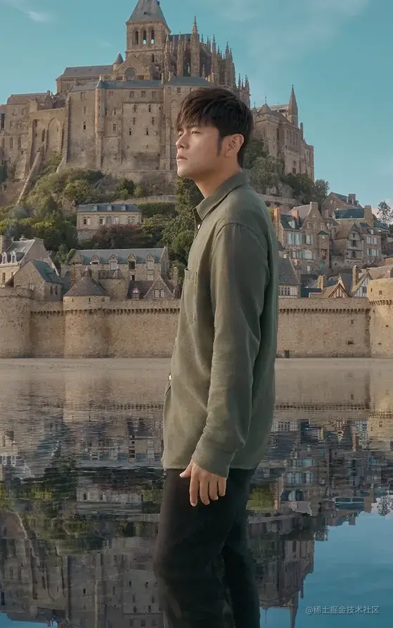
将返回的结果 arrayValue 处理成为黑白图片后的结果：
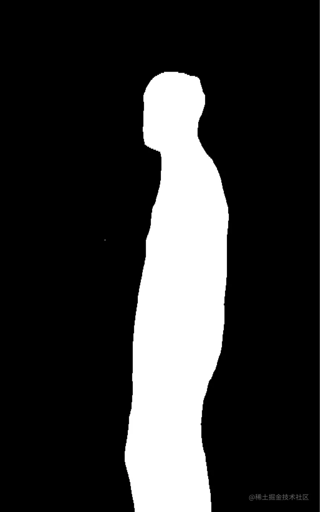
发现它分割的还是挺精准的。当然，如果要在代码中当掩码图（mask）来使用，应当将它处理为背景全透明，而前景不透的图片：

最后，我们将原图放最下层，其它控件放中间，原图 + mask 的视图放最上层，就形成了最终的效果：
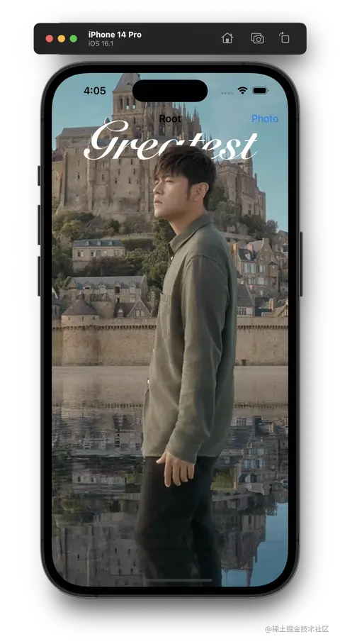
实际背后的原理就是夹心饼干：
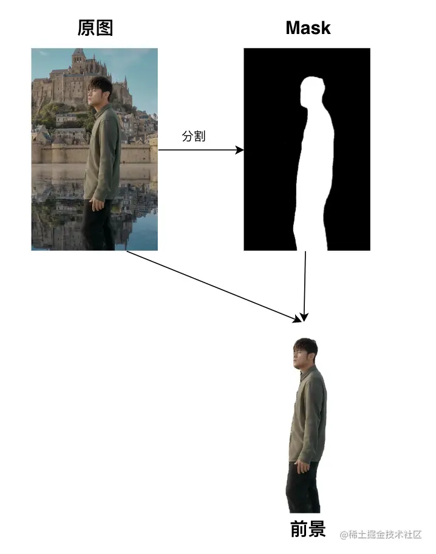
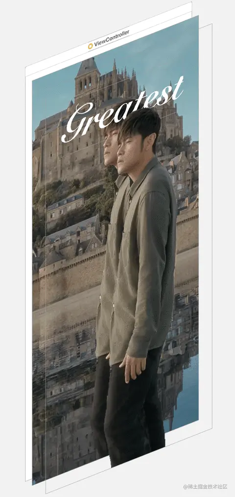
再多来几张效果图：
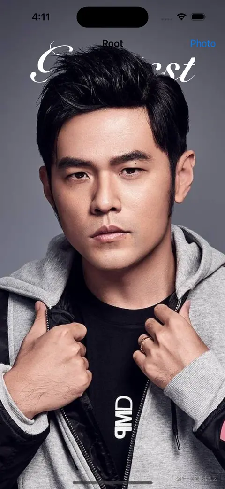 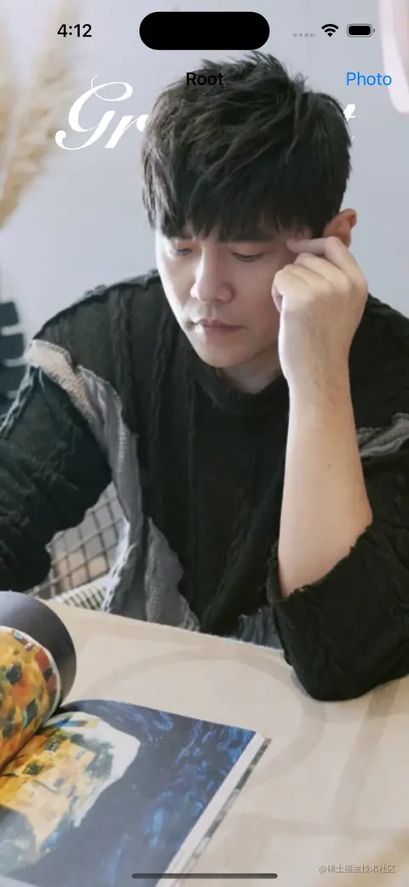
## 0x04 后记
当然该模型并不是万能的，在具体的应用中还存在局限性，对于有人物的照片分割得较好，但是对于类似大场景的风景照这种可能出现完全无法分割的情况。本文的 Demo 可以在 [Github](https://link.juejin.cn/?target=https%3A%2F%2Fgithub.com%2Frickytan%2FDepthEffectImage) 上找到。
## 参考资料

1. [developer.apple.com/documentati…](https://link.juejin.cn/?target=https%3A%2F%2Fdeveloper.apple.com%2Fdocumentation%2Fvision%2Fapplying_matte_effects_to_people_in_images_and_video)
2. [www.appcoda.com.tw/vision-pers…](https://link.juejin.cn/?target=https%3A%2F%2Fwww.appcoda.com.tw%2Fvision-person-segmentation%2F)
3. [enlight.nyc/projects/im…](https://link.juejin.cn/?target=https%3A%2F%2Fenlight.nyc%2Fprojects%2Fimage-segmentation-mobile-app)


---

> 作者: 宋明  
> URL: https://apolla.cc/posts/tips/%E5%A6%82%E4%BD%95%E5%AE%9E%E7%8E%B0-ios-16-%E5%B8%A6%E6%9D%A5%E7%9A%84-depth-effect-%E5%9B%BE%E7%89%87%E6%95%88%E6%9E%9C/  

